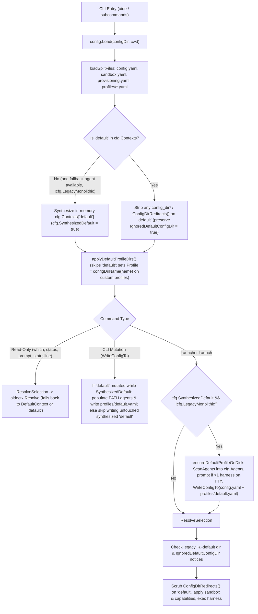

# Built-In `default` Profile and Zero-Config Native Harness Resolution

*   **Author:** Krishnaswamy Subramanian
*   **Status:** Approved
*   **Date:** 2026-11-08

--------------------------------------------------------------------------------

## Overview

`aide` manages coding agent execution environments, sandboxes, capabilities, and encrypted credentials across multiple harnesses (`claude`, `codex`, `pi`, `opencode`, `gemini`, `copilot`, `cursor`, `hermes`). Currently, `aide` applies profile directory isolation (`~/.<harness>-<profile>`) to every profile, including `default`, and splits execution between a limited zero-config passthrough mode and the full profile launcher.

This design establishes two distinct mechanisms:

1.  **The Built-In `"default"` Profile (`~/.config/aide/profiles/default.yaml`):** A reserved, non-removable profile named `"default"` that always exists, is auto-created on launch when missing, registers all harnesses found on `PATH`, and always uses each harness's native configuration directory (`~/.claude`, `~/.codex`, `~/.pi/agent`, `~/.config/opencode`) without suffixing `-default`.
2.  **The Unbound-Directory Fallback Setting (`default_profile` in `config.yaml`):** The configuration setting (`aide profile set-default <name>`) that selects which profile `aide` uses when the current working directory does not match any profile's `match:` rules. When unset, `default_profile` defaults to `"default"`, and creating a new custom profile (`aide profile create <name>`) no longer overwrites `default_profile`.

## The Problem

Three defects in the current profile and launch design break the out-of-the-box experience:

1.  **`default` Redirects Native Harness Directories:** [`applyDefaultProfileDir`](file:///Users/subramk/source/github.com/jskswamy/aide/internal/config/profile_dirs.go#L188-L204) sets `ctx.Profile = configDirName(name)` for every profile, including `"default"`. When a user runs `aide init` or uses the `"default"` profile, `aide` redirects the harness to `~/.claude-default`, `~/.codex-default`, `~/.pi-default`, and `~/.opencode-default`. All of the user's existing harness logins, MCP servers, skills, plugins, and session history in `~/.claude` (and equivalents) become invisible inside `aide`.
2.  **Split Launch Paths (`Passthrough` vs. `Launch`):** When `~/.config/aide` has no configuration files, [`cmd/aide/main.go`](file:///Users/subramk/source/github.com/jskswamy/aide/cmd/aide/main.go#L93-L102) routes execution to [`Launcher.Passthrough`](file:///Users/subramk/source/github.com/jskswamy/aide/internal/launcher/passthrough.go#L87-L139) instead of [`Launcher.Launch`](file:///Users/subramk/source/github.com/jskswamy/aide/internal/launcher/launcher.go#L239). `Passthrough` ignores `.aide.yaml` project overrides, `--with` / `--without` capability flags, saved repository preferences (`aide project set`), `--diagnose` post-mortem reports, and `AIDE_*` session variables, and fails with an error whenever more than one harness binary is installed on `PATH`.
3.  **Conflating `"default"` Profile Identity with `default_profile` Fallback:** [`runCreateWizard`](file:///Users/subramk/source/github.com/jskswamy/aide/cmd/aide/profile.go#L500-L502) automatically sets `cfg.DefaultContext = name` when creating the first custom profile (such as `aide profile create work`). Every unbound directory on the machine then switches to `work` instead of staying on `"default"`. Conversely, if `default_profile` is unset and `"default"` is not on disk, launching `aide` in an unbound directory fails and triggers an empty-state prompt ([`internal/launcher/empty_state.go`](file:///Users/subramk/source/github.com/jskswamy/aide/internal/launcher/empty_state.go)).

**Proposed Solution:** Treat `"default"` as a built-in profile that is synthesized in memory during `config.Load` when missing on disk (whenever at least one agent is configured or found on `PATH`), materialized to `~/.config/aide/profiles/default.yaml` on launch or when `"default"` is mutated, and exempted from profile config-directory isolation so it always targets native harness directories. Route all launches through `Launcher.Launch`, retire `Launcher.Passthrough` and `empty_state.go`, and default `default_profile` to `"default"` when unset while preserving `aide profile set-default <name>` for users who want a custom fallback profile.

## Goals

*   **G1 — Native Harness Directories on `"default"`:** Ensure the `"default"` profile always uses each harness's native config directory (`~/.claude`, `~/.codex`, `~/.pi/agent`, `~/.config/opencode`), ignoring and stripping any `config_dir_name`, `config_dir`, `config_dirs`, `profile`, or `profile_dir` keys (and any harness config-dir redirect variables in `env:`) on `"default"` with a one-line notice.
*   **G2 — Ambient Shell Config-Dir Scrubbing on `"default"`:** Scrub inherited shell config-directory redirect variables (`envscrub.ConfigDirRedirects()`, including `CLAUDE_CONFIG_DIR`, `CODEX_HOME`, `PI_CODING_AGENT_DIR`, `PI_CODING_AGENT_SESSION_DIR`, `OPENCODE_CONFIG_DIR`, `OPENCODE_CONFIG`, `GEMINI_HOME`, `COPILOT_HOME`, `AMP_HOME`, `CURSOR_CONFIG_DIR`, `GOOSE_PATH_ROOT`) when launching, syncing gateways, testing sandboxes, or provisioning `"default"` so parent shell exports cannot redirect `"default"` away from native harness directories.
*   **G3 — Zero-Config Auto-Creation and `PATH` Harness Registration:** Automatically synthesize `"default"` in memory during `config.Load` (so read-only commands like `aide prompt`, `aide statusline`, `aide which`, and `aide status` never write to disk or block on `stdin`) without mutating `cfg.Agents` in memory, and materialize `~/.config/aide/profiles/default.yaml` plus all `PATH`-detected harnesses into `config.yaml` on `Launcher.Launch` or when a CLI command mutates `"default"` (`cap`, `sandbox`, `env`, `gateway`, `mcp`, `plugin`).
*   **G4 — Single-Prompt Multi-Harness Selection:** When auto-creating `profiles/default.yaml` on launch, auto-select the harness if only one is on `PATH` or if `--agent` was passed; prompt once on interactive TTYs when multiple harnesses are on `PATH`; and select deterministically (`claude` first, then alphabetical) when `stdin` is not a TTY.
*   **G5 — Built-In Profile Lifecycle Guards:** Refuse `aide profile remove default`, `aide profile create default`, `aide profile rename default <new>`, and `aide profile rename <old> default` with actionable error messages, automatically recreate `profiles/default.yaml` on launch if deleted from disk, and revert `default_profile` to `"default"` if the currently active custom `default_profile` is removed via `aide profile remove <name>`.
*   **G6 — Separate `default_profile` Fallback from `"default"` Profile:** Default `default_profile` to `"default"` when unset, stop `aide profile create <name>` (and deprecated `aide use`) from auto-setting `default_profile` to `<name>`, and retain `aide profile set-default <name>` so users can explicitly change the fallback profile for unbound directories.
*   **G7 — Unified Launch Pipeline & Legacy Directory Notice:** Retire `Launcher.Passthrough` and `handleEmptyStateLaunch`, and emit a one-line notice when an orphaned `~/.<harness>-default` directory from `v3.5.0` exists on disk asking the user to delete it.

## Non-Goals

*   **NG1 — Renaming the `"default"` Profile:** Allowing users to rename `"default"` or mark an arbitrary profile name as using native harness directories via a YAML flag.
*   **NG2 — Custom Config Directories on `"default"`:** Allowing the `"default"` profile to use `~/.<harness>-default` or custom `config_dir` / `config_dirs` paths.
*   **NG3 — Changing Custom Profile Isolation:** Altering how named custom profiles (`work`, `personal`, etc.) isolate their harness config directories (`~/.<harness>-<name>`) or validate against aliasing in [`validateProfileDirs`](file:///Users/subramk/source/github.com/jskswamy/aide/internal/config/profile_dirs.go#L133-L168).

## Open Questions

None. All product and architectural questions were resolved during the brainstorming phase.

## Critical User Journeys (CUJs)

### CUJ 1: First-Run Zero-Config Launch with Existing Native Harness Setup

*   **Given**: A user has `claude` and `codex` installed on `PATH` with existing logins and MCP servers in `~/.claude` and `~/.codex`, and `~/.config/aide/` does not exist.
*   **When**: The user runs `aide` in an interactive terminal inside `~/projects/demo` (which contains a `.aide.yaml` enabling capability `docker`).
*   **Then**: `aide` detects `claude` and `codex` on `PATH`, prompts once to choose the default harness for the `"default"` profile, writes `~/.config/aide/config.yaml` (registering `claude` and `codex` in `agents:`) and `~/.config/aide/profiles/default.yaml`, evaluates `.aide.yaml` trust and `docker` capability rules, and launches the chosen harness using its native config directory (`~/.claude` or `~/.codex`).

### CUJ 2: Creating a Custom Profile Without Overwriting the Unbound-Directory Fallback

*   **Given**: A user is using `aide` with the built-in `"default"` profile and runs `aide profile create work --agent claude --here` inside `~/work/api`.
*   **When**: The user later changes directory to `~/personal/notes` (an unbound folder) and runs `aide`.
*   **Then**: `~/work/api` launches under profile `work` (using `~/.claude-work`), while `~/personal/notes` falls back to profile `"default"` (using native `~/.claude`) because `aide profile create work` did not overwrite `default_profile`.

### CUJ 3: Mutating Capabilities, Sandbox, and Gateways on `"default"`

*   **Given**: The current directory resolves to the built-in `"default"` profile.
*   **When**: The user runs `aide cap enable k8s --global`, `aide sandbox allow ~/datasets --global`, or `aide gateway add litellm --url https://llm.example.com`.
*   **Then**: `aide` materializes `~/.config/aide/profiles/default.yaml` (and registers `PATH`-detected harnesses into `config.yaml` if `"default"` was still in-memory synthesized) and syncs gateway models into the native harness directories (`~/.claude`, `~/.codex`, `~/.pi/agent`, `~/.config/opencode`) identically to any custom profile, while keeping `"default"` locked to native harness directories.

### CUJ 4: Protecting `"default"` From Removal, Renaming, or Config-Dir Overrides

*   **Given**: A user runs `aide profile remove default` or `aide profile rename default primary`, or manually adds `config_dir: ~/.claude-custom` to `~/.config/aide/profiles/default.yaml`.
*   **When**: The CLI command executes or `aide` loads the configuration.
*   **Then**: `aide profile remove default` and `aide profile rename` fail with an explicit error stating that `"default"` is a built-in profile; manual `config_dir*` keys in `profiles/default.yaml` are ignored and stripped with a one-line notice; and if `~/.claude-default` exists on disk from `v3.5.0`, `aide` prints a one-line notice advising the user to delete `~/.claude-default`.

## Technical Plan (Architecture)

### 1. System Data Flow

### 2. Built-In `"default"` Identity and Native Config-Directory Lock

In [`internal/config/profile_dirs.go`](file:///Users/subramk/source/github.com/jskswamy/aide/internal/config/profile_dirs.go) and [`internal/config/profiles.go`](file:///Users/subramk/source/github.com/jskswamy/aide/internal/config/profiles.go):

*   **Canonical Identifier:** Define `const DefaultProfileName = "default"` and `func IsDefaultProfile(name string) bool { return name == DefaultProfileName }`.
*   **Skipping Default Config-Dir Derivation:**
    *   In [`applyDefaultProfileDir(name string, ctx *Context, harnessOf func(string) string)`](file:///Users/subramk/source/github.com/jskswamy/aide/internal/config/profile_dirs.go#L188-L204), when `IsDefaultProfile(name)` is true:
        *   If `ctx.Profile != ""` or `ctx.ProfileDir != ""` or `len(ctx.ConfigDirs) > 0` or `hasExplicitConfigDirEnv(*ctx)` is true, set `ctx.IgnoredDefaultConfigDir = true` (a `yaml:"-"` field on [`Context`](file:///Users/subramk/source/github.com/jskswamy/aide/internal/config/schema.go); preserve an already-`true` value across repeated calls), clear `ctx.Profile`, `ctx.ProfileDir`, and `ctx.ConfigDirs`, and delete any `envscrub.ConfigDirRedirects()` entries from `ctx.Env` (setting `ctx.Env = nil` if empty).
        *   Return immediately without setting `ctx.Profile = configDirName(name)`.
    *   Because `ctx.Profile`, `ctx.ProfileDir`, and `ctx.ConfigDirs` remain empty on `"default"`, [`ctx.SelectsConfigDir()`](file:///Users/subramk/source/github.com/jskswamy/aide/internal/config/profile_dirs.go#L42-L44) returns `false`.
*   **Stripping Overrides on Serialization:**
    *   In [`EncodeProfileYAML(name string, ctx Context)`](file:///Users/subramk/source/github.com/jskswamy/aide/internal/config/profiles.go#L203-L215) and [`Config.MarshalYAML()`](file:///Users/subramk/source/github.com/jskswamy/aide/internal/config/profiles.go#L96-L125), when `IsDefaultProfile(name)` is true, clear `ctx.Profile`, `ctx.ProfileDir`, `ctx.ConfigDirs`, and any `envscrub.ConfigDirRedirects()` keys in `ctx.Env` before marshaling so ignored directory overrides are never written back to `profiles/default.yaml`.
*   **Safe `NativeConfigDir` Fallback:**
    *   In [`Context.NativeConfigDir(h, home string)`](file:///Users/subramk/source/github.com/jskswamy/aide/internal/config/profile_dirs.go#L33-L38), if `!c.SelectsConfigDir()`, look up `d, ok := harness.Lookup(h)` and return `d.DefaultDir(home)` instead of calling `harness.ProfileConfigDir(h, "", "", home)` (which would return `~/.<h>-`).
*   **Global Directory Validation Exemption for `"default"`:**
    *   In [`validateProfileDirs(home string)`](file:///Users/subramk/source/github.com/jskswamy/aide/internal/config/profile_dirs.go#L133-L168), `"default"` has `SelectsConfigDir() == false` and no `ConfigDirRedirects()` in `ctx.Env`, so it uses each harness's native default directory. Custom profiles (`!IsDefaultProfile(name)`) continue to be rejected by `pinsGlobalDir` and `envPinsGlobalDir` if they attempt to target a harness's native default directory.

### 3. Ambient Shell Config-Dir Scrubbing and Diagnostic Notices

*   **Scrubbing Ambient `ConfigDirRedirects()` on `"default"`:**
    *   In [`launchScrubRegistry`](file:///Users/subramk/source/github.com/jskswamy/aide/internal/launcher/launcher.go#L807-L813), remove the `if ctx.SelectsConfigDir()` guard around `names = append(names, envscrub.ConfigDirRedirects()...)` so that all `ConfigDirRedirects()` from the parent shell are always scrubbed on launch—both for custom profiles (which inject their own per-profile directory) and for `"default"` (which must use the native directory).
    *   In [`Context.LaunchConfigDir`](file:///Users/subramk/source/github.com/jskswamy/aide/internal/config/profile_dirs.go#L56-L78), remove the `getenv(d.ProfileEnvKey)` lookup when `!c.SelectsConfigDir()`, in [`openCodeFile.path`](file:///Users/subramk/source/github.com/jskswamy/aide/internal/gateway/writers.go#L520-L524) remove the `os.Getenv("OPENCODE_CONFIG")` lookup when `!ctx.SelectsConfigDir()`, in [`preparePiSandboxPreview`](file:///Users/subramk/source/github.com/jskswamy/aide/cmd/aide/sandbox.go#L360-L363) remove the `os.LookupEnv("PI_CODING_AGENT_DIR")` lookup when `!rc.Context.SelectsConfigDir()`, and in [`resolveProvisionContext`](file:///Users/subramk/source/github.com/jskswamy/aide/cmd/aide/provision_list.go#L27-L69) remove `inheritProfileEnv` so `aide which`, `aide status`, `aide gateway sync`, `aide sandbox test`, `aide sync`, and `Launcher.Launch` all resolve `"default"` to `d.DefaultDir(home)` (or the Linux Landlock sandbox redirect `~/.config/aide/claude` when sandboxing is enabled on Linux).
*   **Ignored Override Notice:**
    *   In [`Launcher.ResolveSelection`](file:///Users/subramk/source/github.com/jskswamy/aide/internal/launcher/selection.go#L80-L138), if `rc.Context.IgnoredDefaultConfigDir` is `true`, append to `res.Notices`:
        `profile "default" always uses native harness config directories; ignoring config_dir override in profiles/default.yaml (create a named profile with 'aide profile create <name>' for isolated config directories)`
*   **Legacy `~/.<harness>-default` Cleanup Notice:**
    *   In [`Launcher.ResolveSelection`](file:///Users/subramk/source/github.com/jskswamy/aide/internal/launcher/selection.go#L80-L138), when `rc.Name == config.DefaultProfileName` and `homeDir != ""`, check whether the legacy suffixed directory for the selected harness (`legacyDir := harness.ProfileConfigDir(h, config.DefaultProfileName, "", homeDir)`, e.g., `~/.claude-default`, `~/.codex-default`, `~/.pi-default`, `~/.opencode-default`) exists on disk via `os.Stat(legacyDir)`.
    *   If `legacyDir` exists, append a one-line notice to `res.Notices`:
        `profile "default" now uses <tildeNativeDir>; delete legacy directory <tildeLegacyDir> if you no longer need it`

### 4. In-Memory Synthesis vs. On-Launch / On-Mutation Auto-Creation

*   **Shared Default Harness Candidate Helper (`config.DefaultAgentCandidate`):**
    *   Define `DefaultAgentCandidate(names []string) string` in [`internal/config/config.go`](file:///Users/subramk/source/github.com/jskswamy/aide/internal/config/config.go) (returning `"claude"` when present in `names`, else the first lexicographically sorted name, or `""` when empty) and reuse it across `cfg.ensureBuiltinDefault()`, `Launcher.ensureDefaultProfileOnDisk()`, and [`initCmd`](file:///Users/subramk/source/github.com/jskswamy/aide/cmd/aide/status.go#L65-L95).
*   **Read-Only In-Memory Synthesis (`config.Load`):**
    *   Update [`config.Load(configDir, projectDir string)`](file:///Users/subramk/source/github.com/jskswamy/aide/internal/config/config.go#L25-L80) so that even when `!HasAnyConfigFile(configDir)` is true, it still loads `.aide.yaml` via `cfg.loadProjectConfig(projectDir)` and calls `cfg.ensureBuiltinDefault()`.
    *   `cfg.ensureBuiltinDefault()` (skipped when [`cfg.LegacyMonolithic`](file:///Users/subramk/source/github.com/jskswamy/aide/internal/config/schema.go#L97) is true, which indicates a pre-migration single-file `config.yaml` without `profiles/*.yaml`):
        1.  If `_, ok := cfg.Contexts[DefaultProfileName]; !ok`:
            *   Resolves a fallback agent for `"default"` by checking (a) `cfg.Contexts[cfg.DefaultContext].Agent` if `cfg.DefaultContext != ""`, (b) `DefaultAgentCandidate` over `cfg.Agents`, or (c) `DefaultAgentCandidate` over launchable harnesses on `PATH` via `exec.LookPath`.
            *   Does **not** mutate `cfg.Agents` in memory (keeping `aide agents list` and `aide agents add` accurate to what is written in `config.yaml`, since `Launcher.Launch`, `SelectHarness`, `ValidateAgentOverride`, `whichCmd`, and `statusCmd` already resolve all `KnownAgents` via `harness.Lookup`).
            *   If a non-empty `fallbackAgent` is found, inserts `cfg.Contexts[DefaultProfileName] = Context{Agent: fallbackAgent}` and sets `cfg.SynthesizedDefault = true` (`yaml:"-"` on `Config`). If no config exists and no known agent is on `PATH`, `"default"` is not synthesized in memory so `aide prompt` exits non-zero as expected when no agent is installed.
        2.  If `cfg.DefaultContext == ""` and `"default"` is in `cfg.Contexts`, sets `cfg.DefaultContext = DefaultProfileName` (and records `cfg.SynthesizedDefaultContext = true` if it was unset on disk).
    *   Because `config.Load` performs no disk writes and no `stdin` reads, background and inspection commands (`aide prompt`, `aide statusline`, `aide which`, `aide status`, `aide profile list`, `aide cap list`, `aide sandbox show`) always see `"default"` and `.aide.yaml` without side effects.
*   **Materialization on CLI Config Mutations (`config.WriteConfigTo`):**
    *   When [`config.WriteConfigTo`](file:///Users/subramk/source/github.com/jskswamy/aide/internal/config/writer.go#L78-L85) persists `cfg` while `cfg.SynthesizedDefault` is true:
        *   If `cfg.Contexts["default"]` was not mutated by the command (it still equals the bare synthesized `Context{Agent: fallbackAgent}`), `WriteConfigTo` skips writing `profiles/default.yaml` (and omits `default_profile: default` from `config.yaml` if `cfg.SynthesizedDefaultContext` is true). That way, commands that only mutate other state (such as `aide agents add` or `aide profile create work`) do not prematurely write `profiles/default.yaml` before the first `Launcher.Launch`.
        *   If `cfg.Contexts["default"]` *was* mutated (for example via [`resolveContextForMutation`](file:///Users/subramk/source/github.com/jskswamy/aide/cmd/aide/cmdenv.go#L61-L82) in `aide cap enable --global`, `aide sandbox allow --global`, `aide env set --global`, or `aide gateway add`), `WriteConfigTo` populates `cfg.Agents` with launchable harnesses found on `PATH`, writes `profiles/default.yaml`, and clears `cfg.SynthesizedDefault = false`.
*   **On-Launch Disk Materialization (`Launcher.ensureDefaultProfileOnDisk`):**
    *   In [`cmd/aide/main.go`](file:///Users/subramk/source/github.com/jskswamy/aide/cmd/aide/main.go#L93-L102), remove the `if !config.HasAnyConfigFile` / `l.Passthrough` branch; `main.go` unconditionally calls `l.Launch(cwd, sf.agent, args, cleanEnv, resolve, withCaps, withoutCaps)`.
    *   At the start of [`Launcher.Launch`](file:///Users/subramk/source/github.com/jskswamy/aide/internal/launcher/launcher.go#L239-L260) (immediately after `config.Load`), call `l.ensureDefaultProfileOnDisk(cfg, agentOverride)`:
        1.  If `_, hasDefault := cfg.Contexts[config.DefaultProfileName]; hasDefault && !cfg.SynthesizedDefault` or `cfg.LegacyMonolithic`: return `nil`.
        2.  Scan `PATH` using `ScanAgents(l.lookPath())` (so tests injecting `l.LookPath` work hermetically) and merge discovered harnesses into `cfg.Agents`.
        3.  Determine the default `agent` to record in `profiles/default.yaml` using `config.DefaultAgentCandidate`:
            *   If no harnesses were found on `PATH`, accept `agentOverride` (validated via `ValidateAgentOverride`) or an existing `cfg.Contexts["default"].Agent`, or return the error: `no known agents found on PATH (supported: agy, aider, amp, claude, codex, copilot, cursor-agent, gemini, goose, opencode, pi)`.
            *   If exactly one harness was found on `PATH`, auto-select it.
            *   If multiple harnesses were found on `PATH`, compute the candidate via `config.DefaultAgentCandidate(foundNames)`; when `l.Interactive && isTTY()` and `agentOverride == ""`, prompt once on `l.stderr()` / `l.stdinReader()` (`Detected agents on PATH: ...` / `Default agent for profile "default" [<candidate>]: `) and validate with `ValidateAgentOverride`; otherwise (non-TTY or `--agent` flag passed), select the default candidate without prompting.
        4.  Update `cfg.Contexts["default"]` with the chosen agent, clear `cfg.SynthesizedDefault = false`, ensure `cfg.DefaultContext` is set, and persist `config.yaml` and `profiles/default.yaml` via `config.WriteConfigTo`.

### 5. Separating `default_profile` Fallback from `"default"` Profile

*   **Fallback Resolution (`internal/context/resolver.go`):**
    *   In [`defaultContext(cfg *config.Config)`](file:///Users/subramk/source/github.com/jskswamy/aide/internal/context/resolver.go#L159-L173), resolve the target fallback profile name as `cmp.Or(cfg.DefaultContext, config.DefaultProfileName)` and look it up in `cfg.Contexts`, returning a `ResolvedContext` with `Source: SourceDefault` and `MatchReason: fmt.Sprintf("default_context (%s)", target)`.
    *   Remove the special `if len(cfg.Agents) == 0 && len(cfg.Contexts) == 0` branches in [`Resolve`](file:///Users/subramk/source/github.com/jskswamy/aide/internal/context/resolver.go#L70-L76) and [`ResolveByName`](file:///Users/subramk/source/github.com/jskswamy/aide/internal/context/resolver.go#L103-L109) once callers use `cfg.Contexts["default"]`.
*   **Preserving `default_profile` During `aide profile create` and `aide use` (`cmd/aide/profile.go`, `cmd/aide/status.go`):**
    *   In [`runCreateWizard`](file:///Users/subramk/source/github.com/jskswamy/aide/cmd/aide/profile.go#L500-L502) and [`useCmd`](file:///Users/subramk/source/github.com/jskswamy/aide/cmd/aide/status.go#L637-L639), set `cfg.DefaultContext = config.DefaultProfileName` when `cfg.DefaultContext == ""` instead of overwriting `cfg.DefaultContext` with the newly created custom profile name.
    *   In [`contextListCmd`](file:///Users/subramk/source/github.com/jskswamy/aide/cmd/aide/profile.go#L113), compute `effectiveDefault := cmp.Or(cfg.DefaultContext, config.DefaultProfileName)` so `Default: name == effectiveDefault` is always true for `"default"` when `default_profile` is unset.
    *   Keep `aide profile set-default [profile-name]` ([`contextSetDefaultCmd`](file:///Users/subramk/source/github.com/jskswamy/aide/cmd/aide/profile.go#L693-L743)) intact so users can explicitly switch `default_profile` to any profile and back to `"default"`.

### 6. CLI Lifecycle Guards and Subsystem Cleanup

*   **Lifecycle Guards on `"default"` (`cmd/aide/profile.go`, `cmd/aide/agents.go`, `cmd/aide/status.go`):**
    *   [`contextCreateCmd` / `runCreateWizard`](file:///Users/subramk/source/github.com/jskswamy/aide/cmd/aide/profile.go#L419-L421): Check `config.IsDefaultProfile(name)` *before* checking `cfg.Contexts[name]` existence, returning `fmt.Errorf("profile %q is built-in and already exists", name)`.
    *   [`contextRemoveCmd`](file:///Users/subramk/source/github.com/jskswamy/aide/cmd/aide/profile.go#L568-L611): If `config.IsDefaultProfile(name)`, return `fmt.Errorf("cannot remove built-in profile %q", name)`. When removing a custom profile `name` where `cfg.DefaultContext == name`, reset `cfg.DefaultContext = config.DefaultProfileName` so `default_profile` falls back to `"default"` instead of dangling.
    *   [`contextRenameCmd`](file:///Users/subramk/source/github.com/jskswamy/aide/cmd/aide/profile.go#L527-L566): If `config.IsDefaultProfile(oldName)`, return `fmt.Errorf("cannot rename built-in profile %q", oldName)`; if `config.IsDefaultProfile(newName)`, return `fmt.Errorf("cannot rename profile to reserved built-in name %q", newName)`.
    *   [`agentsListCmd`](file:///Users/subramk/source/github.com/jskswamy/aide/cmd/aide/agents.go#L183-L185): When `cfg.SynthesizedDefault` is true, skip `"default"` when building `agentContexts` (`UsedBy`) so unmaterialized `"default"` does not pollute `UsedBy` for configured profiles.
    *   [`setupCmd`](file:///Users/subramk/source/github.com/jskswamy/aide/cmd/aide/status.go#L680-L684): Treat `len(cfg.Contexts) == 0 || (len(cfg.Contexts) == 1 && cfg.SynthesizedDefault)` as having no configured profiles on disk so `aide setup` delegates to `contextCreateCmd()` when no profiles have been created yet.
*   **Retiring `Passthrough` and `empty_state.go`:**
    *   In [`internal/launcher/passthrough.go`](file:///Users/subramk/source/github.com/jskswamy/aide/internal/launcher/passthrough.go), remove `Launcher.Passthrough`, `Launcher.execAgent`, `firstRunHintDir`, `writeFirstRunHint`, and `IsFirstRun` (retaining `KnownAgents`, `LookPathFunc`, `PassthroughResult`, `IsKnownAgent`, `ValidateAgentOverride`, and `ScanAgents`).
    *   In [`cmd/aide/selection_flags.go`](file:///Users/subramk/source/github.com/jskswamy/aide/cmd/aide/selection_flags.go), remove `passthroughSelectionError`.
    *   Delete [`internal/launcher/empty_state.go`](file:///Users/subramk/source/github.com/jskswamy/aide/internal/launcher/empty_state.go), [`internal/launcher/empty_state_test.go`](file:///Users/subramk/source/github.com/jskswamy/aide/internal/launcher/empty_state_test.go), and [`cmd/aide/empty_state_actions.go`](file:///Users/subramk/source/github.com/jskswamy/aide/cmd/aide/empty_state_actions.go), and remove `EmptyStateActions`, `handleEmptyStateLaunch`, and the orphaned [`aidectx.SourcePrompt`](file:///Users/subramk/source/github.com/jskswamy/aide/internal/context/resolver.go#L33) constant from [`internal/launcher/launcher.go`](file:///Users/subramk/source/github.com/jskswamy/aide/internal/launcher/launcher.go), [`internal/launcher/selection.go`](file:///Users/subramk/source/github.com/jskswamy/aide/internal/launcher/selection.go), and [`internal/context/resolver.go`](file:///Users/subramk/source/github.com/jskswamy/aide/internal/context/resolver.go).

## Alternatives Considered

### Alternative A: Purely In-Memory `"default"` Profile (Never Written to `profiles/default.yaml`)

*   **Pros**: Avoids creating `~/.config/aide/profiles/default.yaml` on disk when a user runs `aide` for the first time.
*   **Cons**: Either prevents global profile mutations (`aide cap enable --global`, `aide sandbox allow --global`, `aide gateway add`, `aide env set --global`, `aide profile set-secret`) from working on `"default"`, or requires a second storage mechanism separate from `profiles/<name>.yaml`.
*   **Reason for Rejection**: Rejected by author: Materializing `profiles/default.yaml` on launch (and on profile-level mutations) while synthesizing `"default"` in memory for read-only commands keeps the UX and config-mutation code identical between `"default"` and custom profiles.

### Alternative B: Custom-Named Default Profile Identified by a YAML Flag (`default: true`) and Converting Custom Profiles to Default

*   **Pros**: Allows users to name the native-directory profile something other than `"default"` or convert an existing custom profile into the native-directory profile.
*   **Cons**: Requires scanning every `profiles/*.yaml` file to enforce that at most one profile sets `default: true`, breaks deterministic `--profile default` usage in scripts, and requires interactive consent prompts when converting a custom profile because switching to native harness directories abandons the profile's existing `~/.<harness>-<name>` directory.
*   **Reason for Rejection**: Rejected by author: Fixing the native-directory profile name as `"default"` eliminates multi-default validation errors, directory-abandonment consent flows, and YAML flag overhead.

### Alternative C: Dropping `default_profile` and `aide profile set-default` Entirely

*   **Pros**: Removes `DefaultContext` from `Config` and deletes `aide profile set-default`.
*   **Cons**: Conflates two distinct concepts: (1) the built-in `"default"` profile that targets native harness directories, and (2) which profile acts as the fallback for unbound directories (`default_profile`). Dropping `default_profile` breaks existing users who intentionally set `default_profile: work` so unbound directories use `work`.
*   **Reason for Rejection**: Rejected by author: Keeping `default_profile` (defaulting to `"default"` when unset, and no longer auto-overwritten by `aide profile create <name>`) separates the built-in `"default"` profile identity from the unbound-directory fallback setting and preserves backward compatibility.

### Alternative D: Treating `aide profile remove default` as a Factory Reset

*   **Pros**: Gives `aide profile remove default` a non-error behavior by deleting and immediately recreating a clean `profiles/default.yaml`.
*   **Cons**: `remove` means deletion everywhere else in the CLI; having `aide profile remove default` leave `default` in place in `aide profile list` is confusing when the user expects the profile to disappear.
*   **Reason for Rejection**: Rejected by author: Refusing `aide profile remove default` with an explicit error message makes the built-in invariant clear, while still auto-recreating `profiles/default.yaml` on launch if a user deletes the file from disk manually.

--------------------------------------------------------------------------------

## Non-Functional Requirements

*   **Security & Privacy (Credential & Login Isolation):**
    *   Because `"default"` has `SelectsConfigDir() == false`, [`launchScrubRegistry`](file:///Users/subramk/source/github.com/jskswamy/aide/internal/launcher/launcher.go#L807-L813) must scrub `envscrub.ConfigDirRedirects()` from the inherited shell environment so an exported shell variable cannot silently redirect `"default"` to another directory.
    *   Custom profiles (`!IsDefaultProfile(name)`) must continue to fail validation in [`validateProfileDirs`](file:///Users/subramk/source/github.com/jskswamy/aide/internal/config/profile_dirs.go#L133-L168) if they attempt to target a harness's native default directory (`~/.claude`, `~/.codex`, `~/.pi/agent`, `~/.config/opencode`).
*   **Performance & Latency (Read-Only Shell Hooks):**
    *   `aide prompt` (invoked by Starship on every shell prompt redraw with a 100ms budget) and `aide statusline` must never write to disk or block on `stdin`. Synthesizing `"default"` in memory inside `config.Load` keeps read-only paths side-effect-free.
*   **Rollout & Backward Compatibility:**
    *   Existing `config.yaml` files with `default_profile: <name>` continue to load and honor `<name>` as the fallback for unbound directories.
    *   Users upgrading from `v3.5.0` who have an orphaned `~/.<harness>-default` directory on disk receive a one-line notice on `"default"` launches advising them to delete `~/.<harness>-default`.

--------------------------------------------------------------------------------

## Detailed Implementation Plan

### Target Files to Create/Modify

#### 1. [`internal/config/schema.go`](file:///Users/subramk/source/github.com/jskswamy/aide/internal/config/schema.go) (Modify)

*   **Type / Scope**: Go Configuration Schema (`internal/config`)
*   **Proposed Changes**:
    *   Add `SynthesizedDefault bool` (`yaml:"-"`) and `SynthesizedDefaultContext bool` (`yaml:"-"`) to `Config` to record when `cfg.Contexts["default"]` and `cfg.DefaultContext = "default"` were synthesized in memory because `profiles/default.yaml` and `default_profile` did not exist on disk at load time.
    *   Add `IgnoredDefaultConfigDir bool` (`yaml:"-"`) to `Context` to record when a `config_dir_name`, `config_dir`, `config_dirs`, `profile`, `profile_dir`, or harness `ConfigEnvKeys` entry in `env:` was ignored and stripped on the `"default"` profile.
    *   Rationale: Allows `Launcher.Launch`, `Launcher.ResolveSelection`, `config.WriteConfigTo`, `agentsListCmd`, and `setupCmd` to distinguish an in-memory synthesized `"default"` profile from an on-disk `profiles/default.yaml` and to emit the one-line notice when config-directory overrides were ignored on `"default"`.

#### 2. [`internal/config/profile_dirs.go`](file:///Users/subramk/source/github.com/jskswamy/aide/internal/config/profile_dirs.go) (Modify)

*   **Type / Scope**: Go Profile Directory Isolation & Validation (`internal/config`)
*   **Proposed Changes**:
    *   Define `const DefaultProfileName = "default"` and `func IsDefaultProfile(name string) bool`.
    *   Update `applyDefaultProfileDir(name string, ctx *Context, harnessOf func(string) string)` so that when `IsDefaultProfile(name)` is true:
        *   If `ctx.Profile != ""`, `ctx.ProfileDir != ""`, `len(ctx.ConfigDirs) > 0`, or `hasExplicitConfigDirEnv(*ctx)` is true, set `ctx.IgnoredDefaultConfigDir = true` (preserving an already-`true` value on `ctx.IgnoredDefaultConfigDir` if `applyDefaultProfileDir` is called more than once), clear `ctx.Profile`, `ctx.ProfileDir`, and `ctx.ConfigDirs`, and delete all `envscrub.ConfigDirRedirects()` keys (`d.ConfigEnvKeys` across `harness.All()`) from `ctx.Env` (setting `ctx.Env = nil` if `len(ctx.Env) == 0`).
        *   Return without setting `ctx.Profile = configDirName(name)` so `ctx.SelectsConfigDir()` remains `false` for `"default"`.
    *   Update `Context.NativeConfigDir(h, home string)` to return `d.DefaultDir(home)` when `!c.SelectsConfigDir()` rather than calling `harness.ProfileConfigDir(h, "", "", home)`.
    *   Update `Context.LaunchConfigDir(h, home string, getenv func(string) string)` so that when `!c.SelectsConfigDir()`, it does not read `getenv(d.ProfileEnvKey)` from the parent shell (since ambient `ConfigDirRedirects()` are scrubbed on `"default"`).
    *   Rationale: Prevents `"default"` from ever deriving `~/.<harness>-default` or honoring config-directory overrides while keeping `SelectsConfigDir() == false` so all downstream launch and provisioning helpers target native harness directories.

#### 3. [`internal/config/profiles.go`](file:///Users/subramk/source/github.com/jskswamy/aide/internal/config/profiles.go) & [`internal/config/writer.go`](file:///Users/subramk/source/github.com/jskswamy/aide/internal/config/writer.go) (Modify)

*   **Type / Scope**: Go Profile YAML Encoding/Decoding and Modular Writer (`internal/config`)
*   **Proposed Changes**:
    *   In `EncodeProfileYAML(name string, ctx Context)` and `Config.MarshalYAML()`, when `IsDefaultProfile(name)` is true, clear `ctx.Profile`, `ctx.ProfileDir`, `ctx.ConfigDirs`, and any `envscrub.ConfigDirRedirects()` keys in `ctx.Env` before marshaling.
    *   In [`WriteConfigTo(cfg *Config, path string)`](file:///Users/subramk/source/github.com/jskswamy/aide/internal/config/writer.go#L41-L86), when `cfg.SynthesizedDefault` is true:
        *   If `cfg.Contexts["default"]` has not been modified beyond the bare synthesized `Context{Agent: fallbackAgent}` (e.g., during `aide agents add` or `aide profile create work`), omit `"default"` from `profileBytes` (and omit `DefaultContext` from `extractCoreConfig()` if `cfg.SynthesizedDefaultContext` is true) so `profiles/default.yaml` is not written prematurely before the first `Launcher.Launch`.
        *   If `cfg.Contexts["default"]` *has* been mutated (e.g., via `aide cap enable --global`, `aide sandbox allow --global`, `aide env set --global`, `aide gateway add`), populate `cfg.Agents` with launchable harnesses found on `PATH` (if not already present), write `profiles/default.yaml`, and set `cfg.SynthesizedDefault = false` and `cfg.SynthesizedDefaultContext = false`.
    *   Rationale: Ensures ignored config-directory overrides on `"default"` are stripped when `profiles/default.yaml` is written to disk, and ensures CLI mutations to `"default"` materialize `profiles/default.yaml` + `cfg.Agents` while mutations to other profiles/agents leave `"default"` unmaterialized until launch.

#### 4. [`internal/config/config.go`](file:///Users/subramk/source/github.com/jskswamy/aide/internal/config/config.go) (Modify)

*   **Type / Scope**: Go Configuration Loader (`internal/config`)
*   **Proposed Changes**:
    *   Add `func DefaultAgentCandidate(names []string) string`, returning `"claude"` if present in `names`, else the first sorted element of `names` (or `""` if empty).
    *   Remove the early return `if !HasAnyConfigFile(configDir) { return &Config{}, nil }` before `.aide.yaml` discovery so `.aide.yaml` is always loaded even when `~/.config/aide` has no files yet.
    *   Add `cfg.ensureBuiltinDefault()` called during `Load` after `loadSplitFiles`:
        *   If `cfg.Contexts["default"]` is not present and `!cfg.LegacyMonolithic`, determines a fallback agent (from `cfg.Contexts[cfg.DefaultContext].Agent`, `DefaultAgentCandidate` over `cfg.Agents`, or `DefaultAgentCandidate` over launchable harnesses on `PATH` via `exec.LookPath`) without mutating `cfg.Agents`.
        *   When a non-empty fallback agent is found, synthesizes `cfg.Contexts["default"] = Context{Agent: fallbackAgent}` and marks `cfg.SynthesizedDefault = true`.
        *   If `cfg.DefaultContext == ""` and `"default"` is in `cfg.Contexts`, sets `cfg.DefaultContext = DefaultProfileName` and `cfg.SynthesizedDefaultContext = true`.
    *   Rationale: Guarantees read-only commands (`aide prompt`, `aide statusline`, `aide which`, `aide status`, `aide profile list`, `aide cap list`, `aide sandbox show`) and profile-mutation helpers ([`resolveContextForMutation`](file:///Users/subramk/source/github.com/jskswamy/aide/cmd/aide/cmdenv.go#L61-L82)) see `"default"` in memory without disk writes, interactive prompts, or mutating `cfg.Agents`.

#### 5. [`internal/config/profiles_test.go`](file:///Users/subramk/source/github.com/jskswamy/aide/internal/config/profiles_test.go), [`internal/config/split_test.go`](file:///Users/subramk/source/github.com/jskswamy/aide/internal/config/split_test.go), [`internal/config/config_test.go`](file:///Users/subramk/source/github.com/jskswamy/aide/internal/config/config_test.go), [`internal/config/writer_test.go`](file:///Users/subramk/source/github.com/jskswamy/aide/internal/config/writer_test.go) (Modify)

*   **Type / Scope**: Go Unit Tests (`internal/config`)
*   **Proposed Changes**:
    *   Add unit tests verifying that `DecodeProfileYAML("default", ...)` leaves `SelectsConfigDir() == false`, sets `IgnoredDefaultConfigDir = true` (and preserves `IgnoredDefaultConfigDir = true` across repeated `ApplyDefaultProfileDir` calls), strips `config_dir_name` / `config_dir` / `config_dirs` / `CLAUDE_CONFIG_DIR` / `OPENCODE_CONFIG` when present on `"default"`, and that `EncodeProfileYAML("default", ...)` omits them.
    *   Add unit tests verifying that `config.Load` on an empty config directory synthesizes `cfg.Contexts["default"]` with `SynthesizedDefault = true`, sets `cfg.DefaultContext = "default"`, does not mutate `cfg.Agents`, and loads `.aide.yaml`.
    *   Add unit tests in `writer_test.go` verifying that `WriteConfigTo` skips writing `profiles/default.yaml` when `SynthesizedDefault` is true and `"default"` is untouched, and materializes `profiles/default.yaml` + `cfg.Agents` when `"default"` is mutated.
    *   Update any existing test fixtures that expected `"default"` to have `ctx.Profile == "default"` (`~/.claude-default`).
    *   Rationale: Exercises the `"default"` native-directory lock, idempotent override flag preservation, and synthesis/materialization invariants.

#### 6. [`internal/context/resolver.go`](file:///Users/subramk/source/github.com/jskswamy/aide/internal/context/resolver.go) & [`internal/context/resolver_test.go`](file:///Users/subramk/source/github.com/jskswamy/aide/internal/context/resolver_test.go) (Modify)

*   **Type / Scope**: Go Profile Resolution (`internal/context`)
*   **Proposed Changes**:
    *   Update `defaultContext(cfg *config.Config)` so that when `cfg.DefaultContext == ""`, it defaults `target := cmp.Or(cfg.DefaultContext, config.DefaultProfileName)` (`"default"`) before looking up `cfg.Contexts[target]`.
    *   Remove the orphaned `SourcePrompt = "prompt"` constant from [`internal/context/resolver.go`](file:///Users/subramk/source/github.com/jskswamy/aide/internal/context/resolver.go#L33).
    *   Add unit tests verifying that when custom profiles (`work`) exist and `cfg.DefaultContext` is `""` or `"default"`, unbound directories resolve to `"default"` with `Source: SourceDefault`, while setting `cfg.DefaultContext = "work"` resolves unbound directories to `"work"`.
    *   Rationale: Separates the `"default"` profile identity from the `default_profile` fallback setting while ensuring `"default"` is the automatic fallback when `default_profile` is unset.

#### 7. [`internal/gateway/writers.go`](file:///Users/subramk/source/github.com/jskswamy/aide/internal/gateway/writers.go) & [`internal/gateway/gateway_test.go`](file:///Users/subramk/source/github.com/jskswamy/aide/internal/gateway/gateway_test.go) (Modify)

*   **Type / Scope**: Gateway Harness File Resolution (`internal/gateway`)
*   **Proposed Changes**:
    *   In `openCodeFile.path(ctx config.Context, dir, home string)`, remove the `if !ctx.SelectsConfigDir() { if v := os.Getenv("OPENCODE_CONFIG"); v != "" { return homepath.Expand(v, home) } }` block so gateway sync and inspection on `"default"` always target `filepath.Join(dir, "opencode.jsonc")` (`~/.config/opencode/opencode.jsonc`) rather than an inherited shell `OPENCODE_CONFIG` variable that `Launcher.Launch` scrubs.
    *   Update [`TestMaterializeHarness_OpenCodeHonorsOPENCODE_CONFIG`](file:///Users/subramk/source/github.com/jskswamy/aide/internal/gateway/gateway_test.go#L760-L775) in `internal/gateway/gateway_test.go` accordingly.
    *   Rationale: Keeps `aide gateway sync` and `aide gateway list` aligned with `Launcher.Launch` on `"default"`.

#### 8. [`internal/launcher/launcher.go`](file:///Users/subramk/source/github.com/jskswamy/aide/internal/launcher/launcher.go) (Modify)

*   **Type / Scope**: Go Agent Launcher (`internal/launcher`)
*   **Proposed Changes**:
    *   Add `ensureDefaultProfileOnDisk(cfg *config.Config, agentOverride string) error` called at the start of `Launcher.Launch` after `config.Load`:
        *   When `(cfg.SynthesizedDefault || cfg.Contexts["default"] is missing) && !cfg.LegacyMonolithic`, scans `PATH` via `ScanAgents(l.lookPath())`, merges discovered harnesses into `cfg.Agents`, selects the fallback `agent` for `"default"` using `config.DefaultAgentCandidate(foundNames)` (auto-selecting when 1 harness is on `PATH`, prompting once on `l.stderr()` / `l.stdinReader()` when multiple harnesses are on `PATH` and `l.Interactive && isTTY()` and `agentOverride == ""`, or picking `config.DefaultAgentCandidate(foundNames)` in non-TTY mode), clears `cfg.SynthesizedDefault = false`, and writes `config.yaml` + `profiles/default.yaml` via `config.WriteConfigTo`.
    *   In `launchScrubRegistry`, remove the `if ctx.SelectsConfigDir()` condition around `names = append(names, envscrub.ConfigDirRedirects()...)` so ambient config-directory redirect variables from the parent shell are always scrubbed on launch.
    *   Remove `EmptyStateActions` field and `handleEmptyStateLaunch` method from `Launcher`.
    *   Rationale: Unifies zero-config and configured launches into `Launcher.Launch`, persists `profiles/default.yaml` on launch, and prevents ambient shell variables from redirecting `"default"` away from native harness directories.

#### 9. [`internal/launcher/selection.go`](file:///Users/subramk/source/github.com/jskswamy/aide/internal/launcher/selection.go) (Modify)

*   **Type / Scope**: Go Launch Selection & Notices (`internal/launcher`)
*   **Proposed Changes**:
    *   Remove the `handleEmptyStateLaunch` fallback branch in `ResolveSelection`.
    *   When `rc.Context.IgnoredDefaultConfigDir` is true, append the ignored-override notice to `res.Notices`:
        `"profile \"default\" always uses native harness config directories; ignoring config_dir override in profiles/default.yaml (create a named profile with 'aide profile create <name>' for isolated config directories)"`.
    *   When `rc.Name == config.DefaultProfileName` and `homeDir != ""`, check if `legacyDir := harness.ProfileConfigDir(h, config.DefaultProfileName, "", homeDir)` (`~/.<harness>-default`) exists on disk via `os.Stat(legacyDir)`; if so, compute `tildeNativeDir := homepath.Tilde(d.DefaultDir(homeDir), homeDir)` and `tildeLegacyDir := homepath.Tilde(legacyDir, homeDir)` and append to `res.Notices`:
        `fmt.Sprintf("profile %q now uses %s; delete legacy directory %s if you no longer need it", config.DefaultProfileName, tildeNativeDir, tildeLegacyDir)`.
    *   Rationale: Surfaces both the ignored `config_dir` notice and the legacy `~/.<harness>-default` cleanup notice in `aide` launch, `aide which`, and `aide status`.

#### 10. [`internal/launcher/passthrough.go`](file:///Users/subramk/source/github.com/jskswamy/aide/internal/launcher/passthrough.go) & [`internal/launcher/passthrough_test.go`](file:///Users/subramk/source/github.com/jskswamy/aide/internal/launcher/passthrough_test.go) (Modify)

*   **Type / Scope**: Go Harness Discovery (`internal/launcher`)
*   **Proposed Changes**:
    *   Remove `Launcher.Passthrough`, `Launcher.execAgent`, `firstRunHintDir`, `writeFirstRunHint`, and `IsFirstRun`, keeping `KnownAgents`, `LookPathFunc`, `PassthroughResult`, `IsKnownAgent`, `ValidateAgentOverride`, and `ScanAgents`.
    *   Update `passthrough_test.go` to test `ScanAgents`, `IsKnownAgent`, and `ValidateAgentOverride`, and move zero-config launch tests to `launcher_test.go`.
    *   Rationale: Eliminates the duplicate ~200-line passthrough launch pipeline now that all launches go through `Launcher.Launch` with the built-in `"default"` profile.

#### 11. [`internal/launcher/empty_state.go`](file:///Users/subramk/source/github.com/jskswamy/aide/internal/launcher/empty_state.go), [`internal/launcher/empty_state_test.go`](file:///Users/subramk/source/github.com/jskswamy/aide/internal/launcher/empty_state_test.go), [`cmd/aide/empty_state_actions.go`](file:///Users/subramk/source/github.com/jskswamy/aide/cmd/aide/empty_state_actions.go) (Delete)

*   **Type / Scope**: Dead Empty-State Prompt Code (`internal/launcher`, `cmd/aide`)
*   **Proposed Changes**:
    *   Delete all three files.
    *   Rationale: Because `"default"` always exists and `default_profile` defaults to `"default"` when unset, `aidectx.Resolve` always resolves a fallback profile for unbound directories, making the empty-state prompt unreachable.

#### 12. [`internal/launcher/launcher_test.go`](file:///Users/subramk/source/github.com/jskswamy/aide/internal/launcher/launcher_test.go) & [`internal/launcher/scrub_test.go`](file:///Users/subramk/source/github.com/jskswamy/aide/internal/launcher/scrub_test.go) (Modify)

*   **Type / Scope**: Go Launcher Unit Tests (`internal/launcher`)
*   **Proposed Changes**:
    *   Add tests for `Launcher.Launch` auto-creating `config.yaml` and `profiles/default.yaml` when missing:
        *   Single harness on `PATH` (auto-selected without prompt).
        *   Multiple harnesses on `PATH` on interactive TTY (prompts once, saves chosen agent to `profiles/default.yaml`).
        *   Multiple harnesses on `PATH` in non-TTY mode or with `--agent` flag (no prompt).
    *   Add tests for the one-line legacy `~/.claude-default` notice and ignored `config_dir` notice on `"default"`.
    *   Update `scrub_test.go` to verify that ambient `CLAUDE_CONFIG_DIR` / `CODEX_HOME` / `OPENCODE_CONFIG` are scrubbed even on `"default"` (`SelectsConfigDir() == false`).
    *   Rationale: Verifies all zero-config launch, multi-harness selection, notice generation, and ambient env scrubbing behaviors.

#### 13. [`cmd/aide/main.go`](file:///Users/subramk/source/github.com/jskswamy/aide/cmd/aide/main.go) & [`cmd/aide/selection_flags.go`](file:///Users/subramk/source/github.com/jskswamy/aide/cmd/aide/selection_flags.go) & [`cmd/aide/selection_flags_test.go`](file:///Users/subramk/source/github.com/jskswamy/aide/cmd/aide/selection_flags_test.go) (Modify)

*   **Type / Scope**: CLI Entrypoint & Flag Handling (`cmd/aide`)
*   **Proposed Changes**:
    *   In `cmd/aide/main.go`, remove `EmptyStateActions: newEmptyStateAdapter(cmd)` and the `if !config.HasAnyConfigFile(config.Dir())` passthrough branch so `RunE` always calls `l.Launch(...)`.
    *   In `cmd/aide/selection_flags.go`, remove `passthroughSelectionError` and update `selection_flags_test.go`.
    *   Rationale: Routes every launch through the unified `Launcher.Launch` pipeline.

#### 14. [`cmd/aide/profile.go`](file:///Users/subramk/source/github.com/jskswamy/aide/cmd/aide/profile.go), [`cmd/aide/agents.go`](file:///Users/subramk/source/github.com/jskswamy/aide/cmd/aide/agents.go), [`cmd/aide/context_create_test.go`](file:///Users/subramk/source/github.com/jskswamy/aide/cmd/aide/context_create_test.go), [`cmd/aide/context_bind_test.go`](file:///Users/subramk/source/github.com/jskswamy/aide/cmd/aide/context_bind_test.go), [`cmd/aide/context_list_test.go`](file:///Users/subramk/source/github.com/jskswamy/aide/cmd/aide/context_list_test.go) (Modify)

*   **Type / Scope**: CLI Profile & Agent Subcommands & Tests (`cmd/aide`)
*   **Proposed Changes**:
    *   In `contextListCmd`: compute `effectiveDefault := cmp.Or(cfg.DefaultContext, config.DefaultProfileName)` so `Default: name == effectiveDefault` is true for `"default"` when `default_profile` is unset.
    *   In `runCreateWizard`: check `if config.IsDefaultProfile(name)` *before* `if _, exists := cfg.Contexts[name]; exists`, returning `fmt.Errorf("profile %q is built-in and already exists", name)`, and change `if cfg.DefaultContext == "" { cfg.DefaultContext = name }` to `if cfg.DefaultContext == "" { cfg.DefaultContext = config.DefaultProfileName }`.
    *   In `contextRemoveCmd`: reject `config.IsDefaultProfile(name)` with `cannot remove built-in profile "default"`, and if `cfg.DefaultContext == name`, reset `cfg.DefaultContext = config.DefaultProfileName`.
    *   In `contextRenameCmd`: reject `config.IsDefaultProfile(oldName)` (`cannot rename built-in profile "default"`) and `config.IsDefaultProfile(newName)` (`cannot rename profile to reserved built-in name "default"`).
    *   In `agentsListCmd` (`cmd/aide/agents.go`): skip counting `"default"` in `agentContexts` (`UsedBy`) when `cfg.SynthesizedDefault` is true.
    *   Update `context_create_test.go`, `context_bind_test.go`, and `context_list_test.go` to cover these lifecycle guards and verify that creating or removing a custom profile keeps `default_profile` valid.
    *   Rationale: Enforces the built-in `"default"` lifecycle invariants, keeps `default_profile` from dangling after `remove`, and preserves `aide agents list` accuracy.

#### 15. [`cmd/aide/provision_list.go`](file:///Users/subramk/source/github.com/jskswamy/aide/cmd/aide/provision_list.go), [`cmd/aide/sandbox.go`](file:///Users/subramk/source/github.com/jskswamy/aide/cmd/aide/sandbox.go), [`cmd/aide/provision_env_test.go`](file:///Users/subramk/source/github.com/jskswamy/aide/cmd/aide/provision_env_test.go), [`cmd/aide/provision_env_linux_test.go`](file:///Users/subramk/source/github.com/jskswamy/aide/cmd/aide/provision_env_linux_test.go) (Modify)

*   **Type / Scope**: Provisioning & Sandbox Preview Context Resolution (`cmd/aide`)
*   **Proposed Changes**:
    *   In `resolveProvisionContext` (`cmd/aide/provision_list.go`), remove `inheritProfileEnv(&pCtx, harnessName)` (and delete `inheritProfileEnv`) so provisioning commands (`aide sync`, `aide adopt`, `aide mcp list`, `aide plugin list`, `grantAgentDirectory`) match `Launcher.Launch` by scrubbing ambient shell config-dir variables instead of inheriting them on `"default"`.
    *   In [`preparePiSandboxPreview`](file:///Users/subramk/source/github.com/jskswamy/aide/cmd/aide/sandbox.go#L360-L363) (`cmd/aide/sandbox.go`), remove the `!rc.Context.SelectsConfigDir()` fallback that copies `PI_CODING_AGENT_DIR` from `os.LookupEnv` so `aide sandbox test` matches `Launcher.Launch`.
    *   Update `provision_env_test.go` and `provision_env_linux_test.go` to reflect that `"default"` uses native harness directories rather than inheriting an ambient shell `CLAUDE_CONFIG_DIR`.
    *   Rationale: Keeps `aide sync`, `aide mcp list`, `aide sandbox allow`, and `aide sandbox test` aligned with `Launcher.Launch` on `"default"`.

#### 16. [`cmd/aide/status.go`](file:///Users/subramk/source/github.com/jskswamy/aide/cmd/aide/status.go), [`cmd/aide/status_test.go`](file:///Users/subramk/source/github.com/jskswamy/aide/cmd/aide/status_test.go), [`cmd/aide/which_test.go`](file:///Users/subramk/source/github.com/jskswamy/aide/cmd/aide/which_test.go), [`cmd/aide/init_test.go`](file:///Users/subramk/source/github.com/jskswamy/aide/cmd/aide/init_test.go) (Modify)

*   **Type / Scope**: CLI `init`, `use`, `setup`, `status`, and `which` Commands & Tests (`cmd/aide`)
*   **Proposed Changes**:
    *   In `initCmd` (`cmd/aide/status.go`), use `config.DefaultAgentCandidate(names)` to pick the default candidate from discovered agents.
    *   In `useCmd` (`cmd/aide/status.go`), change `if cfg.DefaultContext == "" { cfg.DefaultContext = ctxName }` to `if cfg.DefaultContext == "" { cfg.DefaultContext = config.DefaultProfileName }`.
    *   In `setupCmd` (`cmd/aide/status.go`), treat `len(cfg.Contexts) > 0 && !(len(cfg.Contexts) == 1 && cfg.SynthesizedDefault)` as the condition for delegating to `contextBindCmd()`, and otherwise delegate to `contextCreateCmd()`.
    *   Update `status_test.go`, `which_test.go`, and `init_test.go` assertions where `"default"` previously resolved to `~/.claude-default` so they assert `"default"` resolves to native `~/.claude` (`~/.codex`, `~/.pi/agent`, `~/.config/opencode`).
    *   Rationale: Keeps `aide init`, `aide setup`, `aide status`, and `aide which` consistent with the built-in `"default"` profile and native harness config directories.

#### 17. [`docs/configuration.md`](file:///Users/subramk/source/github.com/jskswamy/aide/docs/configuration.md) & [`DESIGN.md`](file:///Users/subramk/source/github.com/jskswamy/aide/DESIGN.md) (Modify)

*   **Type / Scope**: User and Architecture Documentation
*   **Proposed Changes**:
    *   Update `docs/configuration.md` and `DESIGN.md` to document that `"default"` (`~/.config/aide/profiles/default.yaml`) is a built-in profile that always exists, is auto-created on launch when missing, and always uses each harness's native configuration directory (`~/.claude`, `~/.codex`, `~/.pi/agent`, `~/.config/opencode`), while custom profiles (`work`, `personal`) isolate their configuration directories (`~/.<harness>-<name>`) and `default_profile` (`aide profile set-default`) controls which profile is used for unbound directories.
    *   Rationale: Keeps user-facing and architectural documentation accurate.

### Verification Plan

*   **Compilation/Build**: `GOPATH=${TMPDIR:-/tmp}/go GOCACHE=${TMPDIR:-/tmp}/go-build go build ./...`
*   **Unit & Integration Tests**: `GOPATH=${TMPDIR:-/tmp}/go GOCACHE=${TMPDIR:-/tmp}/go-build go test -race ./...` across all packages (`internal/config`, `internal/context`, `internal/gateway`, `internal/launcher`, `cmd/aide`, `internal/provision`).
*   **Static Analysis & Linting**: `GOPATH=${TMPDIR:-/tmp}/go GOCACHE=${TMPDIR:-/tmp}/go-build golangci-lint run ./...` and `./scripts/check-doc-slop.sh`.
*   **Test Coverage Requirement**: 85%+ branch coverage on modified functions in `internal/config`, `internal/context`, `internal/gateway`, `internal/launcher`, and `cmd/aide`.

--------------------------------------------------------------------------------

<!-- Provenance: Indicates initial structural drafting via EGM. -->

*Drafted with EGM*
