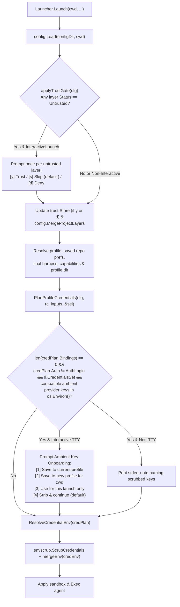

# CLI & Launch UX Improvements: Interactive `.aide.yaml` Trust, Ambient Key Onboarding & Command Consolidation

*   **Author:** jskswamy
*   **Status:** Draft
*   **Date:** 2026-11-07

--------------------------------------------------------------------------------

## Overview

`aide` isolates coding agent launches by gating repository-level `.aide.yaml` files through a content-addressed trust store ([`internal/trust`](../../internal/trust/trust.go)) and scrubbing ambient credentials from the inherited shell environment ([`internal/envscrub`](../../internal/envscrub/envscrub.go)). While those security defaults prevent untrusted repository overrides and cross-profile credential leaks, three user-facing launch and CLI workflows fail silently or expose overlapping legacy commands:

1.  **Untrusted `.aide.yaml` Files Are Ignored Without Prompting on Interactive Launches:** [`Launcher.applyTrustGate`](../../internal/launcher/project_gate.go#L73-L108) marks untrusted `.aide.yaml` layers as rejected without prompting on a terminal. When `preferences.show_info` is `false` (or the user misses the banner line), the agent launches without the repository's configured agent, capabilities, or sandbox rules. Even when noticed, the user must exit the agent, run `aide trust`, and re-launch.
2.  **Ambient Provider API Keys Are Silently Stripped When No Credential Binding Is Active:** [`Launcher.Launch`](../../internal/launcher/launcher.go#L460-L467) scrubs ambient provider secrets (`ANTHROPIC_API_KEY`, `OPENAI_API_KEY`, `GEMINI_API_KEY`, `OPENROUTER_API_KEY`, `CODEX_API_KEY`, etc.) from `os.Environ()`. When a user exports an API key in their shell and launches `aide` under a profile with no active credential binding (`len(credPlan.Bindings) == 0 && credPlan.Auth != AuthLogin && !l.CredentialsSet`), `aide` strips the variable without any notice or onboarding prompt, causing the downstream harness to fail with a missing-key error.
3.  **Overlapping `aide setup`, `aide use`, and `aide profile` Commands:** The CLI exposes three separate workflows to create or attach a profile for the current directory: [`aide profile create` / `aide profile bind`](../../cmd/aide/profile.go#L173-L506), [`aide setup`](../../cmd/aide/status.go#L671-L1272), and [`aide use`](../../cmd/aide/status.go#L504-L669). `aide setup` duplicates profile creation across 600 lines of legacy code, wires secrets into `env: { KEY: "{{ .secrets.key }}" }` templates that [`warnLegacyCredentialEnv`](../../internal/launcher/launcher.go#L789-L797) now flags as deprecated, and uses [`askMatchRule`](../../cmd/aide/commands.go#L54-L125) instead of the git-remote scope and conflict-resolution engine in [`cmd/aide/match_rule.go`](../../cmd/aide/match_rule.go). Furthermore, creating a new encrypted secret store requires a single-key `AgeIdentity.Recipient()` lookup or a mandatory `--age-key` flag rather than discovering multiple age keys or generating a missing keypair in-process.

This design adds an interactive `.aide.yaml` trust prompt on TTY launches, introduces an interactive ambient provider key onboarding prompt (with non-TTY `stderr` notice and multi-key/auto-generated `age` recipient support), and consolidates folder/profile setup onto `aide init` and `aide profile` by deprecating and hiding `aide setup` and `aide use`.

## The Problem

1.  **Friction and Silent Drift on `.aide.yaml` Changes:** Every edit to a repository's `.aide.yaml` changes its content hash in [`trust.FileHash`](../../internal/trust/trust.go#L62-L64), reverting its status to `Untrusted`. Unlike capability variant detection—which prompts interactively via [`ui.NewTTYPrompter`](../../internal/ui/consentprompt.go#L60-L97) during launch—the `.aide.yaml` trust gate never prompts on a terminal, forcing a manual launch → exit → `aide trust` → re-launch cycle.
2.  **Opaque Authentication Failures from Scrubbed Shell Keys:** Users migrating from raw `claude`, `codex`, `pi`, or `opencode` invocations commonly hold provider API keys in shell startup files (`~/.zshrc`). Stripping those variables silently when the active profile has no credential bindings leaves users with an unauthenticated agent and no explanation that `aide` removed the key or how to persist it into an `age`-encrypted store.
3.  **Rigid `age` Key Provisioning During Secret Creation:** When saving a secret into a new `secrets/<store>.enc.yaml` file, [`AgeIdentity.Recipient`](../../internal/secrets/age.go#L40-L75) only returns the first `AGE-SECRET-KEY-` entry in a key file, ignores plugin/YubiKey recipient comments (`# public key: age1...` / `# Recipient: age1...`), and fails when no key file exists on disk instead of offering to generate an X25519 identity in-process via `filippo.io/age`.
4.  **Fragmented CLI Surface (`setup` vs `use` vs `profile bind`):** Having `aide init`, `aide setup`, `aide use`, `aide profile create`, and `aide profile bind` all visible in top-level `--help` confuses users about which command to run, while `aide setup` writes deprecated config constructs.

## Goals

*   **Interactive `.aide.yaml` Trust Prompt on TTY Launches:** When [`Launcher.Launch`](../../internal/launcher/launcher.go#L224) evaluates `.aide.yaml` layers on an interactive terminal (`l.Interactive && !l.IgnoreProjectConfig`), prompt the user once per launch for each `Untrusted` layer with a summary of requested settings (`[y] Trust this file`, `[s] Skip for this launch (default)`, `[d] Deny permanently`). Never prompt for `Denied` layers, non-interactive launches, or preview commands (`aide which`, `aide status`, `aide prompt`, `aide statusline`, `aide sandbox`, `aide project`).
*   **Ambient Provider Key Notice & Interactive Onboarding:** When a configured launch has no active credential binding (`len(credPlan.Bindings) == 0 && credPlan.Auth != AuthLogin && !l.CredentialsSet`) and `os.Environ()` contains non-empty provider secret variables ([`envscrub.IsProviderSecretName`](../../internal/envscrub/envscrub.go#L254-L256)) that are not already configured in the profile and are compatible with the active harness:
    *   In **non-interactive mode**, print a `stderr` note naming the scrubbed variable names (never values) and how to configure a binding or silence the note with `--auth login`.
    *   In **interactive TTY mode**, prompt the user to: `[1]` encrypt and bind the key(s) to the current profile, `[2]` create a new profile bound to the current folder with the encrypted key(s), `[3]` pass the key(s) through for this launch only, or `[4]` strip and continue (default).
*   **Multi-Key Discovery & In-Process Generation for `age` Recipients:** Provide a shared recipient resolution flow in [`internal/secrets`](../../internal/secrets/age.go) and batch encryption in [`internal/secrets/manager.go`](../../internal/secrets/manager.go) that:
    *   Discovers all candidate `age1...` recipients across `SOPS_AGE_KEY`, `SOPS_AGE_KEY_FILE`, and [`defaultKeyPaths()`](../../internal/secrets/age.go#L135-L152) (including `# public key:` / `# Recipient:` comments for plugin identities), using the same identity scanner across `DiscoverAgeKey()`, `AgeIdentity.Recipient()`, and `DiscoverRecipients()`.
    *   Automatically selects the recipient when exactly one exists, presents a numbered picker on TTY when multiple exist, and offers to generate a new X25519 keypair at [`defaultKeyPath()`](../../internal/secrets/age.go#L123-L129) in-process via `age.GenerateX25519Identity()` (or accept a user-entered `age1...` public key) when none exists.
    *   Reuses this helper across ambient key onboarding, `aide init`, and `aide secrets create`.
*   **Consolidate `aide setup` and `aide use` onto `aide profile`:** Hide `aide setup` and `aide use` from top-level help, emit deprecation notices to `stderr`, delete the 600-line legacy `setup` wizard in [`cmd/aide/status.go`](../../cmd/aide/status.go#L671-L1272) (forwarding `aide setup` to `aide profile bind`—which includes a `[N+1] Create a new profile` option—or `aide profile create`), and retain `aide use` flag execution for backward compatibility with existing scripts.

## Non-Goals

*   **Auto-Trusting `.aide.yaml` via `--yes`:** The `--yes` flag remains scoped exclusively to capability variant detection consent prompts. `.aide.yaml` files can disable sandboxing, add writable paths, or enable `auto_approve`; non-interactive CI workflows must run `aide trust <path>` explicitly rather than bypassing the repository trust gate via `--yes`.
*   **Prompting for Non-Provider Scrubbed Variables:** Ambient cloud selector variables (`AWS_PROFILE`, `GOOGLE_CLOUD_PROJECT`) and `aide`'s own `SOPS_AGE_KEY` are governed by capabilities (`--with aws`, `--with gcp`) and secret store decryption respectively; they do not trigger the provider API key onboarding prompt.
*   **Removing `aide use` Flag Execution:** Existing scripts calling `aide use <agent>` continue to work with a `stderr` deprecation notice rather than failing with an unknown-command error.

## Open Questions

*   **None.**

## Critical User Journeys (CUJs)

### CUJ 1: Approving an Untrusted `.aide.yaml` Inline During Launch

*   **Given**: A repository contains an untrusted `.aide.yaml` requesting `agent: claude` and `capabilities: [docker]`. The user runs `aide` from an interactive terminal.
*   **When**: `Launcher.Launch` evaluates the project trust gate before resolving the final harness.
*   **Then**: `aide` displays the canonical path of `.aide.yaml`, any worktree inheritance or symlink note, and its requested grants (`claude agent · docker capability`), then prompts `[y] Trust this file    [s] Skip for this launch (default)    [d] Deny permanently`. Selecting `y` persists the content hash in `trust.Store`, applies the `.aide.yaml` layer immediately for the current launch, and launches `claude` with the `docker` capability enabled. Selecting `d` records a path-hash deny in `trust.Store` so subsequent launches skip the file without prompting.

### CUJ 2: Encrypting and Binding an Ambient Shell API Key on Launch

*   **Given**: The user has `export ANTHROPIC_API_KEY=sk-ant-...` in their shell environment, has no age key file on disk yet, and runs `aide` on an interactive terminal under profile `default` (which has no `credentials:` or `gateways:` configured).
*   **When**: `Launcher.Launch` plans credentials for `default` (`len(credPlan.Bindings) == 0 && credPlan.Auth != AuthLogin && !l.CredentialsSet`) and detects `ANTHROPIC_API_KEY` in `os.Environ()`.
*   **Then**:
    1.  `aide` prompts on `stderr` with options `[1]` Save to encrypted secret store & bind to profile `"default"`, `[2]` Create a new profile for this folder with this key, `[3]` Use for this launch only, or `[4]` Strip and continue (default).
    2.  The user selects `[1]`. Because no `secrets/default.enc.yaml` or local age key exists yet, `aide` prompts to `[1] Generate a new age key at <defaultKeyPath> (default)` or `[2] Enter an existing age public key (age1...)`.
    3.  The user presses Enter (`[1]`). `aide` generates an X25519 identity in-process, writes `<defaultKeyPath>` with `0600` permissions, encrypts `anthropic_api_key` into `secrets/default.enc.yaml`, persists `config.yaml` and modular `profiles/default.yaml` (via `config.WriteConfigTo`) with the `anthropic` credential binding and `default_credentials: [anthropic]`, updates the active profile's credential fields in place, and launches the agent with `ANTHROPIC_API_KEY` injected.

### CUJ 3: Selecting Among Multiple Existing Age Keys

*   **Given**: The user's `~/.config/sops/age/keys.txt` contains two software identities (`age1first...` with comment `# created: 2026-01-10` and `age1second...` with comment `# work key`) and one YubiKey identity (`# Recipient: age1yubikey1q...`).
*   **When**: The user creates a new secret store via `aide secrets create work` (without `--age-key`) or saves an ambient key to a new store on an interactive terminal.
*   **Then**: `aide` lists all three discovered recipients with their source path and comment labels (`[1]`–`[3]`) plus `[4] Enter a different age public key (age1...)`, defaulting to `[1]` on Enter, and encrypts the new secret store to the selected recipient.

### CUJ 4: Non-Interactive Ambient Key Scrub Notice

*   **Given**: A script or non-interactive shell with `OPENAI_API_KEY=sk-...` exported invokes `aide` under profile `default` (no credential bindings configured, and `--auth login` not set).
*   **When**: `Launcher.Launch` scrubs the environment.
*   **Then**: `aide` does not block on `stdin`; it prints `aide: note: scrubbed ambient OPENAI_API_KEY from the environment (profile "default" has no credential binding; configure credentials: in your profile, run interactively to save, or pass --auth login to silence)` to `stderr` and continues the launch with `OPENAI_API_KEY` removed.

### CUJ 5: Invoking Deprecated `aide setup`

*   **Given**: A user accustomed to older releases runs `aide setup` in a repository.
*   **When**: `setupCmd` executes.
*   **Then**: `aide` prints `aide setup is deprecated; use 'aide profile bind' to attach a folder to an existing profile or 'aide profile create' to create a new one` to `stderr`, delegates directly to `aide profile bind` (when profiles exist in config, offering existing profiles plus `[N+1] Create a new profile`) or `aide profile create` (when no profiles exist), and exits with that command's status.

--------------------------------------------------------------------------------

## Technical Plan (Architecture)

### 1. Launch-Time Interactive Gates & Selection Flow



### 2. Interactive `.aide.yaml` Trust Gate (`internal/launcher` & `internal/ui`)

*   **Separation Between Launch and Read-Only Previews:**
    *   Read-only callers (`GateProjectConfig`, `aide which`, `aide status`, `aide prompt`, `aide statusline`, `aide sandbox`, `aide project`) invoke `ResolveSelection` or `GateProjectConfig` with trust prompting disabled. They never read from `stdin` or mutate `trust.Store`.
    *   During `Launcher.Launch`, when `l.Interactive && !l.IgnoreProjectConfig`, the initial trust gate pass evaluates each layer in `cfg.ProjectLayers` in order (`inherited` main-worktree layer first, `local` layer second). Subsequent config reloads during the same launch (such as after an empty-state profile creation) disable re-prompting so a layer skipped via `[s]` is not prompted a second time.
*   **Handling Each Trust Status:**
    *   `trust.Trusted`: Applied without prompting.
    *   `trust.Denied`: Rejected and recorded in the banner's trust summary as `"denied"` without prompting (respecting the user's prior `aide deny` decision).
    *   `trust.Untrusted`: Displays the layer path, origin/symlink notes, and requested grants summary on `stderr`, then prompts:
        *   **`y` / `yes`**: Records the content hash in `trust.Store` and includes the layer in the merged project overrides for the current launch.
        *   **`s` / `skip` / `n` / `no` / `""` (Enter / EOF)**: Keeps the layer rejected for the current launch without modifying `trust.Store`.
        *   **`d` / `deny`**: Records a permanent path-hash deny in `trust.Store` and rejects the layer.
*   **Shared Input Reader on `Launcher`:**
    *   `Launcher` maintains a single lazy `*bufio.Reader` (`l.stdinReader()`) shared across the `.aide.yaml` trust prompt, the empty-state profile prompt, the ambient key onboarding prompt, and the default `ui.NewTTYPrompter` instance so sequential prompts during a single launch never lose buffered lines.

### 3. Multi-Key `age` Discovery, Batch Encryption & In-Process Key Generation (`internal/secrets`)

*   **Unified Candidate Discovery (`DiscoverRecipients` & `DiscoverAgeKey`):**
    *   `DiscoverRecipients()`, `DiscoverAgeKey()`, and `AgeIdentity.Recipient()` share a single line-scanner (`parseRecipientsFromReader`) across `SOPS_AGE_KEY`, `SOPS_AGE_KEY_FILE`, and [`defaultKeyPaths()`](../../internal/secrets/age.go#L135-L152).
    *   For `AGE-SECRET-KEY-1...` lines (including when `SOPS_AGE_KEY` has leading `#` comment lines), the scanner parses the X25519 identity, derives its `age1...` recipient, and attaches the preceding descriptive comment as a human-readable `Label`.
    *   For `# public key: age1...` or `# Recipient: age1...` comments not followed by a software secret key, the scanner records the `age1...` recipient so plugin/YubiKey identities documented in `keys.txt` are also discoverable for encryption.
    *   Candidates are deduplicated by `PublicKey` in discovery order.
*   **In-Process Key Generation (`GenerateDefaultAgeKey`):**
    *   Generates a new X25519 identity in-process via `age.GenerateX25519Identity()` from `filippo.io/age`, formats the standard `age-keygen` block (`# created: ...`, `# public key: ...`, `AGE-SECRET-KEY-1...`), and writes it to `defaultKeyPath()` with directory mode `0700` and file mode `0600`.
*   **Interactive Recipient Resolution (`ResolveRecipient`):**
    *   When an explicit `--age-key` is supplied, validates and returns it.
    *   When **1** recipient is discovered, selects it and prints `Using age key: <PublicKey> (<Source>)`.
    *   When **2+** recipients are discovered, presents a numbered picker on TTY (`[1]..[N]` plus `[N+1] Enter a different age public key (age1...)`) or selects the first candidate on non-TTY.
    *   When **0** recipients are discovered, offers `[1] Generate a new age key at <defaultKeyPath> (default)` or `[2] Enter an existing age public key (age1...)` on TTY, or returns the `no age identity found` error from `DiscoverAgeKey()` on non-TTY.
*   **Single-Pass Batch Secret Writing (`Manager.SetKeys`):**
    *   `secrets.Manager.SetKeys` writes or updates multiple secret keys in a single decrypt-merge-encrypt pass so onboarding 2+ ambient keys never has to re-decrypt a newly created store encrypted to an external public key.

### 4. Ambient Provider API Key Detection & Onboarding (`internal/launcher`)

*   **Detection Criteria (`detectAmbientProviderKeys`):**
    *   Evaluated in `Launcher.Launch` after `PlanProfileCredentials` when `len(credPlan.Bindings) == 0 && credPlan.Auth != AuthLogin && !l.CredentialsSet`.
    *   Inspects `os.Environ()` for non-empty provider secret variables (`envscrub.IsProviderSecretName`) that are not already set in `rc.Context.Env`, permitted by `capOverrides.EnvAllow`, or bound in `rc.Context.Credentials` / `rc.Context.Gateways`.
    *   Filters interactive onboarding candidates to keys whose binding is compatible with the active harness (`cfg.HarnessOf(rc.Context.Agent)`) so unrelated shell keys (such as `OPENAI_API_KEY` when launching `claude`) do not cause repeated prompts on subsequent launches.
*   **Non-Interactive Behavior:**
    *   Emits a `stderr` note naming the scrubbed variable names (never values) and how to configure a binding or pass `--auth login`.
*   **Interactive TTY Behavior:**
    *   Presents the 4-option onboarding menu on `stderr`:
        *   **Option `[1]` (Save & bind to current profile):** Resolves the secret store path under `filepath.Join(l.configDir(), "secrets")` and the `age` recipient via `ResolveRecipient`, encrypts all onboarded keys in one pass via `Manager.SetKeys`, updates `cfg.Contexts[rc.Name]` and persists `config.yaml` + modular `profiles/<name>.yaml` via `config.WriteConfigTo`, updates `rc.Context`'s credential fields (`Credentials`, `DefaultCredentials`, `Secret`) in place without clobbering merged `.aide.yaml` or profile-dir state, and re-runs `PlanProfileCredentials` + `ResolveCredentialEnv` (falling back to in-memory `credEnv` for this launch if the user encrypted to an external public key that has no local private key).
        *   **Option `[2]` (Create a new profile for this folder with this key):** Prompts for the new profile name (defaulting to `filepath.Base(cwd)`), encrypts the key(s) into `secrets/<newProfile>.enc.yaml`, registers the profile and agent in `cfg`, persists via `config.WriteConfigTo`, re-resolves `rc` for `<newProfile>` (including profile directory and `provision.InjectProfileEnv`), and continues launch under the new profile.
        *   **Option `[3]` (Use for this launch only):** Injects the ambient key(s) into `credEnv` in memory for the current process without touching `config.yaml` or `secrets/`.
        *   **Option `[4]` / Enter / EOF (Strip and continue):** Leaves `credEnv` empty so `envscrub.ScrubCredentials` strips the variables.

### 5. Consolidating `aide setup` & `aide use` (`cmd/aide`)

*   **`aide setup` Deprecation & Delegation:**
    *   Hides `aide setup` from `--help`, prints a `stderr` deprecation notice, deletes the 600-line legacy `setup` wizard (`setupCreateNew`, `setupCreateSecrets`, `setupMatchRuleSummary`, `askMatchRule`), and delegates to `aide profile bind` (when profiles exist) or `aide profile create` (when no profiles exist).
    *   Adds `[N+1] Create a new profile` to `pickExistingContext` in [`cmd/aide/profile.go`](../../cmd/aide/profile.go#L268-L300) so running `aide profile bind` (or `aide setup`) with no arguments after `aide init` allows either binding an existing profile or creating a new one via `runCreateWizard`.
*   **`aide use` Deprecation:**
    *   Hides `aide use` from `--help` and prints a `stderr` deprecation notice before running the existing `useCmd` logic so scripts remain compatible.
*   **`aide init` and `aide secrets create` Age Key Integration:**
    *   Uses `secrets.ResolveRecipient` in both `aide init` and `aide secrets create` so single-key auto-selection, multi-key picking, and in-process key generation work identically across CLI commands and launch onboarding.

--------------------------------------------------------------------------------

## Alternatives Considered

### Alternative A: Auto-Approve Untrusted `.aide.yaml` Files When `--yes` Is Passed

*   **Pros**: Allows non-interactive scripts to approve `.aide.yaml` and capability variants with a single `--yes` flag.
*   **Cons**: `.aide.yaml` is checked into git repositories and can set `sandbox: { disabled: true }`, `yolo: true`, `writable: [~]`, or `unguard: [ssh]`. Making `--yes` auto-trust `.aide.yaml` turns a capability-variant convenience flag into a full sandbox bypass in cloned repositories.
*   **Reason for Rejection**: Violates the repository trust boundary. Non-interactive pipelines that wish to trust a checkout's `.aide.yaml` can run `aide trust` explicitly before `aide`, or pass `--ignore-project-config`.

### Alternative B: Delete `aide setup` and `aide use` Entirely

*   **Pros**: Removes `useCmd` (~165 lines) in addition to the 600-line `setup` wizard.
*   **Cons**: Hard-breaks user scripts, shell aliases, or documentation snippets that still invoke `aide use <agent>` or `aide setup`.
*   **Reason for Rejection**: Following the precedent of `aide context` ([`cmd/aide/profile.go`](../../cmd/aide/profile.go#L23-L49)), hiding the commands from `--help` and printing a `stderr` deprecation notice while forwarding `aide setup` to `aide profile bind`/`create` and preserving `aide use` execution cleans up the UX and deletes the 600-line legacy wizard without breaking callers.

### Alternative C: Shell Out to `age-keygen` Binary When No Age Key Exists

*   **Pros**: Uses the external `age-keygen` CLI tool mentioned in existing error text.
*   **Cons**: Fails if the user has not installed the `age` binary via Homebrew/apt, even though `aide` already compiles `filippo.io/age` into the `aide` binary itself.
*   **Reason for Rejection**: Calling `age.GenerateX25519Identity()` directly in Go has zero external binary dependencies and works on every macOS and Linux installation.

--------------------------------------------------------------------------------

## Risks & Mitigations

*   **External or Hardware-Backed `age1...` Public Keys Without Local Private Identity During Launch Onboarding:**
    *   *Risk*: A user selects Option `[1]` or `[2]` during launch and supplies an external `age1...` public key whose private key is on another machine or requires a hardware plugin not available in the current environment. Encrypting succeeds, but `ResolveCredentialEnv` cannot decrypt the newly written store for the current launch.
    *   *Mitigation*: `Manager.SetKeys` encrypts all onboarded keys in a single pass without re-decrypting, and if `ResolveCredentialEnv` fails to decrypt immediately after onboarding an external recipient, `handleAmbientProviderKeys` prints a `stderr` note and falls back to injecting the in-memory `credEnv` for the current launch.
*   **Cross-Harness Ambient Keys in Shell Startup Files:**
    *   *Risk*: A user exports `OPENAI_API_KEY` in `~/.zshrc` but launches `claude`. Because built-in `"openai"` only targets `pi, opencode, codex` by default, onboarding it without filtering would leave `claude`'s active `credPlan.Bindings` empty and re-prompt on every launch.
    *   *Mitigation*: `detectAmbientProviderKeys` excludes variables already bound in `rc.Context.Credentials` / `rc.Context.Gateways` and filters interactive onboarding candidates to keys compatible with the active harness (`cfg.HarnessOf(rc.Context.Agent)`).
*   **Prompt Keybinding Distinction Between `.aide.yaml` Trust (`[d] Deny`) and Capability Variant Consent (`[D]etails`):**
    *   *Risk*: Users accustomed to pressing `d` for `[D]etails` in the capability variant consent prompt might press `d` on the `.aide.yaml` trust prompt expecting details rather than `[d] Deny permanently`.
    *   *Mitigation*: The `.aide.yaml` prompt prints the full `wants:` summary inline above the options so no separate details view is needed, spells out `[d] Deny permanently` explicitly in the prompt line, and prints `Denied: <path> (run 'aide trust <path>' to allow later)` when selected.

## Non-Functional Requirements

*   **Security & Privacy**:
    *   Ambient provider API key values must never be written to `stdout`, `stderr`, startup banners, or error messages—only environment variable names (`ANTHROPIC_API_KEY`, etc.) may be displayed.
    *   In-process generated `age` private keys (`AGE-SECRET-KEY-1...`) must be written with directory mode `0700` and file mode `0600`; only the public `age1...` recipient may be printed to the terminal.
    *   `.aide.yaml` files with status `trust.Denied` must never prompt or apply unless the user explicitly runs `aide trust`.
*   **Test Coverage & Quality Gates**:
    *   `internal/secrets` and `internal/config` enforce an **80% per-file coverage floor** in [`.testcoverage.yml`](../../.testcoverage.yml). All new functions in `internal/secrets/age.go`, `internal/secrets/manager.go`, and `internal/config/credentials.go` must have unit tests keeping every file in those packages above 80%.
*   **Backward Compatibility**:
    *   Non-interactive launches (`stdin` not a TTY) must never block waiting for input on either the `.aide.yaml` trust check or the ambient key check.
    *   Preview commands (`aide which`, `aide status`, `aide prompt`, `aide statusline`, `aide sandbox`, `aide project`) must remain non-interactive and side-effect-free.

--------------------------------------------------------------------------------

## Detailed Implementation Plan

### Target Scope & File Boundary

The implementation modifies or creates only the following repository-relative files:

1.  `internal/secrets/age.go` (Modify)
2.  `internal/secrets/age_test.go` (Modify)
3.  `internal/secrets/manager.go` (Modify)
4.  `internal/secrets/manager_test.go` (Modify)
5.  `internal/config/credentials.go` (Modify)
6.  `internal/config/credentials_test.go` (Modify)
7.  `internal/launcher/project_gate.go` (Modify)
8.  `internal/launcher/project_gate_test.go` (Modify)
9.  `internal/launcher/selection.go` (Modify)
10. `internal/launcher/ambient_keys.go` (Create)
11. `internal/launcher/ambient_keys_test.go` (Create)
12. `internal/launcher/launcher.go` (Modify)
13. `cmd/aide/main.go` (Modify)
14. `cmd/aide/secrets.go` (Modify)
15. `cmd/aide/secrets_test.go` (Modify)
16. `cmd/aide/profile.go` (Modify)
17. `cmd/aide/status.go` (Modify)
18. `cmd/aide/commands.go` (Modify)
19. `cmd/aide/context_create_test.go` (Modify)
20. `RELEASE_NOTES.md` (Modify)

---

### Phase 1: Multi-Key `age` Discovery, Batch Encryption, In-Process Key Generation & CLI Secret Integration

#### 1. [`internal/secrets/age.go`](../../internal/secrets/age.go) & [`internal/secrets/manager.go`](../../internal/secrets/manager.go) (Modify)

*   **Type / Scope**: Go Package (`internal/secrets`)
*   **Rationale**: Support discovering multiple `age` recipients (software and plugin comments) with unified parsing across encryption and decryption, batch-setting multiple keys in one pass, selecting among multiple keys interactively, and generating a new X25519 identity in-process when no key is configured.
*   **Proposed Changes**:
    *   In [`internal/secrets/age.go`](../../internal/secrets/age.go):
        *   Define `type AgeRecipient struct`:
            *   `PublicKey string`
            *   `Source string` (e.g., `"env:SOPS_AGE_KEY"`, or file path)
            *   `Label string` (comment metadata such as `"created: 2026-01-15"` or `"YubiKey"`)
        *   Implement `parseRecipientsFromReader(r io.Reader, source string) ([]AgeRecipient, []*age.X25519Identity, error)`:
            *   Scan lines with `bufio.NewScanner(r)`.
            *   When a comment line (`# ...`) is seen:
                *   If it matches `#\s*(?:public key|Recipient):\s*(age1\S+)` (case-insensitive), record that `age1...` recipient in a pending plugin/header slot; if the next non-comment line is an `AGE-SECRET-KEY-1...`, the derived X25519 recipient supersedes the header comment so it is not duplicated, whereas if it is an `AGE-PLUGIN-...` line (or EOF/blank), emit the `AgeRecipient` with `PublicKey` from the comment and `Label` from any preceding `# created:` or descriptive comment.
                *   Otherwise record the trimmed comment text (excluding bare `# public key:` lines) as the pending `Label` for the next key.
            *   When an `AGE-SECRET-KEY-1...` line is seen: parse with `age.ParseX25519Identity(line)`, append `x` to the identity slice, append `AgeRecipient{PublicKey: x.Recipient().String(), Source: source, Label: pendingLabel}`, and reset pending state.
        *   Refactor `(id *AgeIdentity) Recipient() (string, error)` and `DiscoverAgeKey()` to use `parseRecipientsFromReader` so `SOPS_AGE_KEY` with leading `#` comment lines and multi-source identity discovery behave identically across `DiscoverAgeKey()` and `DiscoverRecipients()`.
        *   Implement `DiscoverRecipients() ([]AgeRecipient, error)`:
            *   Collect recipients from `SOPS_AGE_KEY` (if non-empty, `Source: "env:SOPS_AGE_KEY"`), `SOPS_AGE_KEY_FILE` (if readable), and each readable path in `defaultKeyPaths()`.
            *   Deduplicate by `PublicKey` while preserving first-seen order.
        *   Implement `GenerateDefaultAgeKey(targetPath string) (AgeRecipient, error)`:
            *   If `targetPath == ""`, set `targetPath = defaultKeyPath()`.
            *   Generate identity via `id, err := age.GenerateX25519Identity()`.
            *   Format key block: `fmt.Sprintf("# created: %s\n# public key: %s\n%s\n", time.Now().UTC().Format(time.RFC3339), id.Recipient().String(), id.String())`.
            *   Ensure `filepath.Dir(targetPath)` exists with `os.MkdirAll(dir, 0o700)`.
            *   Write `targetPath` with mode `0o600` (if `targetPath` already exists, append with a leading newline; otherwise write via `os.WriteFile(targetPath, []byte(block), 0o600)`).
            *   Return `AgeRecipient{PublicKey: id.Recipient().String(), Source: targetPath, Label: "generated"}`.
        *   Implement `ValidateRecipient(pubKey string) error`:
            *   Trim whitespace; return error if empty. If `strings.HasPrefix(pubKey, "age1")`, validate standard X25519 keys with `age.ParseX25519Recipient(pubKey)` and allow `age1yubikey1...` / plugin Bech32 recipients that start with `age1` and contain no whitespace; otherwise return an error.
        *   Implement `ResolveRecipient(explicitPubKey string, in *bufio.Reader, out io.Writer, isTTY bool) (string, error)`:
            *   If `strings.TrimSpace(explicitPubKey) != ""` (e.g., from `--age-key`): validate with `ValidateRecipient` and return it.
            *   Call `candidates, err := DiscoverRecipients()` (return `err` if non-nil).
            *   If `len(candidates) == 1`: print `fmt.Fprintf(out, "Using age key: %s (%s)\n", candidates[0].PublicKey, candidates[0].Source)` (when `out != nil`) and return `candidates[0].PublicKey, nil`.
            *   If `len(candidates) > 1`:
                *   If `!isTTY || in == nil`: print `fmt.Fprintf(out, "Using age key: %s (%s)\n", candidates[0].PublicKey, candidates[0].Source)` (when `out != nil`) and return `candidates[0].PublicKey, nil`.
                *   If `isTTY`: print `"Multiple age keys found:\n"` to `out`, list `[1]..[N]` as `fmt.Fprintf(out, "  [%d] %s (%s)\n", i+1, c.PublicKey, sourceAndLabel(c))`, plus `[N+1] Enter a different age public key (age1...)` and `Select [1]: `. Read line from `in`; default empty to `1`. If `1..N`, return `candidates[choice-1].PublicKey, nil`. If `N+1`, prompt `"Age public key (age1...): "`, read from `in`, validate with `ValidateRecipient`, and return.
            *   If `len(candidates) == 0`:
                *   If `!isTTY || in == nil`: return the error from `DiscoverAgeKey()`.
                *   If `isTTY`: print:
                    ```text
                    No age encryption key found.
                      [1] Generate a new age key at <defaultKeyPath()> (default)
                      [2] Enter an existing age public key (age1...)
                    Select [1]:
                    ```
                    Read line from `in`; default empty to `1`.
                    *   Case `1`: call `rec, err := GenerateDefaultAgeKey(defaultKeyPath())`, print `fmt.Fprintf(out, "✓ Generated age key at %s (public key: %s)\n", rec.Source, rec.PublicKey)`, and return `rec.PublicKey, nil`.
                    *   Case `2`: prompt `"Age public key (age1...): "`, read from `in`, validate with `ValidateRecipient`, and return.
                    *   Otherwise: return `fmt.Errorf("invalid selection: %q", line)`.
        *   Update line 117 of `DiscoverAgeKey()` error message from `Run 'aide setup' for guided configuration` to `Run 'aide init' or 'aide secrets create <name>' to generate or configure a key`.
    *   In [`internal/secrets/manager.go`](../../internal/secrets/manager.go):
        *   Add `func (m *Manager) SetKeys(storeName, secretsDir string, kv map[string]string, explicitAgePubKey string) error`:
            *   If the store file already exists, call `m.decryptForUpdate(path)` once to load existing keys and recipient; otherwise resolve the recipient from `explicitAgePubKey` (or `m.resolveRecipient()`).
            *   Copy all entries from `kv` into the map in sorted key order and encrypt/write the store once via `encryptMapToFile(existing, recipient, path)`.
        *   Refactor `SetKey` to delegate to `m.SetKeys(storeName, secretsDir, map[string]string{key: value}, explicitAgePubKey)`.

#### 2. [`internal/secrets/age_test.go`](../../internal/secrets/age_test.go) & [`internal/secrets/manager_test.go`](../../internal/secrets/manager_test.go) (Modify)

*   **Type / Scope**: Unit Tests (`internal/secrets`)
*   **Proposed Changes**:
    *   In [`internal/secrets/age_test.go`](../../internal/secrets/age_test.go):
        *   Update `TestDiscoverAgeKey_NoneFound` (line 346) to assert `strings.Contains(err.Error(), "aide init")` instead of `"aide setup"`.
        *   Add `TestDiscoverRecipients_SingleAndMultiple`: verifies `SOPS_AGE_KEY` (with leading `#` comments), `SOPS_AGE_KEY_FILE` with multiple software keys + `# created:` labels + `# Recipient: age1yubikey1...` plugin comments, and deduplication.
        *   Add `TestGenerateDefaultAgeKey`: verifies in-process X25519 key generation creates a `0600` file, is discovered by `DiscoverAgeKey()` and `DiscoverRecipients()`, and encrypts/decrypts a round-trip secret via `Manager.SetKeys` + `DecryptSecretsFile`.
        *   Add `TestResolveRecipient`: covers explicit key validation, 1-key auto-select, multi-key TTY picker (`[2]` and `[N+1]` custom key), multi-key non-TTY default `[1]`, 0-key TTY auto-generation (`[1]` / Enter), 0-key TTY custom public key (`[2]`), and 0-key non-TTY error.
    *   In [`internal/secrets/manager_test.go`](../../internal/secrets/manager_test.go):
        *   Add `TestManager_SetKeys_BatchNewStore` verifying that `SetKeys` writes multiple keys to a new store in a single pass (including when encrypted to an explicit external `age1...` public key).
*   **Phase 1a Verification Checkpoint**: `go test -race ./internal/secrets/...`

#### 3. [`cmd/aide/secrets.go`](../../cmd/aide/secrets.go) & [`cmd/aide/secrets_test.go`](../../cmd/aide/secrets_test.go) (Modify)

*   **Type / Scope**: CLI Commands & Tests (`package main`)
*   **Proposed Changes**:
    *   In [`secretsCreateCmd`](../../cmd/aide/secrets.go#L44-L68): remove `_ = cmd.MarkFlagRequired("age-key")` so `--age-key` is optional. Resolve the recipient via `recipient, err := secrets.ResolveRecipient(ageKey, bufio.NewReader(cmd.InOrStdin()), cmd.OutOrStdout(), isInputTTY(cmd))` before calling `mgr.Create(name, secretsDir, recipient)`.
    *   In [`cmd/aide/secrets_test.go`](../../cmd/aide/secrets_test.go): set `t.Setenv("EDITOR", ...)` to a helper script that writes `api_key: test-secret` to its file argument, and add tests verifying `aide secrets create <name>` without `--age-key` when a single key is present, when multiple keys are present on TTY, and when no key exists on TTY (auto-generating `keys.txt`).

---

### Phase 2: Interactive `.aide.yaml` Trust Prompt on TTY Launch

#### 4. [`internal/launcher/project_gate.go`](../../internal/launcher/project_gate.go), [`internal/launcher/selection.go`](../../internal/launcher/selection.go), [`internal/launcher/launcher.go`](../../internal/launcher/launcher.go), [`cmd/aide/main.go`](../../cmd/aide/main.go) & [`internal/launcher/project_gate_test.go`](../../internal/launcher/project_gate_test.go) (Modify)

*   **Type / Scope**: Go Package (`internal/launcher` & `cmd/aide`)
*   **Rationale**: Prompt the user once per launch on interactive TTY runs when an untrusted `.aide.yaml` layer is encountered, share a single `*bufio.Reader` across all launch prompts, and keep previews and non-interactive launches side-effect-free.
*   **Proposed Changes**:
    *   In [`internal/launcher/launcher.go`](../../internal/launcher/launcher.go) and [`cmd/aide/main.go`](../../cmd/aide/main.go):
        *   Add `inReader *bufio.Reader` and `promptProjectTrust bool` fields to `Launcher`.
        *   Add helper `(l *Launcher) stdinReader() *bufio.Reader` (initializing `l.inReader = bufio.NewReader(l.Stdin)` when `l.Stdin != nil`, else `bufio.NewReader(os.Stdin)`).
        *   In `Launcher.handleEmptyStateLaunch`, pass `l.stdinReader()` instead of `l.Stdin` into `handleEmptyState`.
        *   In `Launcher.Launch`, lazily initialize `l.Prompter = ui.NewTTYPrompter(l.stdinReader(), l.stderr())` when `l.Prompter == nil && l.Interactive` (and remove the eager `l.Prompter = ui.NewTTYPrompter(os.Stdin, os.Stderr)` assignment in `cmd/aide/main.go`) so all 4 launch-time prompts share `l.stdinReader()`.
    *   In [`internal/launcher/selection.go`](../../internal/launcher/selection.go):
        *   After the first `l.applyTrustGate(cfg)` call in `ResolveSelection`, set `l.promptProjectTrust = false` so any subsequent `applyTrustGate` call triggered by empty-state config reload reuses the trust store state without re-prompting a skipped layer.
    *   In [`internal/launcher/project_gate.go`](../../internal/launcher/project_gate.go):
        *   When `fc.Status == trust.Untrusted` and `l.promptProjectTrust` is true:
            *   Format `<wantsLine>` directly in `project_gate.go` as `"wants: " + strings.Join(ti.Wants, " · ")` when `len(ti.Wants) > 0`, else `"wants: (no special grants)"`.
            *   Render the prompt to `l.stderr()`:
                ```text
                [aide] Untrusted .aide.yaml at <displayPath><originNote>
                  <wantsLine>

                  [y] Trust this file    [s] Skip for this launch (default)    [d] Deny permanently
                >
                ```
                (where `<originNote>` is `" (inherited from main checkout)"` when `layer.Source == config.LayerInherited` and/or `" (symlink to <target>)"` when `fc.Target != ""`).
            *   Read answer from `l.stdinReader()`:
                *   `"y"`, `"yes"` (case-insensitive): call `store.Trust(fc.Path, fc.Contents)`. If error, return it; otherwise set `fc.Status = trust.Trusted` and `layer.Rejected = false`, and print `fmt.Fprintf(l.stderr(), "Trusted: %s\n", display)` to `l.stderr()`.
                *   `"d"`, `"deny"` (case-insensitive): call `store.Deny(fc.Path)`. If error, return it; otherwise set `fc.Status = trust.Denied`, `layer.Rejected = true`, append `ui.TrustInfo{Status: "denied", Path: display, Source: layer.Source}` to `gate.Files`, and print `fmt.Fprintf(l.stderr(), "Denied: %s (run 'aide trust %s' to allow later)\n", display, display)` to `l.stderr()`.
                *   `"s"`, `"skip"`, `"n"`, `"no"`, `""` (or EOF): keep `fc.Status = trust.Untrusted`, `layer.Rejected = true`, and append `ti` to `gate.Files`.
                *   Any other input: print `"please answer y (trust), s (skip), or d (deny)"` to `l.stderr()` and re-prompt.
    *   In [`internal/launcher/project_gate_test.go`](../../internal/launcher/project_gate_test.go):
        *   Add unit tests covering interactive `y` (persists trust in store and merges `.aide.yaml` override into launch), `s` / Enter (skips for this launch without persisting trust or deny, and does not prompt a second time on reload), `d` (persists deny in store; subsequent interactive launch does not re-prompt), invalid input retry, and non-interactive / preview calls (`GateProjectConfig`, `ResolveSelection` with `Interactive: false`) never prompting.
*   **Phase 2 Verification Checkpoint**: `go test -race ./internal/launcher/... -run "TestProjectGate|TestTrustGate"`

---

### Phase 3: Ambient Provider API Key Notice & Interactive Onboarding

#### 5. [`internal/config/credentials.go`](../../internal/config/credentials.go) & [`internal/config/credentials_test.go`](../../internal/config/credentials_test.go) (Modify)

*   **Type / Scope**: Go Package (`internal/config`)
*   **Proposed Changes**:
    *   Export `LegacyBindingName(envVar string) string` (renaming `legacyBindingName` so `internal/launcher` can map `ANTHROPIC_API_KEY` → `"anthropic"`, `OPENAI_API_KEY` → `"openai"`, `GEMINI_API_KEY` → `"gemini"`, `CODEX_API_KEY` → `"codex"`, `OPENROUTER_API_KEY` → `"openrouter"`, and custom provider secret names to `strings.ToLower(envVar)`).
    *   Add unit test in `internal/config/credentials_test.go` verifying `LegacyBindingName` for all built-in and custom variable names.

#### 6. [`internal/launcher/ambient_keys.go`](../../internal/launcher/ambient_keys.go) & [`internal/launcher/ambient_keys_test.go`](../../internal/launcher/ambient_keys_test.go) (Create)

*   **Type / Scope**: Go Package (`internal/launcher`)
*   **Rationale**: Detect ambient provider API keys when a profile has no active credential binding, emit a `stderr` notice in non-interactive mode, and run the 4-option onboarding prompt on interactive TTY launches.
*   **Proposed Changes**:
    *   Implement `detectAmbientProviderKeys(environ []string, ctx config.Context, permitted []string, activeHarness string, requireHarnessMatch bool) []string`:
        *   Build a set of excluded env var names from `ctx.Env`, `permitted` (`capOverrides.EnvAllow`), and any env vars already covered by `ctx.Credentials` (`binding.EffectiveEnv(name)` for each `name, binding := range ctx.Credentials`) or `ctx.Gateways`.
        *   For each `entry` in `environ`, split `k, v, ok := strings.Cut(entry, "=")`. If `!ok || v == ""`, skip.
        *   If `!envscrub.IsProviderSecretName(k)` or `excluded[k]`, skip.
        *   If `requireHarnessMatch && activeHarness != ""`: check `bindingName := config.LegacyBindingName(k)`; if `config.IsBuiltinCredential(bindingName)` and `!(config.CredentialBinding{}).DefaultAllowsHarness(bindingName, activeHarness)`, skip `k` so cross-harness shell variables (such as `OPENAI_API_KEY` when launching `claude`) do not trigger repeated interactive onboarding prompts.
        *   Return `slices.Compact(slices.Sorted(keys))`.
    *   Implement `(l *Launcher) handleAmbientProviderKeys(cfg *config.Config, rc *aidectx.ResolvedContext, cwd, homeDir string, inputs SelectionInputs, sel *Selection, credPlan *CredentialPlan, credEnv map[string]string, permitted []string) (*aidectx.ResolvedContext, error)`:
        *   Called in `Launcher.Launch` right after `PlanProfileCredentials` when `len(credPlan.Bindings) == 0 && credPlan.Auth != AuthLogin && !l.CredentialsSet`.
        *   Determine TTY status via `tty := l.Interactive || (l.StdinIsTTY != nil && l.StdinIsTTY())`.
        *   Active harness is `activeHarness := cfg.HarnessOf(rc.Context.Agent)`.
        *   **Non-interactive (`!tty`)**:
            *   Call `ambientKeys := detectAmbientProviderKeys(os.Environ(), rc.Context, permitted, activeHarness, false)`. If `len(ambientKeys) == 0`, return `rc, nil`.
            *   Print `fmt.Fprintf(l.stderr(), "aide: note: scrubbed ambient %s from the environment (%s has no credential binding; configure credentials: in your profile, run interactively to save, or pass --auth login to silence)\n", strings.Join(ambientKeys, ", "), profileLabel(cfg, rc.Name))`
            *   Return `rc, nil`.
        *   **Interactive (`tty`)**:
            *   Call `ambientKeys := detectAmbientProviderKeys(os.Environ(), rc.Context, permitted, activeHarness, true)`. If `len(ambientKeys) == 0`, return `rc, nil`.
            *   Render the 4-option menu to `l.stderr()` and read selection from `l.stdinReader()` (defaulting empty / EOF to `4`):
                *   **`[1]` Save to encrypted secret store & bind to profile `<rc.Name>`**:
                    *   `storeName := rc.Context.Secret`; if `storeName == ""` { `storeName = rc.Name` }.
                    *   `secretsDir := filepath.Join(l.configDir(), "secrets")`
                    *   Call `bindAmbientKeysToProfile(cfg, l.configDir(), secretsDir, rc.Name, storeName, activeHarness, ambientKeys, l.stdinReader(), l.stderr())`:
                        *   Check if store file `filepath.Join(secretsDir, storeName+".enc.yaml")` exists; if not, resolve `recipient, err := secrets.ResolveRecipient("", in, out, true)`.
                        *   Build `kv := make(map[string]string, len(ambientKeys))` mapping `secretKey := strings.ToLower(envVar)` to `os.Getenv(envVar)`, and call `secrets.NewManager(secretsDir, "").SetKeys(storeName, secretsDir, kv, recipient)`.
                        *   For each `envVar` in `ambientKeys`: add `CredentialBinding{Backend: config.CredentialBackendAge, Store: storeName, Key: secretKey}` (plus `Env: []string{envVar}` when `!config.IsBuiltinCredential(bindingName)`, and `Harnesses: []string{activeHarness}` when `!config.IsBuiltinCredential(bindingName)` and `harness.Lookup(activeHarness) != nil`) under `bindingName := config.LegacyBindingName(envVar)`, and append `bindingName` to `ctx.DefaultCredentials` if not present.
                        *   Set `cfg.LegacyMonolithic = false; cfg.ProfileSchema = true` and persist `config.yaml` and modular `profiles/<name>.yaml` via `config.WriteConfigTo(cfg, filepath.Join(configDir, "config.yaml"))`.
                    *   Update `rc.Context` credential fields in place (`rc.Context.Credentials = cfg.Contexts[rc.Name].Credentials`, `rc.Context.DefaultCredentials = cfg.Contexts[rc.Name].DefaultCredentials`, `rc.Context.Secret = cfg.Contexts[rc.Name].Secret`) without overwriting `.aide.yaml` overrides or profile-dir env vars on `rc.Context`.
                    *   Re-run `*credPlan, err = PlanProfileCredentials(cfg, rc, inputs, sel)` and `resolved, err := ResolveCredentialEnv(*credPlan, loadStoreFrom(secretsDir))`. If `ResolveCredentialEnv` fails because the user supplied an external `age1...` public key without a local private identity, print a `stderr` note and populate `credEnv[envVar] = os.Getenv(envVar)` for this launch; otherwise copy `resolved` into `credEnv`. Return `rc, nil`.
                *   **`[2]` Create a new profile for this folder with this key**:
                    *   Default profile name `defaultName := filepath.Base(cwd)`. Prompt `fmt.Fprintf(l.stderr(), "New profile name [%s]: ", defaultName)` and read from `l.stdinReader()`. If the chosen name already exists in `cfg.Contexts`, return an error `profile %q already exists`.
                    *   Build `matchRule`: if `remote := aidectx.CurrentRemote(cwd); remote != ""` use `config.MatchRule{Remote: remote}`, else `config.MatchRule{Path: cwd}`.
                    *   Ensure `cfg.Agents[rc.Context.Agent]` is registered if `rc.Context.Agent != ""`, and initialize `cfg.Contexts[newName] = config.Context{Agent: rc.Context.Agent, Secret: newName, Match: []config.MatchRule{matchRule}}`.
                    *   Call `bindAmbientKeysToProfile(cfg, l.configDir(), filepath.Join(l.configDir(), "secrets"), newName, newName, activeHarness, ambientKeys, l.stdinReader(), l.stderr())`.
                    *   Re-resolve `newRC, err := aidectx.ResolveSelected(cfg, cwd, aidectx.GitRemotes(cwd), newName)`, apply `cfg.ApplyDefaultProfileDir(newRC.Name, &newRC.Context)`, inject profile env via `provision.InjectProfileEnv`, re-run `PlanProfileCredentials` + `ResolveCredentialEnv` (with the same external-key fallback), copy into `credEnv`, and return `newRC, nil`.
                *   **`[3]` Use for this launch only (one-time pass-through)**:
                    *   For each `envVar` in `ambientKeys`: `credEnv[envVar] = os.Getenv(envVar)`.
                    *   Print `fmt.Fprintf(l.stderr(), "aide: note: passing ambient %s for this launch only\n", strings.Join(ambientKeys, ", "))`.
                    *   Return `rc, nil`.
                *   **`[4]` Strip and continue (default)**:
                    *   Return `rc, nil`.
    *   In [`internal/launcher/ambient_keys_test.go`](../../internal/launcher/ambient_keys_test.go):
        *   Test non-interactive `stderr` scrub notice (verifying key names appear, values never appear, and notice is suppressed when a binding is active, `--auth login` is set, or `--credential` is set).
        *   Test interactive option `[1]` (auto-generates age key when none exists, encrypts secret store under `filepath.Join(l.ConfigDir, "secrets")`, updates profile `credentials:` + `default_credentials:` while preserving `.aide.yaml` overrides on `rc.Context`, and injects key into exec env).
        *   Test interactive option `[1]` with an external `age1...` public key (encrypts store and falls back to in-memory `credEnv` for the current launch).
        *   Test cross-harness ambient key filtering (`OPENAI_API_KEY` in `os.Environ()` while launching `claude` does not prompt interactively).
        *   Test interactive option `[2]` (creates new profile bound to `cwd`, encrypts secret store, switches active profile to the new profile, and injects key into exec env).
        *   Test interactive option `[3]` (one-time pass-through injects key into exec env without modifying config or creating secret store).
        *   Test interactive option `[4]` / Enter (strips ambient key from exec env).

#### 7. [`internal/launcher/launcher.go`](../../internal/launcher/launcher.go) (Modify)

*   **Type / Scope**: Go Package (`internal/launcher`)
*   **Proposed Changes**:
    *   In `Launcher.Launch`: set `l.promptProjectTrust = l.Interactive && !l.IgnoreProjectConfig` before `ResolveSelection`.
    *   Right after `PlanProfileCredentials` (around line 424), if `len(credPlan.Bindings) == 0 && credPlan.Auth != AuthLogin && !l.CredentialsSet`, call `rc, err = l.handleAmbientProviderKeys(cfg, rc, cwd, homeDir, inputs, &sel, &credPlan, credEnv, capOverrides.EnvAllow)`. If `credEnv` was not already populated by `handleAmbientProviderKeys`, call `ResolveCredentialEnv(credPlan, ...)`.
*   **Phase 3 Verification Checkpoint**: `go test -race ./internal/launcher/...`

---

### Phase 4: Consolidating `aide setup` & `aide use` into `aide init` + `aide profile`

#### 8. [`cmd/aide/profile.go`](../../cmd/aide/profile.go), [`cmd/aide/status.go`](../../cmd/aide/status.go) & [`cmd/aide/commands.go`](../../cmd/aide/commands.go) (Modify)

*   **Type / Scope**: CLI Commands (`package main`)
*   **Rationale**: Deprecate and hide `aide setup` and `aide use`, delete the 600-line legacy setup wizard and `askMatchRule`, allow `aide profile bind` (no args) to create a new profile when desired, and wire `secrets.ResolveRecipient` into `aide init`.
*   **Proposed Changes**:
    *   In [`cmd/aide/profile.go`](../../cmd/aide/profile.go#L202-L300):
        *   In `contextBindCmd` / `pickExistingContext`, append `[N+1] Create a new profile` to the interactive picker when `len(args) == 0`. If the user selects `N+1`, delegate directly to `runCreateWizard(cmd, "", createOptions{here: tristateYes, scope: scopeFlag, pio: pio})`.
    *   In [`initCmd`](../../cmd/aide/status.go#L127-L155): when the user answers `y` to `"Set up secrets? (y/N): "`, prompt for `"Secrets file name (default: default): "` (defaulting empty input to `"default"`), then resolve the `age` recipient via `ageKey, err := secrets.ResolveRecipient("", reader, out, isInputTTY(cmd))` instead of requiring manual paste of an `age1...` key.
    *   In [`useCmd`](../../cmd/aide/status.go#L504-L669): set `Hidden: true` on the `cobra.Command` and print `fmt.Fprintln(cmd.ErrOrStderr(), "aide use is deprecated; use 'aide profile bind' to attach a folder to a profile, or 'aide project set --agent <name>' to set this repository's agent")` at the top of `RunE`.
    *   Replace [`setupCmd`](../../cmd/aide/status.go#L671-L1272) with a hidden forwarder:
        *   Set `Hidden: true` and `Short: "Deprecated: use 'aide profile bind' or 'aide profile create'"`.
        *   In `RunE`: print `fmt.Fprintln(cmd.ErrOrStderr(), "aide setup is deprecated; use 'aide profile bind' to attach a folder to an existing profile or 'aide profile create' to create a new one")`.
        *   Load `env, err := cmdEnv(cmd)`. If `err != nil`, return `err`.
        *   Construct target command: `target := contextBindCmd()` when `len(env.Config().Contexts) > 0`, else `contextCreateCmd()`. Wire `target.SetIn(cmd.InOrStdin())`, `target.SetOut(cmd.OutOrStdout())`, `target.SetErr(cmd.ErrOrStderr())`, `target.SetArgs([]string{})`, and return `target.Execute()`.
    *   Delete `setupCreateNew`, `setupCreateSecrets`, and `setupMatchRuleSummary` from [`cmd/aide/status.go`](../../cmd/aide/status.go), and delete `askMatchRule` from [`cmd/aide/commands.go`](../../cmd/aide/commands.go#L54-L125).

#### 9. [`cmd/aide/context_create_test.go`](../../cmd/aide/context_create_test.go) & [`RELEASE_NOTES.md`](../../RELEASE_NOTES.md) (Modify)

*   **Type / Scope**: CLI Tests & Release Notes
*   **Proposed Changes**:
    *   In [`cmd/aide/context_create_test.go`](../../cmd/aide/context_create_test.go#L146-L190): update `TestUseAndSetup_ProfilesDefaultToOwnConfigDir` to test `useCmd()` (verifying the deprecation warning on `stderr` and profile isolation) and `setupCmd()` (verifying the deprecation warning on `stderr` and delegation to `aide profile create` / `aide profile bind`, including selecting `[N+1] Create a new profile` when `default` already exists).
    *   In [`RELEASE_NOTES.md`](../../RELEASE_NOTES.md): add a new `## Unreleased` section at the top documenting the interactive `.aide.yaml` trust prompt, ambient provider key onboarding & multi-key/in-process `age` recipient handling, and deprecation of `aide setup` and `aide use`.

### Verification Plan

*   **Compilation/Build**: `go build ./...`
*   **Unit & Integration Tests**: `go test -race -coverprofile=coverage.out ./...`
*   **Test Coverage Requirement**: `go-test-coverage --config .testcoverage.yml` (enforcing ≥80% per-file coverage on `pkg/seatbelt`, `internal/sandbox`, `internal/secrets`, `internal/config`, and ≥60% package/total floor)
*   **Static Analysis & Linting**: `make lint` (`golangci-lint`) and `pre-commit run --all-files` (including `scripts/check-doc-slop.sh`)

--------------------------------------------------------------------------------

*Drafted with EGM*
