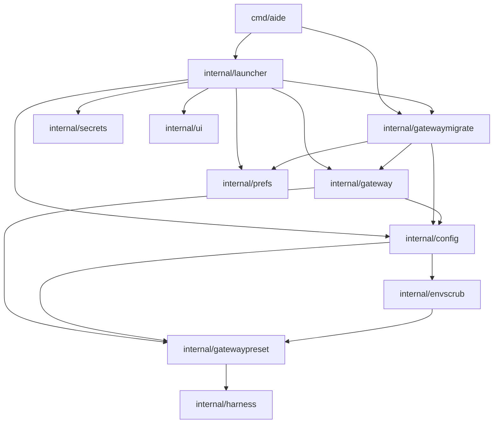

# Gateways for Every Harness

*   **Author:** Krishnaswamy Subramanian
*   **Status:** Approved 2026-11-13 (Full-mode review complete)
*   **Date:** 2026-11-12

--------------------------------------------------------------------------------

## Overview

`aide` launches coding-agent harnesses in a sandbox, one profile at a time
(the full list is in
[`internal/harness/harness.go`](../../internal/harness/harness.go)). Five
of them support configurable LLM endpoints and model catalogues: Claude Code
(`claude`), Pi (`pi`), Oh My Pi (`omp`), OpenCode (`opencode`), and Codex
(`codex`) (the harnesses with writers in
[`internal/gateway/writers.go`](../../internal/gateway/writers.go)). Today,
pointing one of those five harnesses at an API key for a hosted service
(OpenRouter, OpenCode Go, z.ai), a company gateway, a local model server, or
Claude on Bedrock requires navigating two overlapping concepts (`credentials:`
and `gateways:`), hand-editing YAML for built-in providers or cloud switches,
setting up `age` keys manually, and working around environment scrubbing that
strips provider keys from the user's shell.

This design unifies LLM endpoint routing for the five gateway-capable harnesses
into one concept: a **gateway**, a named entry in `gateways:` that serves an
explicit list of harnesses. `aide` stores the gateway's API key in its encrypted
`age` store, writes a provider entry referencing an `aide`-owned environment
variable (`AIDE_GW_<NAME>_KEY`, never the plaintext secret) into each marked
harness's isolated config file under an `aide-<name>` provider ID, and lets the
user choose, per harness, whether a launch uses a gateway or the harness's own
login. Adding any gateway—preset, custom URL, keyless loopback, or cloud
provider switch—takes one `aide gateway add` command with no hand-edited YAML.
Plain environment-variable secrets (`GITHUB_TOKEN`, multi-store secrets, and
env-only harnesses such as `gemini`, `aider`, `goose`, and `amp`) remain in
scoped `credentials:` bindings, while `default_credentials:` is removed.

The design also eliminates silent endpoint selection. Today,
`SynthesizeGatewayCredentials` makes every gateway a default in alphabetical
order, and harness writers persist `model` (OpenCode) and `model_provider`
(Codex) on disk and clear them only when the gateway is removed—silently
moving a user from a flat-rate subscription to pay-per-token billing. Under
this design, `aide` never selects a gateway automatically.

## The Problem

When a user exports an `OPENCODE_API_KEY` (for OpenCode Go) or
`OPENROUTER_API_KEY` in their shell and launches Pi under `aide`, `aide` scrubs
known provider keys from the environment so Pi never sees the variable. While
`aide gateway add` already guides custom-URL setup, built-in provider keys
without a custom URL, cloud provider switches, and first-time `age` identity
creation still require reading multiple docs, running `aide secrets` commands,
and editing profile YAML by hand.

Four structural defects underlie these workflows:

1.  **Two concepts for one LLM routing job.** Built-in provider keys
    (`credentials:` + `default_credentials:`) and custom endpoints (`gateways:`)
    use different schemas, different precedence rules, and mutual exclusion per
    harness in
    [`internal/config/gateway.go`](../../internal/config/gateway.go). Users
    cannot predict which route a launch will select.
2.  **Silent automatic selection.** `SynthesizeGatewayCredentials` marks every
    gateway as a default in sorted name order, and
    [`internal/gateway/writers.go`](../../internal/gateway/writers.go) writes
    OpenCode's `model` and Codex's `model_provider` to disk and clears them
    only when the gateway is removed, never when the choice changes. Adding a
    gateway intended for Pi can switch Claude Code or
    Codex from a subscription login to metered API billing.
3.  **Credentials sent to unintended endpoints.**
    *   Config validation in
        [`internal/config/gateway.go`](../../internal/config/gateway.go) accepts
        keyless gateways on non-loopback URLs, causing Claude Code to send the
        user's saved subscription OAuth token to that remote URL.
    *   Writing a gateway entry under the same name as a built-in provider (for
        example `anthropic` or `opencode` in Pi's `models.json` or OpenCode's
        `opencode.jsonc`) overrides `baseUrl` on the built-in provider while
        retaining its stored `/login` credential.
    *   Profile `env:` allows unrouted provider endpoints (`ANTHROPIC_BASE_URL`,
        `OPENAI_BASE_URL`) and provider switches (`CLAUDE_CODE_USE_BEDROCK`) to
        combine with gateway bindings or saved logins.
4.  **Manual `age` setup on first key.** Saving a first gateway key fails until
    the user separately creates an `age` identity and configures a store.

## Goals

*   **One command, no YAML for any LLM gateway.** `aide gateway add [<preset>|<name>]`
    creates an `age` identity on interactive terminals if none exists, stores
    the key encrypted, marks the selected harnesses, records explicit
    choices for [`slot` harnesses](#concepts), and syncs harness config files.
*   **One gateway concept with three kinds.**
    *   **Static key:** an upstream URL, wire-protocol `api`, and an encrypted
        key stored by `aide`.
    *   **Keyless loopback:** a URL restricted to `127.0.0.1`, `localhost`, or
        `::1` (such as Ollama or a local vLLM server), carrying per-harness
        non-credential placeholders so saved logins never leak.
    *   **Provider switch:** `bedrock` or `vertex` (no URL and no stored key),
        which sets Claude Code's cloud-mode, region, and project variables and
        activates the matching cloud capability (`aws` or `gcp`) for that launch
        only. Claude Code only in v1.
*   **Built-in presets without composition.** Common providers (`anthropic`,
    `openai`, `codex`, `openrouter`, `opencode-go`, `zai`, `ollama`, `bedrock`,
    `vertex`) ship in a Go table analogous to
    [`internal/capability/builtin.go`](../../internal/capability/builtin.go), so
    users supply only a key or cloud region/project. Any other endpoint works as
    a custom URL gateway without waiting for an `aide` release.
*   **No silent billing changes.** Billing moves from a harness login to a
    gateway only when the user explicitly chooses that gateway (`--gateway`,
    repo preference, profile `gateway_choice`, or interactive picker). `aide`
    never auto-picks, even when only one candidate gateway exists.
*   **Unattended launches stay predictable.** Adding a gateway records `"none"`
    on any marked slot harness whose choice was previously unset unless the user
    explicitly makes the new gateway the default, so existing scripts, IDE
    tasks, and CI jobs keep launching with the same auth.
*   **Always visible routing.** The launch banner, `aide which`,
    `aide status`, and `aide gateway list` state, for each gateway-capable
    harness, which gateway or harness login a launch uses, its URL, the secret
    store and key that hold the key, the environment variable that delivers it
    (`AIDE_GW_<NAME>_KEY`, `ANTHROPIC_AUTH_TOKEN`, ...), and why it was chosen
    (the [source](#concepts)). Values are never printed, and read-only commands
    do not decrypt (`aide which --resolve` is the one opt-in exception and never
    shows gateway keys). See [Gateway Visibility](#gateway-visibility).
*   **Clean separation from non-gateway secrets.** `default_credentials:` is
    removed; `credentials:` remains strictly for plain environment-variable
    secrets (`GITHUB_TOKEN`, secondary secret stores, and env-only harnesses
    `gemini`, `aider`, `goose`, `amp`).
*   **Self-healing migration without background hook breakage.** `config.Load`
    stays strictly read-only so latency-critical shell hooks (`aide prompt`,
    `aide statusline`, tab completion) and read-only Nix dotfiles never block or
    fail; `preferences.json` and harness files self-heal lazily; and writable
    YAML configs auto-upgrade on launch or mutating CLI commands with backups in
    `~/.local/state/aide/migrations/` (plus preview/apply via
    `aide config migrate`).
*   **Centralized endpoint resolution for the deferred credential proxy.**
    Upstream base URLs, wire-protocol metadata, and key variable names resolve
    through `gateway.Endpoint` so adopting the approved Unix-socket proxy in
    [`2026-08-03-credential-injecting-proxy-design.md`](../superpowers/specs/2026-08-03-credential-injecting-proxy-design.md)
    reuses one route table without rewriting shared on-disk harness files.

## Non-Goals

*   Managing harness logins (`/login`, OAuth tokens) or cloud credential chains
    (AWS profiles, `gcloud` ADC). `aide` only opens the matching capability when
    a provider switch is chosen.
*   Running or supervising local model servers.
*   Provider switches on harnesses other than Claude Code, Microsoft Foundry
    (`CLAUDE_CODE_USE_FOUNDRY`, deferred until upstream env contract is
    verified), or static-key cloud switches (`AWS_BEARER_TOKEN_BEDROCK`) in v1.
*   Preset inheritance or composition (`extends`, `combines`, `--without`). Two
    variants (for example two Bedrock regions) are two named gateways.
*   Path or git-remote matching rules on gateways; profile selection and
    per-repo preferences already cover directory and repository scoping.
*   Automatic gateway selection or preselected picker defaults.
*   Decrypting secrets or storing secret-derived hashes to render prompts or
    detect rotated shell keys (`aide gateway edit <name> --from-env` handles
    key rotation).
*   In-process MITM credential proxying in v1 (deferred to
    [`2026-08-03-credential-injecting-proxy-design.md`](../superpowers/specs/2026-08-03-credential-injecting-proxy-design.md)).
*   Forwarding a subscription login through a keyless gateway.
*   Deduplicating model lists when both a built-in harness provider and an
    `aide-<gw>` entry expose the same model ID.
*   Launch-time interactive `gateway add` wizards (`aide --gateway <preset>`
    auto-creation or interactive ambient-key save prompts) and pre-sandbox
    `claude auth status --json` subprocess probes in v1; launches print the
    exact `aide gateway add` command instead.
*   Backward compatibility of migrated YAML or v2 `preferences.json` with older
    `aide` binaries (downgrade restores the YAML and `preferences.json` backups
    from `~/.local/state/aide/migrations/`).

## Open Questions

None open. The upstream harness behaviour this design depends on was verified
on 2026-11-14 (story S1) against the installed binaries and a local mock
gateway that logged each request's path, auth headers and model:

*   **Codex (`codex-cli` 0.167.0):**
    *   `wire_api = "chat"` is no longer supported: Codex refuses to load the
        whole `config.toml` ("`wire_api = "chat"` is no longer supported ...
        set `wire_api = "responses"`"), so Codex does not start at all, with or
        without a gateway. Only `wire_api = "responses"` loads; requests go to
        `<base_url>/responses` with `Authorization: Bearer <env_key value>`.
        Codex therefore accepts only `openai-responses` gateways (see
        [Gateway Kinds](#gateway-kinds--wire-protocol-compatibility)). The
        current writer already emits `"responses"` and repairs `"chat"` entries
        (shipped in v3.6.2, `AIDE-mhn9`).
    *   Unselected `[model_providers.aide-*]` entries whose `env_key` variable is
        unset are ignored at startup. A selected entry with its variable unset
        fails with `Missing environment variable: AIDE_GW_<NAME>_KEY` and sends
        no request (fails closed).
    *   `-c model_provider=...` beats `--profile` in either order; repeated
        `-c` flags resolve last-wins, so a user `-c model_provider=...` after
        aide's prepended one wins, as intended.
    *   Codex profiles now live in `<codex-dir>/<name>.config.toml`; a
        `[profiles.<name>]` table in `config.toml` makes `--profile` fail. aide
        writes neither.
*   **Pi (`pi` 1.5.0):** `--provider aide-<gw> --model <id>` and
    `--model aide-<gw>/<id>` both reach the gateway even when the built-in
    `anthropic` provider has the same model ID and `ANTHROPIC_API_KEY` is set.
    A bare `--model <id>` fails as ambiguous. A keyless entry sends only its
    literal placeholder (`x-api-key: <placeholder>`), never a real key.
*   **Oh My Pi (`omp` 18.18.6):** `--model aide-<gw>/<id>` reaches the gateway;
    keyless (`auth: none`) sends no credential. A bare `--model <id>` silently
    used the built-in Anthropic provider with `ANTHROPIC_API_KEY`, so aide must
    always pass the `aide-<gw>/` prefix (it does).
*   **OpenCode (`opencode` v2.2.6):**
    *   A keyless entry with `settings.apiKey` omitted sends no credential under
        both `@ai-sdk/anthropic` and `@ai-sdk/openai-compatible`, even with saved
        `/connect` keys for the same provider ID in `auth.json` and
        `ANTHROPIC_API_KEY`/`OPENAI_API_KEY` exported. No placeholder is needed.
    *   `OPENCODE_CONFIG_CONTENT={"model":"aide-<gw>/<m>"}` appears as the last
        config source in `opencode debug config` and overrides `model` in
        `opencode.jsonc` for `opencode run`. The TUI loads config through the
        same server and was not driven separately.
    *   Without `--standalone`, the CLI connects to the machine's shared managed
        service (`opencode serve --service`) instead of starting its own server,
        confirming why aide keeps `--standalone`
        ([`harness.go:161-191`](../../internal/harness/harness.go#L161-L191)).

## Critical User Journeys (CUJs)

### CUJ 1: Add an OpenCode Go key for Pi on a fresh setup

*   **Given**: `aide` is installed, the user has profile `work` and an OpenCode
    Go API key, and has never created an `age` key or gateway.
*   **When**: the user runs `aide gateway add opencode-go` on a terminal, pastes
    the key, accepts the preset's compatible harness selection (`pi`), picks or
    skips a default model, and runs `aide --agent pi` in a repo matching `work`.
*   **Then**: `aide` creates a default `age` identity in the OS config directory
    and prints its path, encrypts the key in `work`'s secret store, writes
    `aide-opencode-go` into `work`'s isolated Pi `models.json` referencing
    `$AIDE_GW_OPENCODE_GO_KEY`, leaves Pi's startup default unchanged unless
    chosen, and leaves every unmarked harness untouched.

### CUJ 2: Add a company gateway for Claude Code without breaking CI

*   **Given**: the user has a Claude subscription login and launches Claude Code
    both interactively and from non-TTY CI scripts under profile `work`.
*   **When**: the user runs `aide gateway add corp --url https://llm.corp/v1`,
    chooses `anthropic-messages`, marks `claude` and `pi`, and answers `No` to
    `"Make corp the default for claude in profile work? [y/N]"`.
*   **Then**: `gateway_choice.claude` is saved as `"none"`; subsequent TTY and
    non-TTY Claude launches continue using the Claude login with zero billing
    change; `aide --gateway corp` uses `corp` for a single launch without
    overwriting `work`'s shared Claude model cache; and
    `aide gateway use corp --harness claude` switches the profile default when
    desired.

### CUJ 3: Interactive launch picker when a slot harness choice is unset

*   **Given**: profile `work` has two gateways marked for `claude` (`corp` and
    `openrouter`) and `gateway_choice.claude` is unset (`""`, for example after
    hand-editing `profiles/work.yaml`), and stdin is a terminal.
*   **When**: the user runs `aide`.
*   **Then**: `aide` renders a picker listing `corp`, `openrouter` (with URL and
    store/key name), and `none (use claude's own login)`, with nothing
    preselected and no secrets decrypted; after selection, `aide` asks whether
    to apply the choice `"Just this once"`, `"Always in this repo"` (when git
    `origin` exists), or `"Always in profile work"` (falling back to `"Just this
    once"` with a notice if the config directory is read-only).

### CUJ 4: Unattended launch when a slot harness choice is unset

*   **Given**: the same unset `gateway_choice.claude` state as CUJ 3, invoked
    when stdin is not a terminal (`aide -p "summarize"` in CI or a script).
*   **When**: `aide` resolves the gateway choice for `claude`.
*   **Then**: `aide` exits with code `78` before starting Claude, printing the
    candidate gateway names and the exact commands to choose one:
    `aide gateway use <name|none> --harness claude` or `--gateway <name|none>`.

### CUJ 5: Claude on AWS Bedrock for a single launch

*   **Given**: the user has AWS credentials configured on their machine.
*   **When**: the user runs
    `aide gateway add bedrock --region us-east-1 --harnesses claude` (leaving
    `gateway_choice.claude` as `"none"`), and then launches
    `aide --gateway bedrock`.
*   **Then**: `aide` warns during `gateway add` that selecting `bedrock` grants
    the full `aws` capability (`~/.aws` and `AWS_*` variables), and on the
    `--gateway bedrock` launch sets `CLAUDE_CODE_USE_BEDROCK=1` and
    `AWS_REGION=us-east-1` and opens the `aws` capability for that process only.

### CUJ 6: Seamless upgrade from an existing configuration

*   **Given**: an existing split or monolithic `config.yaml` with legacy
    `gateways:`, built-in `credentials:`, `default_credentials:`, and a v1
    `preferences.json`, plus a Starship shell prompt running `aide prompt`.
*   **When**: the user upgrades `aide`; Starship runs `aide prompt`, and the
    user then launches `aide`.
*   **Then**: `aide prompt` translates the legacy config in memory in under
    100ms without touching disk; on `aide` launch, `aide` backs up YAML files to
    `~/.local/state/aide/migrations/<UTC-ts>/`, rewrites `profiles/*.yaml` into
    `gateways:` + explicit `gateway_choice:` (preserving plain non-gateway
    `credentials:` such as `GITHUB_TOKEN`), reconciles harness files to
    `aide-<gw>` without default `model`/`model_provider` pins, prints a one-time
    migration summary (highlighting any choices inherited from the old sorted
    rule), and launches the exact same endpoint as before. On read-only Nix
    dotfiles (`EROFS`), `aide` runs from the in-memory translation and prints a
    one-line hint to inspect `aide config migrate`.

### CUJ 7: Know which gateway and key a launch will use

*   **Given**: profile `work` marks `corp` (`model: claude-sonnet-4-5`) and
    `openrouter` for `claude`; marks `opencode-go`, `corp`, and `ollama` for
    `pi` and `opencode`; has a repo preference `claude: corp`; and sets
    `gateway_choice.pi: opencode-go`.
*   **When**: the user runs `aide which`, then `aide --agent opencode
    --gateway corp`.
*   **Then**: `aide which` prints one line per gateway-capable harness with the
    choice, its source, URL, `store/key`, and delivering variable, without
    decrypting anything; the OpenCode launch banner shows `corp` as the
    startup entry with source `--gateway`, `work/corp → AIDE_GW_CORP_KEY`, and
    the other `aide-*` entries available in `/model`; OpenCode starts on
    `aide-corp/claude-sonnet-4-5` (verified on OpenCode v2.2.6, see
    [Open Questions](#open-questions)), and aide writes no top-level `model` into
    `opencode.jsonc`.

## Changes for Existing Users

Upgrading is automatic (CUJ 6), but these behaviours change:

*   **Config shape:** `default_credentials:` is removed and `credentials:` is
    limited to plain non-LLM variables. Existing `default_credentials:` and
    LLM `credentials:` entries are migrated to `gateways:` and
    `gateway_choice:` on the first launch or config write, with backups.
*   **Flags:** `--gateway` takes one value; `--no-credentials` is removed;
    `--auth login`, `--token-env`, and `--token-stdin` still work as deprecated
    aliases with a notice. `aide gateway rename` is not added; renaming uses
    `aide gateway edit <name> --name <new>`.
*   **Harness entries:** gateway entries are renamed `<gw>` → `aide-<gw>`.
    Models remembered in a harness's own state (Pi, omp, or OpenCode
    last-used model, or a `/model` pick) that name `<gw>/<model>` must be
    picked again in `/model`. Startup pins that aide wrote into config files
    carry over (next bullet).
*   **Startup pins:** aide stops writing OpenCode's top-level `model` and
    Codex's `model_provider`. A value equal to `<gw>/<model>` (OpenCode) or
    `<gw>` or `aide-<gw>` (Codex) for a gateway in the profile is treated as aide-written:
    migration turns it into that harness's `gateway_choice` (and backfills the
    gateway's `model`) before removing it, so the startup endpoint does not
    change; a Codex pin becomes the choice of the gateway that now serves Codex
    for that legacy gateway, or is dropped with the `aide gateway add` notice
    when Codex no longer has one. Any other value is user-set and kept.
*   **Exit code 78** (`EX_CONFIG`, "configuration error") appears when a
    Claude or Codex choice is unset while gateways are still marked for it, in a
    script. Migration and `gateway add` always record a choice; it becomes unset
    after `aide gateway use --unset`, after `gateway remove` or unmarking the
    chosen gateway, when a stored choice goes stale, after a hand edit, or when
    a synced config arrives without `gateway_choice:`. The stderr message names
    the gateways and the exact command to choose one.
*   **`aide status`** no longer needs your `age` key to show the secret count;
    it reads key names from the store without decrypting.
*   **Codex gateways:** a gateway used with Codex must serve the OpenAI
    Responses API, because Codex 0.167 no longer loads `wire_api = "chat"`.
    Migration keeps Codex on a legacy gateway only where Codex used it (listed
    in `harnesses:` or chosen for Codex); see
    [Legacy gateways and Codex](#self-healing-migration-architecture). A
    gateway that reached Codex only through the omitted-`harnesses:` default
    loses that mark, and the migration summary prints the `aide gateway add`
    command to add a Codex gateway. A split-off `<gw>-codex` is an ordinary
    gateway: `gateway remove <gw>` leaves it in place.
*   **Remote keyless gateways** are rejected; keyless URLs must be loopback.
*   **Downgrade:** older `aide` binaries cannot read migrated YAML or v2
    `preferences.json`; restore both from `~/.local/state/aide/migrations/`.

## Technical Plan (Architecture)

### Concepts

Project terms used below: a **profile** is a named set of settings selected
per directory or repository; a **secret store** is an `age`-encrypted sops file
holding named keys; a **capability** opens sandbox access (paths, variables)
for a launch, and `never_allow_env` lists variables a launch must never see;
named profiles get **isolated harness directories** (their own `~/.claude`-style
folders), while the built-in `default` profile uses the native ones;
`/login` (Claude Code, Pi) and `/connect` (OpenCode) are the harnesses' own
saved logins; `aide which --resolve` is an existing debugging flag that
decrypts the profile's store to list its keys.

*   **Gateway:** a named entry in a profile's `gateways:` map. Each entry has a
    derived kind (`static-key`, `keyless-loopback`, or `provider-switch`), an
    optional `preset`, kind-specific endpoint or cloud fields, a required
    non-empty `harnesses:` list (subset of `claude`, `pi`, `omp`, `opencode`,
    `codex`), and an optional `model`.
*   **Marked for `H` (`Candidate`):** gateway `G` lists harness `H` in
    `G.harnesses`. Marks are always explicit after migration and must be
    compatible with both the preset (when set) and the gateway's wire protocol
    (`api`).
*   **Reach:** how many gateways a harness can access in a single session,
    defined on `harness.Descriptor`:
    *   **`slot` harnesses** (`claude`, `codex`): use at most **one** gateway
        per session; only the chosen gateway's secret is decrypted and injected.
    *   **`multi` harnesses** (`pi`, `omp`, `opencode`): materialize **every**
        marked gateway as an `aide-<gw>` provider entry and inject each marked
        gateway's `AIDE_GW_<NAME>_KEY` so the user can switch models mid-session;
        an optional choice pre-selects the startup provider/model on `pi` and
        `omp` (startup flags) and on `opencode` (per-launch
        `OPENCODE_CONFIG_CONTENT`).
*   **Choice (`map[string]string`):** per-harness string stored identically in
    profile YAML (`gateway_choice`) and repo preferences (`preferences.json` v2
    `gateway`):
    *   `""` (or key omitted): **unset** — no decision recorded.
    *   `"none"`: **harness login / native default** — do not activate a gateway
        for `slot` harnesses, and apply no startup selection (flags or
        `OPENCODE_CONFIG_CONTENT`) on `multi` harnesses.
    *   `"<gw>"`: **named gateway** — must exist in `gateways:` and be marked
        for `H`.
*   **Source:** why a harness has its choice. One value set is used in JSON,
    and human output maps it to a label: `flag` → `--gateway`; `repo` →
    `repo preference`; `profile` → `profile <p>`; `picker` → `picked now`
    (plus `, saved to repo` or `, saved to profile <p>` when remembered);
    `no-candidates` → `no gateways marked`; `unset` → `unset`.
*   **Terminal (`TTY`) vs Unattended (`non-TTY`):** interactive prompts and
    pickers require stdin on a terminal; scripts, CI, IDE tasks, and read-only
    inspection commands (`which`, `status`, `prompt`, `statusline`,
    `sandbox show`, `sandbox test`) never open interactive prompts.

### Package Layering & Ownership

To preserve a strict, cycle-free Go dependency graph, pure preset data and
cross-subsystem migration sit in dedicated packages:



*   `internal/gatewaypreset` (new leaf package, importing only standard library
    and `internal/harness`): owns `Preset`, `Kind`, `SwitchSpec`, `Lookup`, and
    `All`. Imported without cycles by `internal/envscrub`, `internal/config`,
    `internal/gateway`, `internal/launcher`, and `cmd/aide`.
*   `internal/gatewaymigrate` (new coordinator package above `config`, `prefs`,
    and `gateway`): owns `PlanGatewayMigration` and `Apply` for config
    migration and `aide config migrate`.
*   [`internal/config`](../../internal/config): owns `GatewayConfig`,
    `GatewayChoice`, legacy in-memory YAML translation during `config.Load`,
    scoped non-gateway `CredentialBinding` validation, and `WriteConfigTo`.
*   [`internal/gateway`](../../internal/gateway): owns `Endpoint`, `FetchModels`,
    per-harness config writers, `Prune`, and idempotent legacy entry cleanup.

### Gateway Kinds & Wire-Protocol Compatibility

| Kind | Required / Optional Fields | Launch & Sync Behaviour | Allowed Harnesses (v1) |
| --- | --- | --- | --- |
| `static-key` | `preset` or (`url` + `api`); `key` (optional `store`); `harnesses`; optional `model` | Decrypts secret into `AIDE_GW_<NAME>_KEY` (or Claude's auth env var); syncs `aide-<gw>` into marked harness files | `claude` (`anthropic-messages` only), `codex` (`openai-responses` only; Codex 0.167 rejects `wire_api = "chat"`), `pi`, `omp`, `opencode` |
| `keyless-loopback` | `url` on `127.0.0.1`, `localhost`, or `::1` (or `ollama` preset); `api`; `no_auth: true` (when no preset); `harnesses`; optional `model` | Never decrypts a store; sets per-harness non-login placeholder (`ANTHROPIC_AUTH_TOKEN="aide-keyless"` + `ANTHROPIC_API_KEY=""` on Claude); syncs `aide-<gw>` | Same wire-protocol matrix as `static-key` |
| `provider-switch` | `preset: bedrock` (`region`) or `preset: vertex` (`region` + `project`); `harnesses: [claude]` | Skips `/v1/models` fetch, cache, and file writers; injects switch + region/project env vars after scrubbing and opens `aws` or `gcp` capability when chosen | `claude` only |

*   **Remote keyless safety:** Non-loopback keyless gateways are rejected by
    `gateway add`, `gateway edit`, `gateway sync`, and `Launcher.Launch`, while
    emitting a warning during `config.Load` rather than failing `Load`—ensuring
    users can always remediate a hand-edited config via `aide gateway remove` or
    `aide gateway edit` without editing YAML.
*   **Collision-free key variables:** Each gateway's injected variable is
    `AIDE_GW_<UPPER_SNAKE_NAME>_KEY` (`-` → `_`, uppercased). Reserved gateway
    names (`none` and `aide-*`, case-insensitive) and two gateways in the same
    profile whose normalized `AIDE_GW_<NAME>_KEY` or lowercased `aide-<name>`
    collide (for example `open-router` and `open_router`) are rejected by
    `ValidateGateways`.
*   **Scoped `credentials:` boundary:** `default_credentials:` is removed.
    `credentials:` remains valid strictly for plain environment-variable secret
    bindings (`env: [VAR]`, optional `store:`, `harnesses:`, `capabilities:`)
    serving non-LLM tools (`GITHUB_TOKEN`, `SENTRY_DSN`) or env-only harnesses
    outside the five gateway harnesses (`gemini`, `aider`, `goose`, `amp`).
    Setting provider endpoint URLs or provider switches inside `credentials:` or
    profile `env:` (and via `aide env set --global`) is rejected with a hint
    pointing to `aide gateway add`.

### Configuration Shape

```yaml
# profiles/work.yaml
secret: work
gateways:
  opencode-go:
    preset: opencode-go
    key: opencode-go
    harnesses: [pi, omp, opencode]
    model: glm-4.6
  corp:
    url: https://llm.corp/v1
    api: anthropic-messages
    key: corp
    harnesses: [claude, pi]
    model: claude-sonnet-4-5
  local-ollama:
    preset: ollama
    harnesses: [pi, omp]
  bedrock:
    preset: bedrock
    region: us-east-1
    harnesses: [claude]
  vertex:
    preset: vertex
    region: us-east5
    project: acme-ml-prod
    harnesses: [claude]

gateway_choice:
  claude: none
  codex: none
  pi: opencode-go

# Retained strictly for non-gateway env secrets and env-only harnesses (e.g. gemini):
credentials:
  github:
    env: [GITHUB_TOKEN]
    harnesses: [claude, pi, codex]
  gemini-cli:
    env: [GEMINI_API_KEY]
    harnesses: [gemini]
```

Per-repository choices live in `~/.local/state/aide/preferences.json` (version
`2`), using the identical `map[string]string` representation (`""` unset,
`"none"`, `"<gw>"`):

```json
{
  "version": 2,
  "profiles": {
    "work": {
      "github.com/acme/api": {
        "harness": "claude",
        "gateway": { "claude": "corp", "codex": "none" }
      }
    }
  }
}
```

### Built-in Presets (`1 Preset = 1 Wire Protocol + 1 Exact BaseURL`)

Each preset in `internal/gatewaypreset` specifies one wire protocol and one
exact upstream base URL (no blind `/v1` stripping or appending when a preset or
explicit `url` already ends in its canonical path):

| Preset | Kind | Exact Base URL | `API` | `Header` | Compatible `Harnesses` | `ShellVars` (unioned into `envscrub`) |
| --- | --- | --- | --- | --- | --- | --- |
| `anthropic` | `static-key` | `https://api.anthropic.com` | `anthropic-messages` | `x-api-key` | `claude`, `pi`, `omp`, `opencode` | `ANTHROPIC_API_KEY` |
| `openai` | `static-key` | `https://api.openai.com/v1` | `openai-responses` | `bearer` | `pi`, `omp`, `opencode`, `codex` | `OPENAI_API_KEY` |
| `codex` | `static-key` | `https://api.openai.com/v1` | `openai-responses` | `bearer` | `codex` | `CODEX_API_KEY` |
| `openrouter` | `static-key` | `https://openrouter.ai/api/v1` | `openai-chat` | `bearer` | `pi`, `omp`, `opencode` | `OPENROUTER_API_KEY` |
| `openrouter-anthropic` | `static-key` | `https://openrouter.ai/api` | `anthropic-messages` | `bearer` | `claude`, `pi`, `omp`, `opencode` | `OPENROUTER_API_KEY` |
| `opencode-go` | `static-key` | `https://opencode.ai/zen/v1` | `openai-chat` | `bearer` | `pi`, `omp`, `opencode` | `OPENCODE_API_KEY` |
| `zai` | `static-key` | `https://api.z.ai/api/paas/v4` | `openai-chat` | `bearer` | `pi`, `omp`, `opencode` | `ZAI_API_KEY` |
| `ollama` | `keyless-loopback` | `http://127.0.0.1:11434/v1` | `openai-chat` | `bearer` | `pi`, `omp`, `opencode` | — |
| `bedrock` | `provider-switch` | — | — | — | `claude` | — (`CLAUDE_CODE_USE_BEDROCK=1`, `AWS_REGION`, cap `aws`) |
| `vertex` | `provider-switch` | — | — | — | `claude` | — (`CLAUDE_CODE_USE_VERTEX=1`, `CLOUD_ML_REGION`, `ANTHROPIC_VERTEX_PROJECT_ID`, cap `gcp`) |

Codex is listed only on `openai-responses` presets because current Codex
accepts no other wire protocol. A gateway that also serves the Responses API
(for example a self-hosted proxy) reaches Codex as a separate custom gateway
with `--api openai-responses`.

[`internal/envscrub/envscrub.go`](../../internal/envscrub/envscrub.go) retains
its master lists of 119 `providerSecretNames` and 29 `providerSelectorNames`,
unions every preset's `ShellVars` into `providerSecretNames` (enforced by unit
test), and scrubs any inherited `AIDE_GW_*` variable from the parent shell.

### Endpoint Resolver & Per-Harness Writer Serialization

Every component that needs a gateway's URL, wire format, auth header, or key
reference calls `gateway.Endpoint(gwName string, gw config.GatewayConfig,
harness string) EndpointSpec`:

| Target | `API` Mapping | Auth / Header Mapping (Keyed) | Keyless Loopback Representation |
| --- | --- | --- | --- |
| `FetchModels` ([`fetch.go`](../../internal/gateway/fetch.go)) | `<BaseURL>/models` (appending `/v1/models` only when URL path has no version segment) | `Header == "x-api-key"` → `x-api-key: <tok>` + `anthropic-version: 2023-06-01`; `"bearer"` → `Authorization: Bearer <tok>` | No auth header |
| `claude` | `anthropic-messages` only | Env: `ANTHROPIC_BASE_URL=<BaseURL>`, plus `ANTHROPIC_API_KEY=<tok>` (`x-api-key`) or `ANTHROPIC_AUTH_TOKEN=<tok>` (`bearer`); `<claude-dir>/cache/gateway-models.json` updated **only** when `<gw>` equals saved `gateway_choice.claude` | Env: `ANTHROPIC_BASE_URL=<BaseURL>`, `ANTHROPIC_AUTH_TOKEN="aide-keyless"`, `ANTHROPIC_API_KEY=""` |
| `pi` (`models.json`) | `anthropic-messages` → `"anthropic-messages"`; `openai-chat` → `"openai-completions"`; `openai-responses` → `"openai-responses"` | `apiKey: "$AIDE_GW_<NAME>_KEY"`, `authHeader: true` (`headers: {"x-api-key": "$AIDE_GW_<NAME>_KEY"}` when `x-api-key`) | `apiKey: "aide-no-auth"` (literal passing `isLiteralPiPlaceholder`), `authHeader: false` |
| `omp` (`models.yml`) | Same `api` strings as `pi` | `apiKey: "AIDE_GW_<NAME>_KEY"`, `authHeader: true` | `auth: "none"`, `apiKey: ""`, `authHeader: false` |
| `opencode` (`opencode.jsonc`, `providers.aide-<gw>`; the legacy `provider.<n>.options` shape is deleted as today) | `anthropic-messages` → `package: "@ai-sdk/anthropic"` (today's only package); `openai-*` → `package: "@ai-sdk/openai-compatible"` (new) | `env: ["AIDE_GW_<NAME>_KEY"]`, `settings.apiKey: "{env:AIDE_GW_<NAME>_KEY}"`, `settings.baseURL` from `Endpoint` (replacing today's unconditional `/v1` append), entry-level `headers` (`x-api-key` vs `Authorization: Bearer`) | `settings.apiKey` omitted, no `env`, no `Authorization` header, as today ([`writers.go:847`](../../internal/gateway/writers.go#L847)); verified to send no credential and never fall back to `/connect` |
| `codex` (`config.toml`) | `openai-responses` → `wire_api = "responses"` (the only value Codex 0.167 loads; `openai-chat` gateways are never written for `codex`) | `env_key = "AIDE_GW_<NAME>_KEY"`; `aide` never writes top-level `model_provider` | Omit `env_key` |

### Launch Selection & Delivery

| Precedence Step | `slot` Harnesses (`claude`, `codex`) | `multi` Harnesses (`pi`, `omp`, `opencode`) |
| --- | --- | --- |
| **1. CLI `--gateway <name\|none>`** (`--auth login` is deprecated alias for `--gateway none`) | Use `<name>` or `none`; unknown `<name>` fails fast (with `aide gateway add <name>` hint if `<name>` is a preset) | Pre-select `<name>` via startup flags (`pi`, `omp`) or `OPENCODE_CONFIG_CONTENT` (`opencode`) (`none` → nothing preselected); unknown `<name>` fails fast |
| **2. Repo preference (`preferences.json` v2)** | Use `<name>` or `none` if valid | Pre-select `<name>` if valid (`none` → no startup selection) |
| **3. Profile `gateway_choice`** | Use `<name>` or `none` if valid | Pre-select `<name>` if valid (`none` → no startup selection) |
| **4. Zero candidates marked for `H`** | Use harness's own login (`none`) | Use harness default |
| **5. Candidates exist, choice unset — on TTY** | Open interactive picker (candidates + `none`, nothing preselected, zero secrets decrypted; remember `"Just this once"`, `"Always in this repo"`, or `"Always in profile <p>"`) | Use harness default (all marked `aide-<gw>` entries available in `/model`) |
| **6. Candidates exist, choice unset — non-TTY** | Exit `78` naming candidates and `aide gateway use <name\|none> --harness <h>` / `--gateway <name\|none>` | Use harness default |

*   **Stale choices:** A stored choice naming a removed or unmarked gateway is
    treated as unset (`""`) with a stderr notice naming the stale value.
*   **Passive non-launch callers:** `aide which`, `aide status`, `aide prompt`,
    `aide statusline`, `aide sandbox show`, `aide sandbox test`, and
    `project set` validation resolve choices in passive preview mode—never
    opening a picker and never exiting `78`. For an unset choice, `which` and
    `status` print `unset (would prompt on a terminal, exit 78 in scripts)` on
    `slot` harnesses and `unset (starts on <harness> default)` on `multi`
    harnesses.
*   **Optional `model` & choice delivery:** `GatewayConfig.Model` is
    optional (`omitempty`). When a gateway is chosen:
    *   `codex`: prepends `-c model_provider=aide-<gw>`, plus `-c model=<model>`
        when `model != ""`.
    *   `pi`: prepends `--provider aide-<gw> --model <model>` when `model != ""`
        (if `model == ""`, omits startup flags and prints a hint to set
        `aide gateway edit <gw> --model <id>` or switch via `/model`).
    *   `omp`: prepends `--model aide-<gw>/<model>` when `model != ""` (if
        `model == ""`, no flags and the same hint as `pi`).
    *   `opencode`: sets `OPENCODE_CONFIG_CONTENT={"model":"aide-<gw>/<model>"}`
        on the launched process when `model != ""` (if `model == ""`, the same
        hint as `pi`). If the launch environment (shell or profile `env:`)
        already has `OPENCODE_CONFIG_CONTENT`: an explicit `--gateway` replaces
        only its top-level `model` key, with a notice; a repo or profile choice
        yields to it, with a notice; invalid JSON or a non-object value means
        no preselection and a warning. This runs after `never_allow_env`
        filtering; if the variable is blocked, aide skips preselection and
        warns. aide writes no top-level `model` into `opencode.jsonc`, so
        `"Just this once"` and concurrent sessions are safe.
    *   `codex`: unchosen `[model_providers.aide-*]` entries stay in
        `config.toml` but are inert because Codex uses only the selected
        `model_provider` (verified on Codex 0.167; see
        [Open Questions](#open-questions)).
    *   A new `harness.ApplyChoice(args, entry, model) (args, env, notice)`
        delivers the choice. It runs before the existing
        [`Descriptor.ApplyLaunchArgs`](../../internal/harness/harness.go#L161-L191),
        which keeps its signature and its OpenCode `--standalone` placement.
        It skips delivery for management subcommands listed on each descriptor
        (`login`, `logout`, `auth`, `mcp`, `completion`, `help`, `--help`,
        `--version`). OpenCode receives `ChoiceEnv` only on a root launch (no
        subcommand) and `run`; any other subcommand gets nothing and the banner
        notes `startup: not applied (<subcommand>)`. It sets no OpenCode
        variable when the user passes `--server` or runs `attach` (the banner
        then warns `server-controlled: gateway choice not applied`), and yields
        to user-supplied `--model`, `-m`,
        `--provider`, or `-c model=` / `-c model_provider=` flags with a
        one-line stderr notice.
*   **Harness folder isolation:** Named profiles automatically receive isolated
    harness directories via
    [`internal/config/profile_dirs.go`](../../internal/config/profile_dirs.go#L220).
    Harness writers receive `profileName` and refuse to write into a shared
    native directory for any named profile; if a named profile lacks directory
    isolation, migration and `gateway add` preserve any custom non-global paths
    from `env:` in `config_dirs` and set `config_dir_name` to the profile name.
    The built-in `default` profile (locked to native folders per
    [`builtin-default-profile.md`](./builtin-default-profile.md)) writes
    `aide-<gw>` entries into native harness files with an explicit notice at
    `gateway add`.
*   **Store & fetch resilience:** On `multi` harnesses, if a secondary marked
    gateway's secret store fails to open, `aide` warns and withholds/prunes that
    `aide-<gw>` entry for the session so no broken `{env:...}` or literal env
    name is left behind; if `/v1/models` fails on cold cache, `aide` synthesizes
    a single-model fallback catalogue when `gw.Model != ""` or skips with a
    warning. Only a chosen gateway's store failure aborts launch. Withheld
    gateways appear as launch-banner warnings only; read-only commands cannot
    detect them without decrypting.
*   **Scrubbed shell keys at launch:** When `envscrub` strips a shell variable
    matching a preset's `ShellVars` that is not yet configured on the profile,
    `aide` prints a non-blocking one-line hint:
    `aide gateway add <preset> --from-env` (replacing `bindAmbientKeysToProfile`
    in [`internal/launcher/ambient_keys.go`](../../internal/launcher/ambient_keys.go)).

### CLI Surface

| Command | Behaviour |
| --- | --- |
| `aide gateway add [<preset>\|<name>]` | Interactive on TTY, flag-driven off TTY (`--url`, `--api`, `--no-auth`, `--harnesses`, `--model`, `--region`, `--project`, `--secret-store`, `--key`, `--refresh-ttl`, `--default-for <h>`, `--from-env[=VAR]` via `NoOptDefVal`, `--key-stdin`; `--token-env` and `--token-stdin` retained as deprecated aliases). Presets pre-suggest compatible harnesses; custom gateways require explicit selection. Fetches `/v1/models` when URL-backed, falling back to manual/empty model if `/v1/models` is unavailable. **Slot-default invariant (TTY & non-TTY):** for each *marked* slot harness `H`, stores `<name>` if explicitly chosen as default (`Yes` on TTY or `--default-for H`), else stores `"none"` **only if `gateway_choice[H]` was unset** (never modifying unmarked harnesses or overwriting existing choices). |
| `aide gateway use [<name\|none>] --harness <h> [--repo] [--unset]` | Sets `gateway_choice[h]` in profile YAML (or `preferences.json` with `--repo`). `--unset` deletes the entry. Omitting `<name>` on TTY opens the picker without preselection. |
| `aide gateway edit <name> [--name <new>]` | Updates fields, marks, secret (rolling back via `secrets.Manager.ReplaceKey` on config-save failure), or gateway name (no separate `rename` command). Renaming updates `gateway_choice`, `preferences.json` v2 `gateway` entries, model cache files, and `aide-<old>` → `aide-<new>` harness entries; unmarking `H` clears stale choices for `H` with a notice. |
| `aide gateway remove <name>` | Removes gateway, prunes `aide-<name>` from harness files, and clears matching profile/repo choices with a notice. |
| `aide gateway sync [<name>]` | Re-fetches catalogues via `Endpoint` and reconciles harness files (`provider-switch` entries are clean no-ops). |
| `aide gateway list` / `aide which` / `aide status` | Show gateways, per-harness choices, and their [source](#concepts) per [Gateway Visibility](#gateway-visibility); `gateway list` adds a `chosen for` column; additive JSON keys preserve existing output contracts. |
| `aide project set --gateway <name\|none> --harness <h>` / `aide project clear --gateway [--harness <h>]` | Reads/writes/clears per-harness repo gateway preferences (`--no-credentials` removed; `--auth login` deprecated alias for `--gateway none`). |
| `aide config migrate [--write]` | Extends existing [`configMigrateCmd`](../../cmd/aide/profile_migrate.go#L60-L90): previews monolithic split + gateway YAML migration by default; `--write` backs up YAML files to `~/.local/state/aide/migrations/<UTC-ts>/` and writes converted `profiles/*.yaml`. |

First-time `age` identity creation reuses
[`secrets.ResolveRecipient`](../../internal/secrets/age.go#L364) (already used
by `aide secrets create`, `aide init`, and `ambient_keys.go`), which discovers
recipients and, on a terminal, offers to generate a key. This design adds only:
a `--generate-age-key` path for non-terminals, an explicit error when
`SOPS_AGE_KEY` or `SOPS_AGE_KEY_FILE` points at a malformed or unreadable
source, and an actionable `--age-key` error when `SourceYubiKey` is detected
without recipients.

### Gateway Visibility

Users must be able to tell, before and during a launch, which endpoint is billed
and which stored key is sent.

**Rules**

1.  One answer per gateway-capable harness: the choice (`<gw>`, `none`, or
    `unset`), its [source](#concepts), the URL or switch summary, the key
    location as `store/key`, and the variable that delivers it. Keyless
    gateways say `keyless (placeholder, login not sent)`; switches say
    `cloud credentials (aws|gcp capability)`.
2.  Values are never printed. `which`, `status`, and `gateway list` read only
    config, preferences, model caches, and harness files. `aide status` stops
    decrypting the store to count keys
    ([`status.go:771-782`](../../cmd/aide/status.go#L771-L782)); a new
    `secrets.KeyNames(path)` reads the top-level keys of a YAML or JSON sops
    store without decrypting (excluding the `sops` metadata key) and reports
    "unknown" for other formats. `aide which
    --resolve` stays an explicit opt-in exception and never prints gateway
    keys.
3.  The launch banner is rendered after the picker, so it always shows the
    final choice.
4.  Multi-harness launches show the startup entry and every other `aide-<gw>`
    entry present in `/model`, each with its key location.
5.  Non-gateway `credentials:` keep their own `Keys` line so plain variables
    such as `GITHUB_TOKEN` are not mistaken for LLM routing.
6.  Stale choices and a fallback to the harness default are warnings in the
    banner, `which`, and `status`. Withheld gateways (store failed to open),
    OpenCode `server-controlled` launches, and `startup: not applied` are known
    only at launch, so they are launch-banner warnings only.

**Launch banner** (`boxed` template; `clean` drops the frame; `compact` has no
`Auth` line today and gains one `Gateway` line):

```text
┌─ aide ───────────────────────────────────────
│ 🎯 Profile   work
│ 🤖 Agent     claude (/opt/homebrew/bin/claude)
│ ⇄  Gateway   corp → https://llm.corp/v1                 (repo preference)
│               key: work/corp → ANTHROPIC_AUTH_TOKEN
│               models: 42 cached (3h ago)
│               other: openrouter · none (claude login) — aide --gateway <name>
│ 🔑 Keys      github (GITHUB_TOKEN)
```

Today's banner shows the same facts on one `🔑 Auth` line
(`corp → https://llm.corp/v1 (ANTHROPIC_BASE_URL, ANTHROPIC_AUTH_TOKEN)`) plus
dim detail lines; the `Gateway` / `Gateways` lines replace it.

```text
│ ⇄  Gateway   none — claude login                         (profile work)
│               available: corp, openrouter — aide --gateway <name>
```

```text
│ ⇄  Gateways  opencode-go (startup) → https://opencode.ai/zen/v1   (profile work)
│               key: work/opencode-go → AIDE_GW_OPENCODE_GO_KEY
│               also in /model: corp (work/corp → AIDE_GW_CORP_KEY)
│                               ollama (keyless, 127.0.0.1:11434)
│               file: ~/.config/aide/harness/work/opencode/opencode.jsonc (in sync)
```

```text
│ ⇄  Gateway   bedrock (AWS us-east-1)                     (--gateway)
│               cloud credentials: ~/.aws via aws capability, this launch only
```

**`aide which` / `aide status`** print the active harness block above, then a
per-harness summary (scenario: CUJ 7):

```text
Gateways (profile work)
  claude    corp          repo preference   work/corp → ANTHROPIC_AUTH_TOKEN
  codex     —             no gateways marked
  pi        opencode-go   profile work      work/opencode-go → AIDE_GW_OPENCODE_GO_KEY  +2 in /model
  opencode  unset         unset             starts on opencode default · 3 in /model
  omp       —             no gateways marked
```

**`aide gateway list`** keeps today's rows and adds a `chosen for` column
listing the harnesses whose resolved choice is that gateway, with the source.

**Data model.** No parallel type is added. `ui.CredentialInfo` already carries
URL, store, key, model cache, and target file
([`types.go:177-188`](../../internal/ui/types.go#L177-L188)); it gains
`Harness`, `Choice`, `Source`, `Kind`, `KeyEnv`, `Startup`, and `Warnings`, and
`ui.GatewayOption` gains `Store`, `Key`, and `KeyEnv`. `ResolveChoice` returns
`Choice{Value, Source}`. One passive helper, `BuildGatewayViews(cfg, rc,
choices, home)` in `internal/launcher/gateway.go`, replaces
`EnrichBannerHarnessesAndGateways` and fills these fields from files only;
`Launch` appends runtime warnings after key injection. `which`, `status`, and
the launch banner all call it (today `statusCmd` skips the enrichment, so its
human output has no URL).

**JSON** (`which`, `status`, `gateway list`): additive. `credentials[]`
keeps describing the launched harness's active bindings, and its gateway
entries gain the Rule 1 fields. A new `gateway_choices[]` list, built by
`BuildGatewayViews`, has one entry per gateway-capable harness (including
`none`, `unset`, and `no-candidates`) with `harness`, `choice`, `source`,
`kind`, `url`, `store`, `key`, `key_env`, `startup`, and `warnings`. Field
names are fixed in step 12.

### Self-Healing Migration Architecture

Instead of coupling `~/.config/aide`, `preferences.json`, and external harness
files into a fragile multi-directory lock/rollback transaction inside
`config.Load`, each persistence layer upgrades along its existing seam:

1.  **Legacy-tolerant, side-effect-free `config.Load`:** When `config.Load`
    encounters legacy YAML shapes (`default_credentials:`, 5-harness LLM
    `credentials:`, `gateways.*.base_url` / `token_env` / omitted `harnesses:`,
    or `env:` setting provider endpoints/switches), it translates them into the
    in-memory `Gateways` + `GatewayChoice` structs without touching disk.
    Passive callers (`aide prompt`, `aide statusline`, shell completion,
    `aide which`, `aide status`, `aide config migrate` preview) stay fast and
    read-only.
    *   **Legacy gateways and Codex.** `config.ConvertLegacyGateways(ctx
        Context) (gateways map[string]GatewayConfig, renames
        map[string]map[string]string)`, used by this translation and by
        `PlanGatewayMigration` so both give the same result, converts each
        legacy `gateways.<gw>` entry (one URL that served Anthropic Messages
        and, for Codex, the OpenAI API). `renames` is keyed by harness and old
        name. Codex *used* `<gw>` when `codex` is listed in its `harnesses:` or
        the profile's legacy `default_credentials:` selects it for Codex
        (`DefaultCredentialsForHarness(ctx, "codex")` on the context after
        today's `SynthesizeGatewayCredentials` rule, so the gateway Codex
        launches with today counts). Only the profile YAML
        counts, so the result never depends on the directory a command runs in:
        the Codex pin aide wrote already follows `default_credentials:`, and a
        repo preference is translated afterwards (step 2). Reserved-name
        renames run first. `config.Load` keeps `renames` on
        `Config.LegacyRenames` (never serialized) for `ResolveChoice`.
        *   Codex did not use it: `<gw>` becomes `api: anthropic-messages`
            without `codex`; the summary prints `aide gateway add <gw>-codex
            --url <url> --api openai-responses --secret-store <store> --key
            <key> --harnesses codex` (`--no-auth` instead of the store and key
            for a keyless gateway) for users whose gateway serves
            `/v1/responses`.
        *   Codex was its only harness: `<gw>` is converted in place to
            `api: openai-responses` with URL
            `config.NormalizeGatewayBaseURL(base_url) + "/v1"`.
        *   Otherwise: `<gw>` becomes `api: anthropic-messages` without
            `codex`, plus a sibling with `api: openai-responses`, that URL, the
            same `store`/`key` (or `no_auth`), the same `refresh_ttl`,
            `harnesses: [codex]` and no `model`. Its name is the first of
            `<gw>-codex`, `<gw>-codex-2`, … that matches no gateway name, no
            reserved name, and no other gateway's `AIDE_GW_<NAME>_KEY`.
        *   Every Codex choice for `<gw>` (pin, default) moves to the gateway
            that now serves Codex, through `renames`. A v1 repo preference that
            names `<gw>` for Codex follows `renames` too; when Codex no longer
            has a gateway for it, `TranslatePreference` drops it with the same
            `aide gateway add` notice.
        *   Keyless legacy gateways follow the same remote-keyless rule as any
            other gateway.
2.  **`preferences.json` v1 → v2:**
    [`prefs.Load`](../../internal/prefs/prefs.go#L116-L137) parses v1 and v2
    and needs no config; a v1 `credentials` list is kept in a
    `LegacyCredentials *[]string` field (JSON `credentials`) so nothing is lost.
    `gatewaymigrate.TranslatePreference(rec, cfg, renames)` maps it: an empty,
    non-nil list → `"none"` for `claude` and `codex`; a named credential that
    became gateway `<gw>` → the gateway that now serves the record's harness
    (for Codex, `<gw>-codex` after a split); anything else is
    dropped with a notice. `ResolveChoice` calls it in memory with the
    `Config.LegacyRenames`; `gatewaymigrate.Apply` calls it
    with the same map and persists the result. `prefs.Save` writes version 2, keeps any
    untranslated `LegacyCredentials`, and backs up a version 1 file with
    `fsutil.BackupToDir` the first time it replaces one.
3.  **Idempotent harness-file reconciliation:** During normal `gateway.Sync` and
    launch-time sync, harness writers write `aide-<gw>`, prune unconfigured
    `aide-*` entries, delete URL-matched legacy bare `<gw>` entries via
    `RemoveFromHarness`'s URL check (in Codex's `config.toml`, any bare
    `[model_providers.<gw>]` whose `base_url` is the legacy gateway's
    `config.NormalizeGatewayBaseURL(base_url) + "/v1"`, whatever the gateway is now marked
    for, so a leftover `wire_api = "chat"` entry cannot stop Codex starting),
    and strip `aide`-written top-level `model`
    (OpenCode) and `model_provider` (Codex) references while keeping user-set
    models (see [Changes for Existing Users](#changes-for-existing-users) for
    the rule; migration records the matching `gateway_choice` first).
    Malformed user JSONC/TOML on an unlaunched profile never aborts YAML
    migration.
4.  **Backed-up YAML upgrade on launch/mutation & `aide config migrate --write`:**
    When `Launcher.Launch` or a mutating CLI command runs against an unmigrated
    YAML config:
    *   `PlanGatewayMigration` converts built-in 5-harness LLM `credentials:`,
        custom base-URL `credentials:`, keyless `bedrock`/`vertex` bindings, and
        profile `env:` provider endpoints/switches into `gateways:` + explicit
        `gateway_choice:` (preserving plain non-gateway `credentials:` such as
        `GITHUB_TOKEN` and `gemini`, renaming reserved `none`/`aide-*` gateway
        names, backfill-populating `model` from OpenCode `model` or cached
        catalogues when available, and isolating shared named-profile dirs while
        preserving custom `env:` dirs in `config_dirs`). Legacy gateways follow
        the [Legacy gateways and Codex](#self-healing-migration-architecture)
        rule in step 1; the summary lists every converted, split or dropped
        Codex mark.
    *   Every modified YAML file (including monolithic `config.yaml` split into
        `profiles/*.yaml`) is backed up to
        `~/.local/state/aide/migrations/<UTC-ts>/<relpath>.bak` before atomic
        writes, and a one-time summary is printed to stderr (highlighting any
        choices inherited from the old sorted rule and printing the backup
        folder path).
    *   There is one migration path. Like the existing
        `ErrLegacyMonolithicConfig` guard
        ([`writer.go:42-44`](../../internal/config/writer.go#L42-L44)),
        `config.WriteConfigTo` returns `ErrNeedsGatewayMigration` while
        `cfg.NeedsGatewayMigration` is true. The command-layer save helper
        (`saveConfigWithMigrationPrompt`) and `Launcher.Launch` then call
        `gatewaymigrate.Apply`, which writes the backups, the YAML, and
        `preferences.json` together and prints the summary, and retry the
        write. Outside the helper, three non-test sites call `WriteConfigTo`
        directly: `aide init` (`status.go:170`), `ambient_keys.go:169`
        (removed in S8), and the first-run default-profile save
        (`launcher.go:1230`). `Launch` runs `gatewaymigrate.Apply` before that
        save; `aide init` is switched to the helper (step 15). A missed site fails loudly
        instead of writing without backups or without translating repo
        preferences.
    *   If `~/.config/aide` is read-only (`EROFS`/`EACCES`), `aide` skips disk
        writes cleanly, continues with the in-memory translation, and prints a
        one-line hint to run `aide config migrate` to update declarative
        dotfiles.

## Risks & Mitigations

| Risk / Operational Limit | Impact | Mitigation / v1 Fallback |
| --- | --- | --- |
| **Injected env keys readable by child commands in v1** | Agent tool subprocesses can inspect `AIDE_GW_<NAME>_KEY` or `ANTHROPIC_API_KEY` until the credential proxy ships. | Inject keys only for marked harnesses (and only the chosen gateway on `slot` harnesses); route all URL/header resolution through `gateway.Endpoint` so the Unix-socket proxy in [`2026-08-03-credential-injecting-proxy-design.md`](../superpowers/specs/2026-08-03-credential-injecting-proxy-design.md) swaps dummy session tokens without changing harness files. |
| **Capability `never_allow_env` strips Claude keyless placeholder** | If `ANTHROPIC_AUTH_TOKEN` is stripped after credential planning, Claude Code falls back to sending its saved OAuth login to the loopback server. | Enforce the keyless-placeholder check in `Launcher.Launch` *after* merging `cfg.NeverAllowEnv` and `resolvedCapSet.NeverAllowEnv`, aborting launch with a clear error. |
| **Cloud switches (`bedrock`, `vertex`) expose broad cloud credentials & collide with `envscrub` pins** | Choosing `bedrock` or `vertex` mounts `~/.aws` or `~/.config/gcloud` for that session; `envscrub` pins `ANTHROPIC_VERTEX_PROJECT_ID` to unset by default. | Warn explicitly at `gateway add` and in the picker that the full cloud capability opens; apply `SwitchSpec` variables after scrubbing while permitting `CLOUD_ML_REGION`, `GOOGLE_CLOUD_PROJECT`, `GOOGLE_CLOUD_LOCATION`, `ANTHROPIC_VERTEX_PROJECT_ID`, and `AWS_WEB_IDENTITY_TOKEN_FILE`; share switch capability resolution with `aide sandbox show` and `sandbox test`. |
| **Built-in `default` profile writes to native harness files** | Running Pi, omp, OpenCode, or Codex *outside* `aide` shows `aide-<gw>` entries whose `$AIDE_GW_<NAME>_KEY` env vars are unset. | Warn during `aide gateway add` on `default`; unset env vars fail closed on auth without leaking native logins. |
| **Linux Landlock explicit `sandbox.network.allow_ports` policies** | Default Linux sandbox policy (`Mode: "unrestricted"`) allows loopback ports (`:11434`), whereas an explicit user `allow_ports` allowlist blocks unlisted TCP ports (and `landlock.ConnectTCP` is IP-agnostic, so auto-opening `:11434` would open `*:11434` publicly). | Do not auto-mutate `AllowPorts`; document that users who set an explicit `sandbox.network.allow_ports` list on Linux must include their local model server port. |
| **Concurrent Claude launches with `--gateway` override** | Rewriting `<claude-dir>/cache/gateway-models.json` on one-shot `--gateway` flags would overwrite another running Claude terminal's `/model` list in the same profile. | Deliver Claude's endpoint and key purely via per-process env vars, and update `cache/gateway-models.json` only for the profile's saved `gateway_choice.claude`. |
| **Upstream harness changes (`codex`, `pi`, `omp`, `opencode`)** | Harness releases change config schemas without notice: Codex 0.167 dropped `wire_api = "chat"` and refuses to load a file containing it, which stops Codex starting at all. | Behaviour was verified on 2026-11-14 (see [Open Questions](#open-questions)). Writers emit only values the verified versions load (`wire_api = "responses"`), `mismatch` flags stale values so `gateway sync` and launch-time drift repair rewrite them. |
| **OpenCode `--server` or `attach`** | The launch joins a server aide did not start, so this launch's `OPENCODE_CONFIG_CONTENT` and `AIDE_GW_<NAME>_KEY` may not apply, and that server may hold another launch's keys. | aide's existing `--standalone` placement ([`harness.go:161-191`](../../internal/harness/harness.go#L161-L191), with `OPENCODE_DB` from [`opencode_db.go`](../../internal/launcher/opencode_db.go)) avoids this by default. With a user `--server` or `attach`, aide sets no choice variable and the banner warns `server-controlled: gateway choice not applied`; a regression test asserts `--standalone` survives alongside `ChoiceEnv`. |

## Alternatives Considered

### Alternative A: Keep provider keys (`credentials:`) and `gateways:` separate for the five gateway harnesses

*   **Pros**: Smaller diff; preserves existing YAML for built-in LLM keys.
*   **Cons**: Retains two competing precedence rules, mutual-exclusion surprises,
    and writer-persisted defaults across the five gateway harnesses.
*   **Trade-off**: Unifying 5-harness LLM routing into `gateways:` while keeping
    `credentials:` strictly for plain env-var secrets (`GITHUB_TOKEN`, `gemini`)
    eliminates dual LLM routing without losing non-LLM secret scoping.

### Alternative B: Auto-select when a harness has only one candidate gateway

*   **Pros**: Avoids an extra question or flag in single-gateway profiles.
*   **Cons**: Adding a gateway for Pi or testing would silently move Claude Code
    or Codex from a flat-rate subscription to metered API billing.
*   **Trade-off**: Asking once during `gateway add` (and storing `"none"` when
    declined or unset off-TTY) preserves unattended launches without silent
    billing shifts.

### Alternative C: Fall back to harness login off a terminal when choice is unset

*   **Pros**: Non-TTY scripts never exit `78` on hand-edited configs with unset
    choices.
*   **Cons**: A CI job or script intended to use a gateway would silently fall
    back to personal subscription auth or fail inside the harness.
*   **Trade-off**: Failing fast with exit code `78` and exact remediation
    commands makes ambiguous automation states explicit.

### Alternative D: Configure Bedrock and Vertex via profile `env:` plus static capabilities

*   **Pros**: Requires no `provider-switch` gateway kind.
*   **Cons**: Exposes `~/.aws` or `~/.config/gcloud` to every harness launch on
    the profile rather than only launches that choose Bedrock/Vertex, and
    prevents one-flag switching (`--gateway bedrock` vs `--gateway none`).
*   **Trade-off**: Provider-switch gateways keep cloud credential exposure
    scoped to launches that select the switch.

### Alternative E: Inject native provider env vars (`OPENCODE_API_KEY`) instead of writing `aide-<gw>` entries

*   **Pros**: Uses built-in provider metadata and avoids duplicate model IDs.
*   **Cons**: Stored `/login` tokens in `auth.json` override injected env vars in
    Pi (`models.md:23`), env-only injection cannot attach custom base URLs
    uniformly, and per-harness env var names fragment proxy integration.
*   **Trade-off**: `aide-<gw>` entries with `AIDE_GW_<NAME>_KEY` behave
    consistently across harnesses and isolate `aide` gateways from `/login`
    credentials.

### Alternative F: Preset inheritance and composition (`extends`, `combines`)

*   **Pros**: Avoids repeating fields across regional variants.
*   **Cons**: Introduces inheritance resolution and cycle validation for a
    10-row static table.
*   **Trade-off**: Flat presets mirror `internal/capability/builtin.go`; two
    regions are two small gateway blocks.

### Alternative G: Ship the credential-injecting proxy in v1

*   **Pros**: Keeps real API keys out of harness process environments from day
    one.
*   **Cons**: Requires Unix-socket `HTTPS_PROXY` supervision, local MITM CA trust
    provisioning, and sandbox TCP egress enforcement per
    [`2026-08-03-credential-injecting-proxy-design.md`](../superpowers/specs/2026-08-03-credential-injecting-proxy-design.md).
*   **Trade-off**: Centralizing upstream URL and header resolution in
    `gateway.Endpoint` now prepares the route table while keeping v1 focused on
    routing, choice safety, and migration.

### Alternative H: Store all gateway choices in machine-local `statedir` only

*   **Pros**: Never writes profile YAML when saving a choice; works uniformly on
    read-only dotfiles.
*   **Cons**: Dotfile-synced `gateways:` would arrive on a second machine or CI
    runner without `gateway_choice:`, causing unattended launches to exit `78`.
*   **Trade-off**: Profile-level intent travels with `gateways:` in YAML while
    repo-specific overrides live in `preferences.json` (with graceful read-only
    fallback in the picker).

### Alternative I: Persist OpenCode's default model in `opencode.jsonc`

*   **Pros**: Gives OpenCode a startup default like Pi and omp.
*   **Cons**: Mutating shared `opencode.jsonc` breaks `"Just this once"` and
    concurrent sessions, and `{env:...}` interpolation in `model` is unverified
    when empty.
*   **Trade-off**: Rejected. OpenCode v2.2.6's interactive TUI has no
    `--model` flag; a per-launch `OPENCODE_CONFIG_CONTENT`, if the
    verification in [Open Questions](#open-questions) confirms it, gives a
    startup default without touching the shared file (see
    [Launch Selection & Delivery](#launch-selection--delivery)).

### Alternative J: Shared harness folders or restricting `default`-profile gateways to Claude

*   **Pros**: Shared folders avoid fresh harness state; Claude-only `default`
    avoids writing `aide-*` entries into `~/.pi` or `~/.codex`.
*   **Cons**: Shared folders leak unkeyed entries across profiles; restricting
    `default` breaks first-run `aide gateway add` for Pi, omp, OpenCode, and
    Codex users who have not created named profiles.
*   **Trade-off**: Enforce isolated folders on all named profiles while allowing
    `default` to write `aide-<gw>` entries into native folders with a clear
    notice.

### Alternative K: Multi-directory transactional lock/restore migration vs in-memory-only migration

*   **Pros**: A cross-directory lock + manifest + `aide config restore` offers
    one-command rollback across `~/.config/aide`, `preferences.json`, and
    harness files; pure in-memory migration avoids all automatic YAML writes.
*   **Cons**: Coupling three persistence layers inside `config.Load` breaks
    100ms `aide prompt` hooks, fails on read-only Nix configs, and aborts YAML
    migration when external user JSONC/TOML is malformed; pure in-memory
    migration leaves legacy implicit choices in YAML indefinitely.
*   **Trade-off**: Read-only `config.Load` + lazy `prefs` v2 + idempotent
    harness sync + backed-up YAML auto-upgrade on launch/mutation (and
    `aide config migrate --write`) achieves safe upgrades with zero lock or
    rollback machinery.

### Alternative L: Custom shell-variable scrub mappings (`provider_env:`) and key-rotation hashes

*   **Pros**: Scrubs arbitrary company env vars before `gateway add` and warns
    when a shell key changes.
*   **Cons**: Adds a second secret-naming config surface and requires storing
    key-derived hashes on disk.
*   **Trade-off**: `aide gateway add <name> --url ... --from-env=VAR` and
    `aide gateway edit <name> --from-env` cover custom and rotated keys cleanly.

## Non-Functional Requirements

*   **Performance & Latency**: `config.Load` performs zero disk writes and zero
    locks so `aide prompt` and `aide statusline` stay well within their 100ms
    budget. At launch, expired model catalogues for marked `multi`-harness
    gateways (or the chosen Claude gateway) refresh in parallel under one shared
    timeout (`10s` on cold cache, `5s` on stale cache); recommending one `age`
    store per profile decrypts secrets once per launch.
*   **Reliability & Concurrency**: All config, preference, cache, and harness
    file writes use [`internal/fsutil`](../../internal/fsutil) atomic rename
    writes; no lock is held across network calls or terminal prompts.
*   **Upgrade & Downgrade**: Modified YAML files are backed up to
    `~/.local/state/aide/migrations/<UTC-ts>/` before auto-upgrade or
    `aide config migrate --write`, and `preferences.json` before its first v2
    write. Older `aide` versions do not read migrated YAML or v2
    `preferences.json`; downgrading copies both backups back into place.

## Additional Resources

*   [`provider-key-restore.md`](./provider-key-restore.md): superseded
    provider-key restoration design kept as prior art.
*   [`gateway/design.md`](./gateway/design.md): original `aide gateway` design
    (catalogue cache, atomic writers, and `list`/`sync` foundations retained;
    naming, default-writing, and selection superseded here).
*   [`builtin-default-profile.md`](./builtin-default-profile.md): built-in
    `default` profile native-directory contract.
*
    [`2026-08-03-credential-injecting-proxy-design.md`](../superpowers/specs/2026-08-03-credential-injecting-proxy-design.md):
    approved Unix-socket credential-injecting proxy architecture.
*   Upstream harness documentation:
    [Claude Code LLM Gateway & Auth](https://docs.anthropic.com/en/docs/claude-code/llm-gateway),
    [OpenCode Providers & Config](https://opencode.ai/docs/providers/),
    [OpenAI Codex CLI](https://github.com/openai/codex),
    [Oh My Pi (`omp`) Models](https://github.com/can1357/oh-my-pi), and Pi
    `docs/models.md` / `docs/cli.md`.

## Future Improvements

*   **Credential-injecting proxy**: implement
    [`2026-08-03-credential-injecting-proxy-design.md`](../superpowers/specs/2026-08-03-credential-injecting-proxy-design.md)
    using `gateway.Endpoint` for upstream routing and per-session dummy tokens
    in `AIDE_GW_<NAME>_KEY`.
*   **Launch-time `gateway add` wizards**: interactive shell-key save prompts
    and inline `aide --gateway <preset>` setup on terminals.
*   **Picker subscription plan labels**: bounded, sandboxed status probes for
    Claude (`claude auth status --json`), Codex (`codex login status`), and Pi
    (`pi auth check --json --no-refresh`).
*   **Prompt and statusline gateway segment**: an opt-in `⇄corp` / `⇄login` /
    `⇄?` segment for `aide prompt` and the Claude statusline, computed from
    config and preferences only (never caches or harness files) to stay in the
    100ms budget. Deferred from v1 on 2026-11-13; the banner, `which`,
    `status`, and `gateway list` cover visibility.
*   **Microsoft Foundry & static-key switches**: add `foundry` once upstream
    `CLAUDE_CODE_USE_FOUNDRY` resource/URL variables are verified, plus static
    keys on cloud switches (`AWS_BEARER_TOKEN_BEDROCK`) and switches on Pi and
    OpenCode.

--------------------------------------------------------------------------------

## Detailed Implementation Plan

`Slice 0` ships first on its own. `Slice 1` ships as the ordered stories
S1–S11 below (story labels; "step N" refers to the numbered file headings).
Each story compiles (`go build ./...`), passes `go test -race ./...`, and is
releasable alone, except S8, whose parts must land together.

### Slice 0: Immediate Safety & Rollback Fixes (`AIDE-yqk7`, `AIDE-whjv`, `AIDE-mhn9`)

Status: `AIDE-mhn9` (item 3a) shipped in v3.6.2; `AIDE-yqk7` (items 1–2,
without the `saveConfigWithMigrationPromptIO` switch) and the part of
`AIDE-whjv` that refuses a key sent to another binding's endpoint shipped in
v3.6.3. `ReplaceKey` snapshots the store file's encrypted bytes rather than
re-reading the value. The rest of item 3 (non-loopback keyless rejection,
Claude keyless placeholder, `never_allow_env` abort) is implemented on
the `gateway-redesign` branch.

#### 1. [`internal/secrets/manager.go`](../../internal/secrets/manager.go) (Modify)

*   **Type / Scope**: Secret store rollback primitive (`AIDE-yqk7`).
*   **Changes** (shipped in v3.6.3): `Manager.ReplaceKey(storeName,
    secretsDir, key, value, explicitAgePubKey string) (restore func() error,
    err error)` (the same arguments as `SetKey`) snapshots the store file's
    encrypted bytes before writing `value`; `restore` writes them back, or
    removes the file when `ReplaceKey` created it.

#### 2. [`cmd/aide/gateway.go`](../../cmd/aide/gateway.go) (Modify)

*   **Type / Scope**: CLI rollback & help text (`AIDE-yqk7`).
*   **Proposed Changes**: Switch `gateway add --force`
    ([`:216-228`](../../cmd/aide/gateway.go#L216-L228)) and `applyGatewayEdit`
    ([`:1166-1192`](../../cmd/aide/gateway.go#L1166-L1192)) from `SetKey` +
    destructive `DeleteKey` to `mgr.ReplaceKey`, invoking `restore()` if
    the config save fails. `applyGatewayEdit`
    ([`:1093`](../../cmd/aide/gateway.go#L1093)) has no `cmd`; at
    [`:1182`](../../cmd/aide/gateway.go#L1182) it switches from
    `saveConfigWithMigrationPrompt(nil, cfg)` to
    `saveConfigWithMigrationPromptIO` with its `errOut` writer. Add `` `omp` ``
    to the `--harnesses` flag help strings on both
    `gatewayAddCmd` ([`:251`](../../cmd/aide/gateway.go#L251)) and
    `gatewayEditCmd` ([`:619`](../../cmd/aide/gateway.go#L619)).

#### 3. [`internal/config/gateway.go`](../../internal/config/gateway.go), [`internal/launcher/credentials.go`](../../internal/launcher/credentials.go), [`internal/launcher/launcher.go`](../../internal/launcher/launcher.go) (Modify)

*   **Type / Scope**: Loopback keyless guard, Claude placeholder, and duplicate
    Anthropic route prevention (`AIDE-whjv`).
*   **Proposed Changes**:
    *   In [`internal/config/gateway.go`](../../internal/config/gateway.go#L176-L178):
        emit a load-time warning on non-loopback keyless gateways while
        providing `ValidateGatewayTarget` so `gateway add`, `gateway edit`,
        `gateway sync`, and `Launcher.Launch` reject non-loopback keyless URLs
        without locking out `aide gateway remove` or `aide gateway edit`. In
        [`gatewayBinding`](../../internal/config/gateway.go#L273-L302), set
        `ANTHROPIC_AUTH_TOKEN: "aide-keyless"` and `ANTHROPIC_API_KEY: ""` on
        keyless Claude routes.
    *   In [`internal/launcher/credentials.go`](../../internal/launcher/credentials.go#L287-L328):
        reject launches on `claude` when >1 Anthropic auth/gateway binding is
        active or when `ctx.Env` sets `ANTHROPIC_BASE_URL` or
        `CLAUDE_CODE_USE_*` alongside any active binding; exclude the
        `"aide-keyless"` placeholder from
        [`SetBannerCredentials`](../../internal/launcher/credentials.go#L317-L336).
    *   In [`internal/launcher/launcher.go`](../../internal/launcher/launcher.go#L499-L508):
        after merging `cfg.NeverAllowEnv` and `resolvedCapSet.NeverAllowEnv` into
        `blockedVars`, fail launch with an explicit error if `blockedVars` strips
        a keyless Claude gateway's `ANTHROPIC_AUTH_TOKEN` placeholder.

#### 3a. [`internal/gateway/writers.go`](../../internal/gateway/writers.go), [`docs/configuration.md`](../configuration.md) (Modify)

*   **Type / Scope**: Codex writer compatibility with Codex 0.167 (`AIDE-mhn9`,
    shipped in v3.6.2).
*   **Changes**: `codexFile.write`
    ([`:926`](../../internal/gateway/writers.go#L926)) writes
    `wire_api = "responses"`; `codexFile.mismatch` reports `wire_api differs`
    for an entry still holding `"chat"`, so `aide gateway sync` and
    launch-time drift repair rewrite files that already stop Codex starting.
    Today's `GatewayConfig` has no wire-protocol field, so the docs state that a
    gateway used with Codex must serve `<base_url>/v1/responses`. Tests cover
    the written value and the mismatch.

#### 4. [`internal/secrets/manager_test.go`](../../internal/secrets/manager_test.go), [`cmd/aide/gateway_test.go`](../../cmd/aide/gateway_test.go), [`internal/config/gateway_test.go`](../../internal/config/gateway_test.go), [`internal/launcher/credentials_test.go`](../../internal/launcher/credentials_test.go), [`internal/launcher/launcher_test.go`](../../internal/launcher/launcher_test.go) (Modify)

*   **Type / Scope**: Slice 0 unit & regression tests.
*   **Proposed Changes**: Cover `ReplaceKey` restore on existing key and new
    single-key store; failed config save in `gateway add --force` and
    `gateway edit` preserving prior secret; non-loopback keyless rejected at
    launch/sync/add/edit while removable via `gateway remove`; Claude keyless
    placeholder injected and hidden from credential banner; capability or global
    `never_allow_env` blocking `ANTHROPIC_AUTH_TOKEN` aborts keyless Claude
    launch; two Anthropic routes on Claude fail.

### Slice 1: Unified Gateways, Presets, Per-Harness Choice, and Self-Healing Migration

**Story order.** Launch routing for existing configs does not change until
S8. S5 renames harness entries to `aide-<gw>`, so models picked in `/model` must
be re-picked from S5 on. From S6, `ResolveChoice` decides key injection for
every config; legacy configs reach it through S4's in-memory translation, which
yields the same choices as the old sorted rule, so `SynthesizeGatewayCredentials`
is no longer consulted and S8 deletes it. From S4 to S7 the translation lives in
derived fields that are never serialized: the writer keeps writing the loaded
legacy fields unchanged, so ordinary commands (`gateway add`, `env set`, `cap`)
keep working and no write changes the config shape before S8 adds the
migration guard and backups.

1.  **S1** Upstream binary verification (Codex, `pi`/`omp`, OpenCode). Gates
    S5, S6, and S9.
2.  **S2** `gatewaypreset` + `envscrub` union (steps 5–6). No behaviour change.
3.  **S3** `gateway.Endpoint` + `FetchModels` header dispatch (step 8, first two
    bullets). No behaviour change.
4.  **S4** `GatewayChoice` schema and in-memory legacy translation of config
    into derived, non-serialized fields, including the "Legacy gateways and
    Codex" conversion; the writer round-trips legacy fields unchanged (step 7
    without the deletions and the writer changes).
5.  **S5** Writers emit `aide-<gw>` entries, remove URL-matched bare `<gw>`
    entries, and rewrite aide-written pins to `aide-<gw>`; they still pin until
    S8, and keep today's key variable (`gw.EnvVarName()`) so a release that
    stops after S5 still authenticates (step 8 writer naming). A Codex entry
    for a split-off `<gw>-codex` uses the legacy `<gw>`'s key variable until
    S6, and an aide-written Codex pin `<gw>` is rewritten to the entry that
    now serves Codex. Needs S1, S3, S4.
6.  **S6** `ResolveChoice` with sources, picker, exit 78 via the existing
    `usage.ExitError`, passive preview; `ApplyChoice` for `codex`, `pi`,
    `omp`; prefs v2 schema with `LegacyCredentials`; create
    `internal/gatewaymigrate` with `TranslatePreference` only (steps 9, 10
    partial, 11, 12 picker, 13 selection). S6 switches writers and injection
    to `AIDE_GW_<NAME>_KEY` together. An explicit `gateway_choice` (YAML or
    repo preference) always wins over a choice derived from legacy
    `default_credentials:`. Needs S1, S4, S5.
7.  **S7** Gateway Visibility: `BuildGatewayViews`, templates, `which`/`status`
    summary, `gateway_choices[]` JSON, `gateway list` column,
    `secrets.KeyNames` (steps 12 and 15). Needs S6.
8.  **S8** Writers stop pinning `model`/`model_provider`, `Prune`,
    `PlanGatewayMigration` and `gatewaymigrate.Apply` with the
    `ErrNeedsGatewayMigration` guard (YAML, preferences, backups), the writer
    emitting `gateways:` + `gateway_choice:`, and removal of the legacy path
    (step 7 deletions, steps 8 and 10). Must land together. Needs S6.
9.  **S9** OpenCode `ChoiceEnv` (steps 11 and 13). Needs S1, S6.
10. **S10** CLI surface: `gateway add` presets, switches, `--from-env`; `use`;
    `edit --name`; `project set`; flag changes; `age` identity (steps 14–15).
    Needs S8.
11. **S11** Documentation (step 17). Needs S10.

#### 5. `internal/gatewaypreset/preset.go` (Create)

*   **Type / Scope**: Leaf preset catalog (imports only stdlib + `internal/harness`).
*   **Proposed Changes**: Define typed `Kind` constants (`KindStaticKey`,
    `KindKeylessLoopback`, `KindProviderSwitch`), `API` constants
    (`APIAnthropicMessages`, `APIOpenAIChat`, `APIOpenAIResponses`), `Header`
    constants (`HeaderXAPIKey`, `HeaderBearer`), `SwitchSpec` (`Env map[string]string`,
    `RequireRegion bool`, `RequireProject bool`, `Capability string`,
    `PermitEnv []string`), `Preset` struct, `Lookup(name string) (Preset, bool)`,
    `All() []Preset`, and `ByShellVar(envName string) (Preset, bool)`. Populate
    the 10 v1 presets (`anthropic`, `openai`, `codex`, `openrouter`,
    `openrouter-anthropic`, `opencode-go`, `zai`, `ollama`, `bedrock`, `vertex`).

#### 6. [`internal/envscrub/envscrub.go`](../../internal/envscrub/envscrub.go), [`internal/capability/builtin.go`](../../internal/capability/builtin.go) (Modify)

*   **Type / Scope**: Shell scrubbing & cloud switch env permissions.
*   **Proposed Changes**: Retain all existing `providerSecretNames` (119 vars),
    `providerSelectorNames` (29 vars), and `providerEndpointNames` in
    [`envscrub.go`](../../internal/envscrub/envscrub.go#L36-L256); union every
    `gatewaypreset.All()` `ShellVars` entry into `providerSecretNames`; scrub
    any inherited `AIDE_GW_*` variable in `ScrubCredentials`; add
    `CLOUD_ML_REGION` to `providerSelectorNames`; and update built-in `gcp` /
    `aws` capabilities in
    [`internal/capability/builtin.go`](../../internal/capability/builtin.go#L11-L49)
    plus `SwitchSpec.PermitEnv` so chosen `vertex` / `bedrock` launches permit
    `CLOUD_ML_REGION`, `GOOGLE_CLOUD_PROJECT`, `GOOGLE_CLOUD_LOCATION`,
    `ANTHROPIC_VERTEX_PROJECT_ID`, and `AWS_WEB_IDENTITY_TOKEN_FILE` and apply
    switch variables after `envscrub` pins.

#### 7. [`internal/config/gateway.go`](../../internal/config/gateway.go), [`internal/config/credentials.go`](../../internal/config/credentials.go), [`internal/config/schema.go`](../../internal/config/schema.go), [`internal/config/profiles.go`](../../internal/config/profiles.go), [`internal/config/writer.go`](../../internal/config/writer.go), [`internal/config/migrate.go`](../../internal/config/migrate.go) (Modify)

*   **Type / Scope**: Config schema, validation, scoped `credentials:`, and
    legacy in-memory translation.
*   **Proposed Changes**:
    *   Update `GatewayConfig` (`Preset`, `URL`, `API`, `NoAuth`, `Key`, `Store`,
        `Harnesses`, optional `Model`, `Region`, `Project`, `RefreshTTL`) and
        add `Context.GatewayChoice map[string]string` (`""` unset, `"none"`,
        `"<gw>"`) with helpers `ChoiceIsUnset`, `ChoiceIsNone`, and
        `ValidateGatewayChoices` (reporting stale choices without failing
        `Load`).
    *   Validate gateway kind from `Preset` or `URL`/`NoAuth`, `(API, harness)`
        compatibility, `Preset.Harnesses` bounds, `SwitchSpec` required
        `region`/`project`, reserved names (`none`, `aide-*`), and
        per-profile `AIDE_GW_<NAME>_KEY` / case-insensitive `aide-<name>`
        collisions. Delete `SynthesizeGatewayCredentials`, and keep
        `DefaultCredentialsForHarness` only as an unexported helper of
        `ConvertLegacyGateways`; update `CredentialScrubNames` to include
        `AIDE_GW_*` + retained `credentials:` env names.
    *   Remove `default_credentials:` from runtime and writer; restrict
        `credentials:` validation to plain non-gateway env-var bindings (rejecting
        5-harness LLM endpoints/switches there with an `aide gateway add` hint);
        reject `envscrub.IsProviderEndpointName` and `CLAUDE_CODE_USE_*` in
        profile `env:`.
    *   Keep legacy YAML decoding in `config.Load` side-effect-free (recording
        `cfg.NeedsGatewayMigration = true` and translating legacy `gateways:`,
        5-harness LLM `credentials:`, `default_credentials:`, and `env:` switches
        in memory).
    *   Add `gateway_choice` to `validProfileEntryKeys` and `writer.go`, add
        `len(ctx.GatewayChoice) == 0` to
        [`isBareSynthesizedDefault`](../../internal/config/writer.go#L252-L280),
        and update [`MigrateProfiles`](../../internal/config/migrate.go#L145-L341)
        so monolithic splits emit `gateways:` + `gateway_choice:` instead of
        `default_credentials:`.

#### 8. [`internal/gateway/endpoint.go`](../../internal/gateway) (Create), [`internal/gateway/fetch.go`](../../internal/gateway/fetch.go), [`internal/gateway/writers.go`](../../internal/gateway/writers.go), [`internal/gateway/sync.go`](../../internal/gateway/sync.go) (Modify)

*   **Type / Scope**: Endpoint resolver, model fetcher, and per-harness writers.
*   **Proposed Changes**:
    *   Create `internal/gateway/endpoint.go` implementing
        `Endpoint(gwName string, gw config.GatewayConfig, harness string) EndpointSpec`
        returning exact `BaseURL` (preserving preset/explicit paths without blind
        `/v1` mangling), `API`, `Header`, `KeyVar` (`AIDE_GW_<NAME>_KEY`),
        per-harness `KeyRef`, keyless auth representation, and `SwitchSpec`.
    *   Update [`FetchModels`](../../internal/gateway/fetch.go#L53-L73) to accept
        `EndpointSpec` (sending `x-api-key` + `anthropic-version: 2023-06-01`
        when `Header == HeaderXAPIKey`, `Authorization: Bearer` when
        `HeaderBearer`, and skipping switches).
    *   Update [`writers.go`](../../internal/gateway/writers.go) and
        [`sync.go`](../../internal/gateway/sync.go): pass `profileName string`
        and `EndpointSpec` into `Sync`, `MaterializeHarness`, `InspectHarness`,
        and `Prune`; enforce `!config.IsDefaultProfile(profileName)` folder
        isolation; write `aide-<gw>` entries using the `(harness, API, Header,
        keyless)` table (preserving `isLiteralPiPlaceholder` on Pi and
        `auth: "none"` on omp); delete `isDefault`, `IsDefaultGateway`,
        `CanSyncHarness`'s sorted fallback
        ([`:230-241`](../../internal/gateway/writers.go#L230-L241) — checking
        `ctx.GatewayChoice["claude"] == gwName` instead), OpenCode's `model`
        write branch ([`:798-821`](../../internal/gateway/writers.go#L798-L821)),
        and Codex's `model_provider` write branch
        ([`:945-951`](../../internal/gateway/writers.go#L945-L951)); skip
        `KindProviderSwitch`; add `Prune(profileName, ctx, harnessName, home, configured)`
        for stale `aide-*` entries and idempotent cleanup of URL-matched legacy
        bare `<gw>` entries and `aide`-written `model`/`model_provider` fields.

#### 9. [`internal/prefs/prefs.go`](../../internal/prefs/prefs.go) (Modify)

*   **Type / Scope**: v2 repository preferences format.
*   **Proposed Changes**: Bump `Version` to 2 and replace
    `Preference.Credentials *[]string` with `Gateway map[string]string` (`""`
    unset, `"none"`, `"<gw>"`). `Load` parses v1 and v2 without translating;
    `gatewaymigrate` translates v1 records (Self-Healing step 2); `Save` /
    `Update` write v2 atomically.

#### 10. [`internal/fsutil`](../../internal/fsutil) (Modify), `internal/gatewaymigrate/migrate.go` (Create)

*   **Type / Scope**: YAML migration planner, state backups, and auto-upgrade.
*   **Proposed Changes**:
    *   Add `BackupToDir(srcPath, backupRoot, relName string) (string, error)` in
        `internal/fsutil`.
    *   Create `internal/gatewaymigrate/migrate.go` with pure
        `PlanGatewayMigration(cfg *config.Config, caches CacheReader) (Plan, error)`
        and `Apply(plan Plan, configDir, stateDir string) (Result, error)`
        (YAML, `preferences.json` via `TranslatePreference`, backups, and the
        one-time summary in one call):
        converts 5-harness LLM `credentials:` (built-in presets, custom base URLs,
        keyless switches), legacy `gateways:`, `default_credentials:`, and
        profile `env:` provider endpoints/switches into `gateways:` + explicit
        `gateway_choice:` (flagging choices derived from the old sorted rule,
        preserving plain non-gateway `credentials:`, backfilling `Model` from
        cached catalogues when available, renaming reserved `none`/`aide-*`
        gateways, and isolating named profiles while preserving custom non-global
        `env:` dirs in `config_dirs`; legacy gateways through the shared
        "Legacy gateways and Codex" function, which S4's in-memory translation
        also calls). Writes backups to
        `~/.local/state/aide/migrations/<UTC-ts>/` before atomic YAML writes, and
        returns a clean read-only notice on `EROFS`/`EACCES`.

#### 11. [`internal/harness/harness.go`](../../internal/harness/harness.go) (Modify)

*   **Type / Scope**: Reach attribute and choice delivery.
*   **Proposed Changes**: Add `Reach` (`ReachSlot`, `ReachMulti`, `ReachNone`),
    a per-descriptor management-subcommand set, `ChoiceArgs func(entry, model
    string) []string` (`codex`: `-c model_provider=<entry>` + optional
    `-c model=<model>`; `pi`: `--provider <entry> --model <model>` when
    `model != ""`; `omp`: `--model <entry>/<model>` when `model != ""`;
    `claude`, `opencode`: `nil`), and `ChoiceEnv func(args []string, entry,
    model string) map[string]string` (`opencode` only:
    `OPENCODE_CONFIG_CONTENT` for root launches and `run`, none with `--server`
    or `attach`). Add `ApplyChoice(args, entry, model) ([]string,
    map[string]string, string)` that skips management subcommands, detects user
    `--model`/`-m`/`--provider`/`-c model=`/`-c model_provider=` flags (both
    `--flag val` and `--flag=val`, returning a notice when overridden), and
    **prepends** `ChoiceArgs`. The existing `ApplyLaunchArgs(args []string)
    []string` and its `--standalone` placement stay unchanged and run after
    `ApplyChoice`.

#### 12. [`internal/ui/picker.go`](../../internal/ui) (Create), [`internal/ui/banner.go`](../../internal/ui/banner.go), [`internal/ui/types.go`](../../internal/ui/types.go), [`internal/explain/state.go`](../../internal/explain/state.go) (Modify)

*   **Type / Scope**: Interactive launch picker & output contracts.
*   **Proposed Changes**:
    *   Create `internal/ui/picker.go` rendering candidate gateways (name, URL or
        switch summary, store/key, cloud-capability warning on switches) and
        `none` with no preselected default, followed by the remember-scope prompt
        (`"Just this once"`, `"Always in this repo"`, `"Always in profile <p>"`),
        using injected `io.Reader` / `io.Writer` for tests.
    *   Implement [Gateway Visibility](#gateway-visibility): extend
        `ui.CredentialInfo` (`Harness`, `Choice`, `Source`, `Kind`, `KeyEnv`,
        `Startup`, `Warnings`) and `ui.GatewayOption` (`Store`, `Key`,
        `KeyEnv`) in [`types.go`](../../internal/ui/types.go#L156-L188), with
        JSON names `harness`, `choice`, `source`, `kind`, `key_env`, `startup`,
        `warnings`; add `BannerData.GatewayChoices []CredentialInfo` (JSON
        `gateway_choices`, one entry per gateway-capable harness, same field
        names plus `url`, `store`, `key`); replace the `Auth` line with
        `Gateway` / `Gateways` lines in
        `boxed.tmpl` and `clean.tmpl` and add one `Gateway` line to
        `compact.tmpl`; keep non-gateway bindings on a `Keys` line; render the
        per-harness summary for `which` and `status`; exclude keyless
        placeholders from key counts.
    *   Include redacted `Gateways` and `GatewayChoice` in
        [`explain.StateFromConfig`](../../internal/explain/state.go#L16).

#### 13. [`internal/launcher/selection.go`](../../internal/launcher/selection.go), [`internal/launcher/agentcfg.go`](../../internal/launcher/agentcfg.go), [`internal/launcher/credentials.go`](../../internal/launcher/credentials.go), [`internal/launcher/gateway.go`](../../internal/launcher/gateway.go), [`internal/launcher/launcher.go`](../../internal/launcher/launcher.go), [`internal/launcher/ambient_keys.go`](../../internal/launcher/ambient_keys.go), [`internal/launcher/native_auth.go`](../../internal/launcher/native_auth.go), [`internal/launcher/codex_env_keys.go`](../../internal/launcher/codex_env_keys.go) (Modify)

*   **Type / Scope**: Launch choice resolution, key/switch planning, parallel
    sync, and dead-code cleanup.
*   **Proposed Changes**:
    *   In `selection.go`: implement `ResolveChoice` (flag → repo → profile →
        zero-candidates → TTY picker / passive preview / exit 78), returning
        `Choice{Value, Source}` and rejecting
        unknown gateway names (adding an `aide gateway add <name>` hint if
        `<name>` is a preset). Exit 78 returns
        `fmt.Errorf("<candidates and commands>: %w", &usage.ExitError{Code:
        78})`, reusing the existing type
        ([`usage.go:229`](../../internal/usage/usage.go#L229)): `main.go`
        prints the error through `output.PrintError` (so the candidate gateway
        names and the exact `aide gateway use <name|none> --harness <h>` /
        `--gateway <name|none>` commands reach stderr, honouring `--format`)
        and finds the code with `errors.As`. `internal/usage` does not import
        `internal/launcher`, so there is no cycle.
    *   In `agentcfg.go` and `launcher.go`: call `harness.ApplyChoice` before
        the existing `ApplyLaunchArgs` wrapper
        ([`agentcfg.go:35`](../../internal/launcher/agentcfg.go#L35), called at
        [`launcher.go:343`](../../internal/launcher/launcher.go#L343)); merge
        the OpenCode `ChoiceEnv` result into the environment after
        `never_allow_env` filtering, following the precedence in
        [Launch Selection & Delivery](#launch-selection--delivery). Before
        launch, and before the default-profile save at
        [`launcher.go:1230`](../../internal/launcher/launcher.go#L1230), call
        `gatewaymigrate.Apply` when `cfg.NeedsGatewayMigration` is true; wire
        `ResolveChoice` and `ApplyChoice` notice output; skip
        `aide-*` in `codexConfigNoticeFor`.
    *   In `credentials.go`: keep `PlanProfileCredentials` for credentials only;
        decrypt and inject keys by `Reach` (`slot`: chosen
        gateway only; `multi`: all marked gateways under `AIDE_GW_<NAME>_KEY`,
        withholding/pruning any secondary gateway whose store fails to open with
        a warning), plus retained non-gateway `credentials:` bindings; for a
        chosen `provider-switch`, inject `SwitchSpec` variables and contribute
        `SwitchSpec.Capability` + `PermitEnv` via a shared helper also called by
        `cmd/aide/sandbox.go`.
    *   In `gateway.go`: replace `EnrichBannerHarnessesAndGateways` with the
        passive `BuildGatewayViews(cfg, rc, choices, home)` used by `Launch`,
        `which`, and `status`; sync marked gateways in parallel (`10s` cold-cache
        timeout, `5s` refresh timeout): on `claude`, materialize
        `cache/gateway-models.json` **only** when the chosen gateway equals saved
        `gateway_choice["claude"]`; on `codex`, materialize `config.toml` for all
        marked gateways directly without fetching `/v1/models` for unchosen
        gateways; on `multi` harnesses, fall back to a synthesized single-model
        catalogue when `gw.Model != ""` if `/v1/models` fails on cold cache;
        prune stale `aide-*` and legacy entries.
    *   In `ambient_keys.go`: replace `bindAmbientKeysToProfile` with the
        non-blocking `aide gateway add <preset> --from-env` hint via
        `gatewaypreset.ByShellVar`.
    *   In `native_auth.go`: delete dead `selectedKeyNotice`,
        `piStoredLoginNotice`, and `piProvidersByEnv` (~85 lines).
    *   In `codex_env_keys.go`: update `ScrubNames` for `AIDE_GW_*` and retained
        `credentials:`.

#### 14. [`internal/secrets/age.go`](../../internal/secrets/age.go) (Modify)

*   **Type / Scope**: First-run `age` identity helper.
*   **Proposed Changes**: Extend
    [`ResolveRecipient`](../../internal/secrets/age.go#L364) instead of adding
    a parallel helper: add an `allowGenerate` path so non-terminals can create a
    key with `--generate-age-key` via
    [`GenerateDefaultAgeKey`](../../internal/secrets/age.go#L270), return an
    explicit error when `SOPS_AGE_KEY` is malformed or `SOPS_AGE_KEY_FILE` is
    unreadable, and return an actionable `--age-key` error when
    `SourceYubiKey` has no recipients.

#### 15. [`cmd/aide/gateway.go`](../../cmd/aide/gateway.go), [`cmd/aide/profile_migrate.go`](../../cmd/aide/profile_migrate.go), [`cmd/aide/config_migrate_nudge.go`](../../cmd/aide/config_migrate_nudge.go), [`cmd/aide/project.go`](../../cmd/aide/project.go), [`cmd/aide/selection_flags.go`](../../cmd/aide/selection_flags.go), [`cmd/aide/env.go`](../../cmd/aide/env.go), [`cmd/aide/status.go`](../../cmd/aide/status.go), [`cmd/aide/prompt.go`](../../cmd/aide/prompt.go), [`cmd/aide/statusline.go`](../../cmd/aide/statusline.go), [`cmd/aide/sandbox.go`](../../cmd/aide/sandbox.go), [`cmd/aide/provision_list.go`](../../cmd/aide/provision_list.go), [`cmd/aide/main.go`](../../cmd/aide/main.go) (Modify)

*   **Type / Scope**: CLI commands, flags, migration preview/apply, and passive
    preview callers.
*   **Proposed Changes**:
    *   In `cmd/aide/gateway.go`: extend `gateway add` for presets, custom URLs,
        loopback `--no-auth`, and switches (`--region`, `--project`), `age`
        identity via `ResolveRecipient` (`--age-key`, `--generate-age-key`),
        `--from-env[=VAR]` (setting Cobra
        `Flag.NoOptDefVal`), `--key-stdin` (keeping `--token-env` and
        `--token-stdin` as deprecated aliases), `--default-for`, folder
        isolation preserving custom `env:` dirs, and the slot-default invariant;
        update `gateway use` (`--harness`, `--repo`, `--unset`, TTY picker);
        make `gateway edit --name` (no separate `rename` command) update
        `gateway_choice`, v2 `preferences.json`, caches, and `aide-<old>` →
        `aide-<new>`; update `gateway remove`, `gateway sync` (no-op on
        switches), and `gateway list` (`chosen for` column).
    *   In `cmd/aide/profile_migrate.go` & `config_migrate_nudge.go`: extend
        existing `configMigrateCmd` (`aide config migrate` previews; `--write`
        applies split + gateway YAML migration via `gatewaymigrate.Apply`),
        and stop ignoring the `ApplyMigrationSplit` error
        ([`:103`](../../cmd/aide/config_migrate_nudge.go#L103)).
    *   In `selection_flags.go`, `project.go`, `env.go`, `status.go`, `prompt.go`,
        `statusline.go`, `sandbox.go`, `provision_list.go`: make `whichCmd`
        and `statusCmd` call `BuildGatewayViews`; make `statusCmd` count key
        names with `secrets.KeyNames` instead of decrypting; route
        `saveConfigWithMigrationPrompt` through `gatewaymigrate.Apply` on
        `ErrNeedsGatewayMigration` and switch `aide init`
        ([`status.go:170`](../../cmd/aide/status.go#L170)) to that helper; and
        keep `which --resolve` from printing
        gateway keys; change
        `--gateway` to single-valued `StringVar`; keep `--auth login` as a
        deprecated alias for `--gateway none` (erroring if combined with
        `--gateway <gw>`); remove `--no-credentials`; update
        `project set --gateway <name|none> --harness <h>`,
        `project clear --gateway [--harness <h>]`, `project show`, and passive
        `projectTarget.check`; update `cmd/aide/env.go` to reject provider
        endpoints/switches with an `aide gateway add` hint and refresh `Example`
        + `providerSecretEnvError`; share switch capability resolution with
        `sandbox show`/`test`; keep `prompt`, `statusline`, `which`, and `status`
        strictly passive.

#### 16. Unit & Integration Tests (Create/Modify)

*   **Type / Scope**: Automated test suite across all affected packages.
*   **Proposed Changes**:
    *   **Create**: `internal/gatewaypreset/preset_test.go` (preset table &
        `ShellVars ⊆ envscrub.Credentials()`), `internal/gateway/endpoint_test.go`
        (per-harness URL/API/header/keyless matrix; AST/grep check that no
        writer builds URLs or key refs outside `Endpoint`),
        `internal/gatewaymigrate/migrate_test.go` (every legacy `credentials:`,
        `default_credentials:`, `LegacyMonolithic` `config.yaml`, `config_dir` /
        custom `env:` dir override, reserved-name rename, idempotency, and
        read-only `EROFS` fallback; legacy gateways and Codex: listed codex
        split, default-only codex dropped with the printed command, codex-only
        converted in place, `<gw>-codex` name collision, base URL already ending
        in `/v1`, Codex pins `<gw>` / `aide-<gw>` / user-set, a v1 Codex
        preference, keyless, `Load` and `Plan` agreeing, and no second sibling
        on re-run; a leftover `wire_api = "chat"` bare entry removed), and
        `internal/ui/picker_test.go` (no
        preselection, remember scopes, read-only fallback).
    *   **Modify**: [`internal/config/gateway_test.go`](../../internal/config/gateway_test.go),
        [`internal/config/credentials_test.go`](../../internal/config/credentials_test.go),
        [`internal/config/migrate_test.go`](../../internal/config/migrate_test.go),
        [`internal/config/profiles_test.go`](../../internal/config/profiles_test.go),
        [`internal/gateway/gateway_test.go`](../../internal/gateway/gateway_test.go),
        [`internal/prefs/prefs_test.go`](../../internal/prefs/prefs_test.go),
        [`internal/envscrub/envscrub_test.go`](../../internal/envscrub/envscrub_test.go)
        (non-preset secrets remain scrubbed + `AIDE_GW_*` scrubbed),
        [`internal/secrets/age_test.go`](../../internal/secrets/age_test.go),
        [`internal/context/resolver_test.go`](../../internal/context/resolver_test.go),
        [`internal/ui/banner_test.go`](../../internal/ui/banner_test.go),
        [`internal/launcher/selection_test.go`](../../internal/launcher/selection_test.go)
        (full TTY/non-TTY choice matrix + exit `78`, asserting the stderr text names the candidates and both commands),
        [`internal/launcher/gateway_test.go`](../../internal/launcher/gateway_test.go),
        [`internal/launcher/credentials_test.go`](../../internal/launcher/credentials_test.go),
        [`internal/launcher/ambient_keys_test.go`](../../internal/launcher/ambient_keys_test.go),
        [`internal/launcher/pi_auth_test.go`](../../internal/launcher/pi_auth_test.go),
        [`internal/launcher/codex_profile_test.go`](../../internal/launcher/codex_profile_test.go),
        [`internal/launcher/codex_env_keys_test.go`](../../internal/launcher/codex_env_keys_test.go),
        [`internal/launcher/project_gate_test.go`](../../internal/launcher/project_gate_test.go),
        [`internal/launcher/scrub_test.go`](../../internal/launcher/scrub_test.go),
        [`cmd/aide/gateway_test.go`](../../cmd/aide/gateway_test.go),
        [`cmd/aide/project_test.go`](../../cmd/aide/project_test.go),
        [`cmd/aide/selection_flags_test.go`](../../cmd/aide/selection_flags_test.go),
        [`cmd/aide/credentials_output_test.go`](../../cmd/aide/credentials_output_test.go),
        [`cmd/aide/env_set_test.go`](../../cmd/aide/env_set_test.go),
        [`cmd/aide/examples_test.go`](../../cmd/aide/examples_test.go),
        [`cmd/aide/profile_migrate_test.go`](../../cmd/aide/profile_migrate_test.go),
        plus regression tests verifying `aide prompt`, `aide statusline`,
        `aide which`, and `aide sandbox show` succeed with zero disk writes when
        a gateway slot is unset (`""`).
    *   **Visibility & OpenCode**: golden banner tests for each kind
        (static-key, keyless, switch), `none`, `unset`, stale choice, withheld
        gateway, and `server-controlled` across all three templates (fixtures
        under `internal/ui/testdata/banner/<case>.golden`); `which` / `status`
        JSON fields on `credentials[]` and one `gateway_choices[]` entry per
        harness; `which` and `status` open no secret
        store (assert `DecryptSecretsFile` is never called); a migration
        triggered by an unrelated command (`aide env set`) translates repo
        preferences with the rename map; a legacy config plus a synthesized
        default profile migrates before the default-profile save; from S4 to
        S7 a write round-trips legacy fields unchanged; a profile holding both
        `gateway_choice` and legacy `default_credentials:` resolves to the
        explicit choice; after S5 alone, harness entries still reference the
        variable the launcher injects; OpenCode `ChoiceEnv` as one table
        test with cases: no user variable, user variable with `--gateway`
        (model replaced), user variable with a stored choice (yields), invalid
        user JSON, `never_allow_env` blocking it, `--server`, `attach`, a
        management subcommand, `run -m`; and `--standalone` still present
        alongside `ChoiceEnv`.

#### 17. Documentation (Modify)

*   **Type / Scope**: User and design documentation.
*   **Proposed Changes**:
    *   Update [`README.md`](../../README.md), [`DESIGN.md`](../../DESIGN.md),
        [`docs/configuration.md`](../configuration.md),
        [`docs/cli-reference.md`](../cli-reference.md),
        [`docs/getting-started.md`](../getting-started.md),
        [`docs/secrets.md`](../secrets.md),
        [`docs/profiles.md`](../profiles.md),
        [`docs/profiles-verification.md`](../profiles-verification.md),
        [`docs/environment.md`](../environment.md),
        [`docs/capabilities.md`](../capabilities.md), and
        [`docs/skillshare.md`](../skillshare.md) to document `gateways:`,
        `gateway_choice:`, scoped non-gateway `credentials:`, `bedrock`/`vertex`
        switches, the picker, exit code `78`, and `aide config migrate`.
    *   Update [`docs/designs/gateway/design.md`](./gateway/design.md) and line 8
        of [`docs/designs/SITEMAP.md`](./SITEMAP.md) to note that choice,
        entry-naming, and default-writing sections of `gateway/design.md` are
        superseded by `gateway-redesign.md`.

### Verification Plan

*   **Compilation/Build**: `nix develop --command go build ./...`
*   **Unit & Race Tests**: `nix develop --command go test -race ./...`
*   **Static Analysis & Security**: `nix develop --command golangci-lint run` and
    `nix develop --command gosec ./...`
*   **Targeted Table-Test Coverage**:
    *   `internal/gatewaypreset` & `internal/envscrub`: every preset's
        `ShellVars` is scrubbed alongside all 119 existing provider secrets, and
        `AIDE_GW_*` is never inherited.
    *   `internal/gateway`: `(harness × API × Header × keyless)` writer/mismatch
        matrix and `FetchModels` header dispatch.
    *   `internal/launcher` & `internal/ui`: `ResolveChoice` precedence matrix
        across `slot`, `multi`, and `opencode` (including exit `78` off-TTY and
        passive preview mode for `prompt`/`statusline`/`which`/`status`/`sandbox`),
        `ApplyChoice` prepending, subcommand skip, and user-flag yield
        (`ApplyLaunchArgs` still places `--standalone`), and `never_allow_env`
        blocking Claude's keyless placeholder.
    *   `internal/gatewaymigrate`: the legacy gateways and Codex cases listed in
        step 16; split and monolithic `config.yaml`, built-in
        and custom `credentials:`, preserved non-LLM/Gemini `credentials:`,
        `config_dir` / custom `env:` dir preservation, idempotency, and `EROFS`
        read-only fallback.
*   **Manual E2E Checks** (verifying upstream items in [Open Questions](#open-questions)):
    *   Codex: a legacy gateway listed for `codex` migrates to
        `<gw>-codex`; `codex` starts and sends `POST <url>/responses` with the
        shared key.
    *   CUJ 1: `aide gateway add opencode-go` on a fresh profile → Pi `/model`
        lists `aide-opencode-go` with unchanged startup default.
    *   CUJ 2/4: `aide gateway add corp` answering `No` on Claude default →
        `aide -p "hi"` uses Claude login; `--unset` off-TTY exits `78` with hint.
    *   CUJ 6: run `aide prompt` then `aide` against a copy of a legacy config →
        `aide prompt` leaves disk untouched, `aide` backs up YAML to
        `~/.local/state/aide/migrations/` and preserves active endpoints.
    *   CUJ 7: `aide which` and `aide status` list every harness's gateway,
        source, and key location; the OpenCode launch banner matches the model
        OpenCode starts on.
    *   Upstream binary checks: confirm Codex `-c model_provider=aide-<gw>` /
        `-c model=<m>` and unselected `config.toml` entries, `omp --model`,
        OpenCode keyless provider entries, and the OpenCode
        `OPENCODE_CONFIG_CONTENT` startup model, including with a user
        `--server`.

--------------------------------------------------------------------------------

## Evidence & Review Record

### Evidence Provenance

*   **Analyzed Scope & Source Paths**:
    [`cmd/aide/gateway.go`](../../cmd/aide/gateway.go),
    [`cmd/aide/env.go`](../../cmd/aide/env.go),
    [`cmd/aide/project.go`](../../cmd/aide/project.go),
    [`cmd/aide/profile_migrate.go`](../../cmd/aide/profile_migrate.go),
    [`cmd/aide/config_migrate_nudge.go`](../../cmd/aide/config_migrate_nudge.go),
    [`cmd/aide/selection_flags.go`](../../cmd/aide/selection_flags.go),
    [`cmd/aide/prompt.go`](../../cmd/aide/prompt.go),
    [`cmd/aide/statusline.go`](../../cmd/aide/statusline.go),
    [`cmd/aide/status.go`](../../cmd/aide/status.go),
    [`cmd/aide/sandbox.go`](../../cmd/aide/sandbox.go),
    [`internal/config/gateway.go`](../../internal/config/gateway.go),
    [`internal/config/credentials.go`](../../internal/config/credentials.go),
    [`internal/config/profile_dirs.go`](../../internal/config/profile_dirs.go),
    [`internal/config/migrate.go`](../../internal/config/migrate.go),
    [`internal/config/writer.go`](../../internal/config/writer.go),
    [`internal/gateway/writers.go`](../../internal/gateway/writers.go),
    [`internal/gateway/sync.go`](../../internal/gateway/sync.go),
    [`internal/gateway/fetch.go`](../../internal/gateway/fetch.go),
    [`internal/harness/harness.go`](../../internal/harness/harness.go),
    [`internal/launcher/selection.go`](../../internal/launcher/selection.go),
    [`internal/launcher/credentials.go`](../../internal/launcher/credentials.go),
    [`internal/launcher/gateway.go`](../../internal/launcher/gateway.go),
    [`internal/launcher/launcher.go`](../../internal/launcher/launcher.go),
    [`internal/launcher/ambient_keys.go`](../../internal/launcher/ambient_keys.go),
    [`internal/launcher/native_auth.go`](../../internal/launcher/native_auth.go),
    [`internal/launcher/codex_env_keys.go`](../../internal/launcher/codex_env_keys.go),
    [`internal/prefs/prefs.go`](../../internal/prefs/prefs.go),
    [`internal/secrets/age.go`](../../internal/secrets/age.go),
    [`internal/secrets/manager.go`](../../internal/secrets/manager.go),
    [`internal/envscrub/envscrub.go`](../../internal/envscrub/envscrub.go),
    [`internal/capability/builtin.go`](../../internal/capability/builtin.go),
    [`internal/sandbox/linux.go`](../../internal/sandbox/linux.go),
    [`internal/sandbox/portpolicy_linux.go`](../../internal/sandbox/portpolicy_linux.go),
    [`internal/ui/banner.go`](../../internal/ui/banner.go),
    [`internal/explain/state.go`](../../internal/explain/state.go).
*   **Code Revision (`HEAD`)**: `bf71599` (`main`). The original review ran at
    `1d29a98`, the pre-rebase copy of `6e15d95`; see the refresh below.
*   **Evidence Refresh (2026-11-13, `craft:shape` handoff)**: `main` was
    rebased; `1d29a98`/`54cb53f` are the pre-rebase copies of `6e15d95`/`0efc919`
    (`git diff 1d29a98 6e15d95 -- internal cmd` touches only `internal/usage`).
    Current `HEAD` is `bf71599`; the only later gateway-relevant change is the
    8-line lint fix `34b15f2` in `cmd/aide/gateway.go`. The amendment's
    `/codebase:seams` pass (on a re-index of `bf71599`) added:
    [`cmd/aide/status.go`](../../cmd/aide/status.go) (`statusCmd` skips
    `EnrichBannerHarnessesAndGateways`; `whichCmd` calls it at line 254),
    [`internal/launcher/gateway.go`](../../internal/launcher/gateway.go),
    [`internal/launcher/opencode_db.go`](../../internal/launcher/opencode_db.go),
    [`internal/ui/banner.go`](../../internal/ui/banner.go),
    [`internal/ui/types.go`](../../internal/ui/types.go), and
    `internal/ui/templates/{boxed,clean,compact}.tmpl`. The re-review added
    [`internal/harness/harness.go:101-191`](../../internal/harness/harness.go#L101-L191)
    (existing OpenCode `--standalone` placement),
    [`internal/launcher/agentcfg.go`](../../internal/launcher/agentcfg.go),
    [`internal/prefs/prefs.go`](../../internal/prefs/prefs.go) (`Version = 1`,
    `Credentials *[]string`), the OpenCode writer schema
    (`writers.go:696-708`, `:778-800`), and `status.go:771-782` (decrypts to
    count keys). Installed OpenCode
    v2.2.6 checked directly: TUI flags lack `--model`; `opencode run` has
    `--model, -m`; the binary contains `OPENCODE_CONFIG_CONTENT` (behaviour
    unverified, see Open Questions).
*   **Relevant Uncommitted Workspace State**: Modified `AGENTS.md` and
    `docs/designs/SITEMAP.md` (`gateway-redesign.md` already registered);
    the superseded `docs/designs/provider-key-restore.md`. Brainstorm notes
    and the seam report used while drafting are folded into this document
    and not kept separately. Related open Beads issues inspected: `AIDE-yqk7`
    and `AIDE-whjv` (incorporated into Slice 0).
*   **Coverage Gaps**: Upstream runtime CLI flag edge cases for external agent
    binaries (`codex -c`, `omp --model`, OpenCode keyless `@ai-sdk/*`, OpenCode
    `OPENCODE_CONFIG_CONTENT` precedence, OpenCode `--server` behaviour) are not
    verifiable from `aide` source alone and are recorded in
    [Open Questions](#open-questions) and
    [Risks & Mitigations](#risks--mitigations) with explicit v1 fallbacks.

### Review Record

*   **Glossary**: EGM is the project's multi-reviewer design review; Beads
    (`bd`) is the issue tracker holding `AIDE-*` issues.
*   **Review Mode**: `Full` — user explicitly selected Interactive `/egm-review`
    (all 5 stages) + `/ponytail-review` (adapted to proposed-design checks).
*   **Completed Initial Review Suite (on 1047-line draft candidate)**:
    *   EGM Stage 5 (`egm-zoom-out` + `egm-inventive-catalyst`): completed (3B, 6M, 4N).
    *   EGM Stage 6 (`egm-comprehension`, isolated): completed (0B, 5M, 3N).
    *   EGM Stage 7 (`egm-design`, `egm-structural`, `egm-style`): completed (4B, 14M, 4N).
    *   EGM Stage 8 (`egm-zoom-out` intermediate): completed (2B, 5M, 1N).
    * EGM Stage 9 (`egm-implementation-readiness`, `egm-codebase-details`,
        `egm-style`): completed (7B, 9M, 5N).
    * Ponytail Proposed-Design Review: completed (10 Must fix / Blockers, 5
        Should fix / Majors, 1 Nice to have / Nit; no implementation tests
        claimed).
*   **Finding Dispositions**: All Blockers, Majors, and Nits across EGM Stages
    5–9 and Ponytail were resolved (`fixed` in spec) per user-approved decisions:
    (1) retain scoped `credentials:` strictly for plain env-var secrets &
    env-only harnesses while deleting `default_credentials:` and unifying
    5-harness LLM routing under `gateways:`; (2) read-only `config.Load` + lazy
    `prefs` v2 + idempotent harness sync + backed-up YAML auto-upgrade on
    launch/mutation & `aide config migrate --write`; (3) lean v1 deferring
    `foundry`, `claude auth status --json`, and launch-time `gatewayadd` wizards
    to `Future Improvements`; (4) unified `map[string]string` choice across YAML
    and `preferences.json`; and (5) leaf `internal/gatewaypreset` +
    `internal/gatewaymigrate` package layering, `envscrub` union, full
    `(harness × API × Header × keyless)` table preserving `6e15d95`, prepended
    optional-model `ChoiceArgs`, post-capability `never_allow_env` placeholder
    guard, `SwitchSpec` un-pinning + `sandbox show` sharing, and complete
    production/test call-site coverage.
*   **Amendment (2026-11-13)**: OpenCode is designed to accept `--gateway`
    and stored choices via `OPENCODE_CONFIG_CONTENT` (the v2.2.6 TUI has no
    `--model` flag; `opencode run -m` exists); added Gateway Visibility and
    CUJ 7 after a `/codebase:seams` pass showed `aide status` skips gateway
    enrichment.
*   **Targeted Re-Review (2026-11-13, `Full` mode, post-fix candidate +
    amendment)**: `egm-design` (1B, 4M, 3N), `egm-implementation-readiness`
    (2B, 4M, 7N), `egm-codebase-details` (2B, 4M, 5N), `egm-zoom-out` (0B, 4M,
    3N), `egm-comprehension` isolated (0B, 5M, 6N), `egm-style` (2B, 6M, 5N),
    Ponytail proposed-design (3 Must fix, 3 Should fix, 4 Nice to have; no
    implementation tests claimed). After de-duplication, dispositions:
    *   Fixed: existing OpenCode `--standalone` kept and `ApplyChoice` added
        instead of changing `ApplyLaunchArgs`; OpenCode writer row rewritten to
        the `providers`/`settings` schema; ordered Slice 1 stories; v1
        preferences translated in `gatewaymigrate`, not `prefs.Load`, and
        backups in `WriteConfigTo` (both superseded in round 2); Risks table
        repaired and unverified OpenCode behaviour
        calibrated; "never decrypt" made true (`status` key count, `--resolve`
        exception, withheld gateways launch-only); reuse of `CredentialInfo` /
        `GatewayOption` instead of `GatewayView`; `ResolveChoice` returns
        `{Value, Source}` and `BuildGatewayViews` is the single view builder;
        one source vocabulary; Changes for Existing Users section with the
        aide-written pin rule; `preferences.json` backup; verification story
        ahead of gated stories; `ResolveRecipient` reused; Nits (counts,
        harness count, `prefs.Version`, `ReplaceKey` arguments,
        `applyGatewayEdit`, links, revision, glossary, exit 78, `omp` hint,
        Codex inert entries, CUJ 7 wording and scenario, exact unset strings,
        golden fixture path, `rename` merged into `edit --name`).
    *   User decisions (2026-11-13): prompt/statusline segment deferred to
        Future Improvements; an explicit `--gateway` replaces the `model` key of
        a user `OPENCODE_CONFIG_CONTENT`, stored choices yield to it; `gateway
        list` gains a `chosen for` column instead of a matrix.
    *   Accepted (Nit, kept): banner `file: … (in sync)` line and
        `target_file` / `target_sync` / `model_count` fields stay because
        today's banner already shows them.
    *   Re-review of these fixes (same seven reviewers, resumed): all
        earlier findings Fixed or user-overruled except where noted. New
        findings, all fixed in round 2: story order (`aide-<gw>` naming
        moved to S5 ahead of choice delivery; S-labels); prefs
        `LegacyCredentials` + read-time `TranslatePreference`; one migration
        path via `ErrNeedsGatewayMigration` + `gatewaymigrate.Apply`;
        per-harness `gateway_choices[]` JSON; full exit-78 trigger list;
        `launcher.ExitError` marked new; `secrets.KeyNames`; OpenCode
        `ChoiceEnv` subcommands explicit; launch-only warnings; Verification
        Plan names `ApplyChoice`; wording, links, glossary, wrap.
    *   Round-2 verification (all seven resumed): Ponytail "ship the design";
        comprehension and scope no Blocker/Major. New Majors, fixed in round 3:
        migration before the first-run default-profile save (design); S4–S7
        writes round-trip legacy fields and S6 creates `gatewaymigrate` with
        `TranslatePreference` only (readiness); "no behaviour change until S8"
        corrected for the S5 rename (style). Nits fixed: direct write sites
        named, `usage.ExitError` reused, `gateway_choices[]` names in step 12,
        stale disposition marked, line wrap. Open Nit accepted: Launch
        Selection cites S1 before the story list defines it.
    *   Round-3 verification (design, readiness, style, codebase,
        Ponytail resumed): earlier Majors fixed. New items, fixed in round 4:
        exit 78 wraps `usage.ExitError` so the remediation text is printed
        (readiness); `aide init` switched to the helper (codebase); S5 keeps
        today's key variable until S6 and explicit `gateway_choice` beats the
        legacy-derived choice (Ponytail).
    *   Round-4 verification: `egm-implementation-readiness` "ready to slice:
        yes"; Ponytail "ship". No open Blocker, Major, Must fix, or Should fix.
        Accepted residual Nits: Launch Selection cites S1 before the story list
        defines it; upstream harness behaviour remains unverified until S1.
*   **Final User Approval**: Approved by the user on 2026-11-13 (Full mode), for slicing into Beads stories S1–S11.
*   **Post-approval material change (2026-11-14, S1 verification):** Codex
    0.167 rejects `wire_api = "chat"`. Codex is now `openai-responses` only:
    removed from the `openrouter`, `opencode-go`, `zai` and `ollama` presets,
    the writer maps only `openai-responses`, legacy gateways marked for Codex
    migrate to a sibling `<gw>-codex` gateway, and today's writer is fixed in
    Slice 0 (`AIDE-mhn9`). Open Questions now records the verified behaviour of
    all four harnesses; the residual Nit "upstream harness behaviour remains
    unverified until S1" is closed. Approved by the user on 2026-11-14 ("file
    it as a bug and update the spec and we need to handle it").
*   **Re-review of the post-approval change (2026-11-14, `Full` mode,
    targeted):** design, implementation readiness, codebase details and
    Ponytail on commit `28bc29c`. Fixed: the split fired for every legacy
    gateway through the omitted-`harnesses:` default (design, Ponytail) — it
    now fires only where Codex used the gateway, otherwise the mark is dropped
    with the `gateway add` command; codex-only gateways convert in place;
    one shared function for `Load` and `Plan`; Codex pins, v1 preferences and
    defaults follow the gateway that serves Codex (harness-keyed rename map);
    S4 translates and S5 writes the split with the legacy key variable until
    S6 (readiness Blocker); leftover bare `wire_api = "chat"` entries are
    removed regardless of marks (Ponytail); URL is
    `NormalizeGatewayBaseURL + "/v1"`; deterministic `-codex-N` names; sibling
    copies `refresh_ttl`, not `model`; stale "writer still emits chat" text
    and Slice 0 status corrected (codebase Blockers); `ollama` example, OpenCode
    hedges and the `:934` link fixed; migration tests and a Codex E2E added.
    Verification pass: codebase all fixed; Ponytail "ship". Design and
    readiness Major (the "Codex used" test needed pins and repo preferences
    that `config.Load` cannot see, and "no renames before migration" was no
    longer true) fixed by `config.ConvertLegacyGateways` deciding from the
    profile YAML only and returning a harness-keyed `renames` that
    `ResolveChoice` uses before migration; Nits fixed: `--no-auth` in the
    printed command, reserved renames first, one URL helper name, item 1
    wording, `:945-951` link, Verification Plan pointer. Final check:
    design and readiness confirm no open Blocker or Major; readiness "ready to
    build S2/S5/S8: yes". Remaining Nits (`DefaultCredentialsForHarness` kept
    as a converter helper, `Config.LegacyRenames`, the dropped-pin outcome,
    the synthesized default context) fixed.
*   **User approval of the re-reviewed change:** approved by the user on
    2026-11-14.

### Implementation decisions

*   Keyless safety: `config.Load` prints the non-loopback keyless warning to stderr (package-level writer); the Claude placeholder lives in the route's `Set` (so the banner skips any `Set` value equal to `config.KeylessPlaceholder`); `Launcher.Launch` validates only gateways in the launch's credential plan.
*   Legacy translation storage (S4): `Config.LegacyRenames` is keyed by profile first (`profile -> harness -> old name -> new name`) because each profile converts its own gateways; the translated gateways live in the never-serialized `Context.ConvertedGateways`, `GatewayChoice` is parsed and validated but no choice is derived from `default_credentials:` until `ResolveChoice` (S6).
*   Reserved gateway names (S4): a legacy `none` or `aide-*` gateway is renamed to `<name>-gw` (then `-2`, `-3`, ... until it collides with nothing), by the same uniqueness rule as `<gw>-codex`; the full new-schema validation (kinds, API compatibility, reserved-name rejection) lands with the writer and migration guard in S8, so `validateGateway` only accepts `url` where `base_url` was required.
