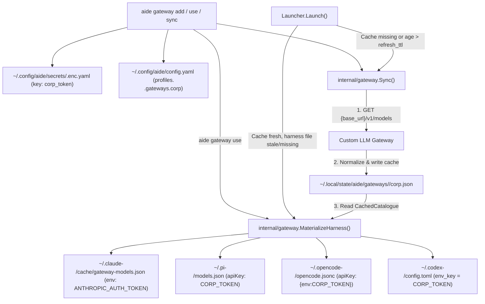

# Multi-Harness Custom Model Gateway Management (`aide gateway`)

*   **Author:** jskswamy
*   **Status:** Reviewed
*   **Date:** 2026-10-28

---

## Overview

`aide` manages per-profile agent identities, age-encrypted secrets, and native configuration directories across coding harnesses. While `aide` can already inject environment variables per harness through `credentials.<name>.for.<harness>` routes in `~/.config/aide/config.yaml`, pointing multiple coding agents at a custom-hosted LLM gateway still requires manual setup per agent. Users must edit encrypted secret stores in `$EDITOR`, hand-write multi-harness `for:` routes, and manually create or update model catalogue files inside each harness's profile directory so the agent's model picker knows which models the gateway serves.

`aide gateway` (`add`, `list`, `use`, `sync`, `remove`) automates custom gateway registration, active gateway switching, and model-catalogue synchronization across all four profile-capable harnesses in `aide` that accept custom endpoints: Claude Code (`claude`), Pi (`pi`), OpenCode (`opencode`), and Codex (`codex`). Gateway bearer tokens are stored in `aide`'s encrypted `age` secret store, gateway configuration lives in a single `profiles.<profile>.gateways.<name>` block in `~/.config/aide/config.yaml` (without duplicating entries under `credentials:`), and the normalized `/v1/models` catalogue is cached locally and written into each harness's profile configuration directory without writing secrets to disk.

## The Problem

Teams and individual developers frequently route LLM requests through self-hosted or organization-managed gateways (such as LiteLLM or internal API proxies) that expose an Anthropic-compatible (`/v1/messages`) and OpenAI-compatible (`/v1/chat/completions`, `/v1/models`) API behind a single base URL and bearer token. Today, configuring such a gateway across harnesses in `aide` breaks down in four places:

1.  **Fragmented per-harness model discovery**: Injecting `ANTHROPIC_BASE_URL` and `ANTHROPIC_AUTH_TOKEN` into the environment only points Claude Code's HTTP client at the gateway; it does not populate Claude Code's `/model` picker (`<claude-dir>/cache/gateway-models.json`). Worse, Pi, OpenCode, and Codex do not discover custom gateway models from `ANTHROPIC_BASE_URL` at all--Pi reads `<pi-dir>/models.json`, OpenCode reads `<opencode-dir>/opencode.jsonc`, and Codex reads `<codex-dir>/config.toml`.
2.  **High onboarding friction**: [`aide env set`](file:///Users/subramk/source/github.com/jskswamy/aide/cmd/aide/env.go#L89-L91) rejects provider credentials (`ANTHROPIC_AUTH_TOKEN`) and instructs the user to run `aide secrets edit <store>` (which requires an interactive `$EDITOR` session) and then hand-author a `credentials:` YAML block in `~/.config/aide/config.yaml`.
3.  **Stale model catalogues and harness-switching gaps**: Gateways add, deprecate, or re-entitle models over time. Without a shared cache and refresh TTL, switching from `claude` to `pi` (`aide --agent pi`) or launching a session days later leaves the harness with missing or outdated model definitions unless the user manually edits each harness's config file.
4.  **Plaintext token leakage risk in harness config files**: When users manually configure custom providers in `models.json` or `opencode.jsonc`, they often paste raw bearer tokens into those unencrypted JSON files instead of referencing environment variables injected by `aide`.

## Goals

*   Provide `aide gateway add [<name>] [--url <base-url>] [--default] [--token-stdin | --token-env <VAR>] [--ttl <duration>] [--harnesses <list>] [--store <store>] [--key <key>] [--age-key <recipient>] [--profile <profile>]` to prompt interactively on a TTY for omitted `--url`, `<name>`, and default-credential replacement, store the gateway token in the profile's `age` secret store, write the gateway definition in one place under `profiles.<profile>.gateways.<name>` in `~/.config/aide/config.yaml`, and run an initial model sync.
*   Follow `aide`'s pattern of explicit configuration in `config.yaml` paired with per-harness driver conventions: `gateways.<name>` declares `base_url`, `refresh_ttl`, `store`, `key`, and `harnesses` once, while `aide`'s harness drivers map `key` to each harness's expected environment variable and config file format.
*   Resolve default gateway/credential bindings **per harness** rather than all-or-nothing across the profile, so a custom gateway added alongside `default_credentials: [anthropic]` is automatically active on harnesses not claimed by `anthropic` (such as `codex`) while `anthropic` remains default for `claude`, `pi`, and `opencode` until switched via `aide gateway use <name>` or `aide gateway add --default`.
*   Provide `aide gateway sync [<name>] [--profile <profile>]` to fetch `{base_url}/v1/models`, normalize LLM entries into `~/.local/state/aide/gateways/<profile>/<gateway>.json`, and write non-secret provider and model definitions into the profile's config directories for `claude`, `pi`, `opencode`, and `codex` with visible progress output (writing Claude's `cache/gateway-models.json` when the gateway is Claude's default, or when no custom gateway in `ctx.Gateways` is Claude's default and `<name>` is the first custom gateway in sorted order that serves `claude`).
*   Automatically refresh the gateway model catalogue during `aide` launch when the cached catalogue is older than `refresh_ttl` (default `24h`), displaying progress to the user and falling back to the cached catalogue with a warning if the gateway is unreachable.
*   Materialize missing or outdated harness model files from the local gateway cache at launch when switching harnesses (`aide --agent pi`) or gateways (`aide --credential <name>`), without requiring an extra network call when the cache is fresh.
*   Provide `aide gateway list [--profile <profile>] [--models] [--format human|json]` showing both built-in provider credentials (`anthropic`, `openai`, `openrouter`, `gemini`, `codex` with their upstream URLs) and custom gateways in a unified view with `default for:` harnesses, cache freshness, and on-disk status (`synced`, `stale`, `pending`).
*   Provide `aide gateway use [<name>] [--profile <profile>]` (with an interactive TTY picker when `<name>` is omitted) to switch a profile's `default_credentials` between any configured gateway or built-in credential and immediately materialize Claude's `cache/gateway-models.json` and Codex's `config.toml` (`model_provider = "<name>"`) from the local cache.
*   Provide `aide gateway remove <name> [--profile <profile>] [--keep-secret]` to remove the gateway definition, cached catalogue, and managed provider entries across all four harnesses' config files.
*   Redesign `aide which` and the startup banner (`compact`, `clean`, `boxed`) around five clear sections: **Profile**, **Harness** (with config dir and available harnesses), **Gateway** (with URL, secret store/key, model cache status, and available alternatives), **Env** (excluding harness config-dir plumbing), and **Sandbox + Capabilities** (fixing `aide which` so it resolves active capabilities instead of falsely reporting `code-only`).

## Non-Goals

*   Supporting vendor-locked harnesses that do not expose custom gateway endpoints or local model catalogue files (`agy` / Antigravity, `copilot`, `cursor-agent`, `amp`, `gemini`).
*   Supporting harnesses that lack profile-directory isolation in `aide` (`aider`, `goose`).
*   Writing plaintext bearer tokens into any harness config file (`gateway-models.json`, `models.json`, `opencode.jsonc`, `config.toml`).
*   Allowing repository-scoped `.aide.yaml` files to define gateways or override gateway base URLs.

## Critical User Journeys (CUJs)

### CUJ 1: Onboarding a Custom Gateway Across Harnesses

*   **Given**: A user has a profile `work` in `~/.config/aide/config.yaml` and a gateway URL `https://gateway.example.com` with a bearer token.
*   **When**: The user runs `aide gateway add corp --url https://gateway.example.com --profile work` and enters the token at the masked prompt.
*   **Then**:
    1. `aide` encrypts the token into `~/.config/aide/secrets/work.enc.yaml` under key `corp_token` without opening `$EDITOR`.
    2. `aide` writes `gateways.corp` (`base_url`, `refresh_ttl: 24h`, `store: work`, `key: corp_token`) under `profiles.work` in `~/.config/aide/config.yaml` (omitting `harnesses`, which defaults to all supported harnesses: `claude`, `pi`, `opencode`, `codex`).
    3. `aide` queries `https://gateway.example.com/v1/models`, prints progress (`Fetching models... Synced N models`), saves `~/.local/state/aide/gateways/work/corp.json`, and updates the model config files for `claude`, `pi`, `opencode`, and `codex`.

### CUJ 2: Inspecting Gateway and Per-Harness Sync Status

*   **Given**: Gateway `corp` is configured on profile `work`.
*   **When**: The user runs `aide gateway list --profile work` (or `aide gateway list --models --format json`).
*   **Then**: `aide` displays the gateway URL, secret store and key name (never the token value), cached model count and last-synced timestamp, and a table listing each harness (`claude`, `pi`, `opencode`, `codex`), its target file path (`~/.claude-work/cache/gateway-models.json`, `~/.pi-work/models.json`, `~/.opencode-work/opencode.jsonc`, `~/.codex-work/config.toml`), and whether each file is `synced`, `stale`, or `pending`.

### CUJ 3: Automatic TTL Refresh and Harness Switching at Launch

*   **Given**: Gateway `corp` was last synced 30 hours ago (`refresh_ttl: 24h`), and the user launches `aide --agent pi` in a repository matched to profile `work`.
*   **When**: `aide` resolves the `work` profile and `corp` gateway during launch.
*   **Then**: `aide` prints progress indicating that `corp` models are being refreshed, fetches `/v1/models` using the decrypted token, updates the local cache and `~/.pi-work/models.json`, and starts `pi` with the updated model catalogue. If the gateway is unreachable (for example, VPN disconnected), `aide` prints a warning and launches `pi` using the existing cached models.

### CUJ 4: Removing a Gateway Cleanly

*   **Given**: Gateway `corp` is configured on profile `work` and its provider definitions exist in the profile's harness config files.
*   **When**: The user runs `aide gateway remove corp --profile work`.
*   **Then**: `aide` removes `gateways.corp` from `~/.config/aide/config.yaml`, deletes `~/.local/state/aide/gateways/work/corp.json`, removes `cache/gateway-models.json` for Claude and the `corp` provider entries from `models.json` (Pi), `opencode.jsonc` (OpenCode), and `config.toml` (Codex) while leaving all other user settings, MCP servers, and plugins intact.

---

## Technical Plan (Architecture)

### 1. How `aide` Balances Configuration and Convention

Across `aide`, user-facing features follow one consistent pattern: **write explicit values in one place in `config.yaml` (never duplicating values across two blocks), and let each harness driver apply its own convention to consume them.**
*   *Existing example (`config_dir_name`)*: The user (or `aide profile create`) writes `config_dir_name: work` once on the profile in `config.yaml`. The user does not write `CLAUDE_CONFIG_DIR`, `PI_CODING_AGENT_DIR`, `OPENCODE_CONFIG_DIR`, or `CODEX_HOME` in `config.yaml`--each harness driver in [`internal/harness/harness.go`](file:///Users/subramk/source/github.com/jskswamy/aide/internal/harness/harness.go#L180-L270) applies its own convention (`~/.<harness>-work` and the harness-specific env var).
*   *How `gateways:` applies the exact same rule*:
    1. **Single configuration block in `config.yaml`**: `aide gateway add corp --url https://gateway.example.com` writes `base_url` (normalized without trailing `/v1` or `/`), `refresh_ttl`, `store`, and `key` (plus `harnesses` only when restricted via `--harnesses`) once under `profiles.<profile>.gateways.corp`. Nothing is duplicated under `credentials:`.
    2. **Conventional defaults at `aide gateway add` time**: When the user does not pass `--store`, `--key`, `--ttl`, or `--harnesses`, `aide gateway add` fills in `store: <profile>` (or the profile's existing `secret:` store), `key: <gateway>_token` (e.g., `corp_token`), and `refresh_ttl: 24h`. When `--harnesses` is not passed, `harnesses` is omitted from `config.yaml` (`omitempty`) and `aide` applies the gateway to all supported harnesses (`claude`, `pi`, `opencode`, `codex`); when `harnesses` is present, `aide` applies the gateway only to the listed harnesses.
    3. **Deterministic per-harness driver convention**: Each harness driver knows how to map `gateways.corp` (`base_url` + `key: corp_token`) into its own environment variable and config file:
        *   For `pi`, `opencode`, and `codex`, the environment variable name is `strings.ToUpper(key)` (so `key: corp_token` maps directly to environment variable **`CORP_TOKEN`**).
        *   For `claude`, because Claude Code hardcodes its environment variable names, the driver maps `key: corp_token` to **`ANTHROPIC_AUTH_TOKEN`** and `base_url` to **`ANTHROPIC_BASE_URL`**.



### 2. Configuration Schema & Harness Mapping

#### YAML Representation (`~/.config/aide/config.yaml`)
A profile declares one or more gateways in a single `gateways:` map, with no duplicate `credentials:` block:

```yaml
profiles:
  work:
    agent: claude
    config_dir_name: work
    gateways:
      corp:
        base_url: https://alpha.gateway.example.com
        refresh_ttl: 24h
        store: work
        key: corp_token
      gw-beta:
        base_url: https://beta.gateway.example.com
        refresh_ttl: 12h
        store: work
        key: beta_token
        harnesses: [opencode, codex]
```

When `harnesses` is omitted (as in `corp` above), the gateway applies to all supported gateway harnesses (`claude`, `pi`, `opencode`, `codex`). When `harnesses` is specified (as in `gw-beta` above), the gateway applies only to the listed harnesses.

#### Go Struct Definitions (`internal/config/schema.go`)
Add `Gateways map[string]GatewayConfig` to [`Context`](file:///Users/subramk/source/github.com/jskswamy/aide/internal/config/schema.go#L110-L150):

```go
// GatewayConfig defines a custom LLM gateway on a profile.
type GatewayConfig struct {
    BaseURL    string   `yaml:"base_url" json:"base_url"`
    RefreshTTL string   `yaml:"refresh_ttl,omitempty" json:"refresh_ttl,omitempty"`
    Store      string   `yaml:"store" json:"store"`
    Key        string   `yaml:"key" json:"key"`
    Harnesses  []string `yaml:"harnesses,omitempty" json:"harnesses,omitempty"`
}
```

*   **Serialization (`Context.MarshalYAML`)**: Update [`Context.MarshalYAML`](file:///Users/subramk/source/github.com/jskswamy/aide/internal/config/schema.go#L153-L206) to serialize `if len(c.Gateways) > 0 { out["gateways"] = c.Gateways }`. Following [`TranslateLegacyCredentials`](file:///Users/subramk/source/github.com/jskswamy/aide/internal/config/credentials.go#L389-L437), `SynthesizeGatewayCredentials(ctx Context) (Context, error)` is a pure value-returning function that clones `ctx.Credentials` and `ctx.DefaultCredentials` on a returned `Context` copy during credential validation and launch planning--never mutating `cfg.Contexts` in place--so `Context.MarshalYAML` never writes synthesized bindings to disk.
*   **Repository Override Protection**: Append `"gateways"` to the [`projectDefiningKeys`](file:///Users/subramk/source/github.com/jskswamy/aide/internal/config/profiles.go#L47-L51) `[]string` slice so `.aide.yaml` cannot declare or redirect gateways.

#### Direct Mapping from `gateways.<name>` to Each Harness (`internal/config/gateway.go`)
For a gateway with `key: alpha_token` and `base_url: https://alpha.gateway.example.com`:

| Harness | Secret Key in `<store>.enc.yaml` | Env Var Injected at Launch (`strings.ToUpper(key)` or Claude Native) | Base URL Written to Harness | Config File Written by `aide gateway sync` |
| :--- | :--- | :--- | :--- | :--- |
| **`claude`** | `alpha_token` | `ANTHROPIC_AUTH_TOKEN=<secret>`<br>`ANTHROPIC_BASE_URL=https://alpha.gateway.example.com`<br>`CLAUDE_CODE_ENABLE_GATEWAY_MODEL_DISCOVERY=1`<br>`ANTHROPIC_API_KEY=""` | `NormalizeBaseURL(base_url)` | `~/.claude-<p>/cache/gateway-models.json` |
| **`pi`** | `alpha_token` | `ALPHA_TOKEN=<secret>` | `NormalizeBaseURL(base_url)` | `~/.pi-<p>/models.json` (`"apiKey": "ALPHA_TOKEN"`) |
| **`opencode`** | `alpha_token` | `ALPHA_TOKEN=<secret>` | `NormalizeBaseURL(base_url) + "/v1"` | `~/.opencode-<p>/opencode.jsonc` (`"apiKey": "{env:ALPHA_TOKEN}"`) |
| **`codex`** | `alpha_token` | `ALPHA_TOKEN=<secret>` | `NormalizeBaseURL(base_url) + "/v1"` | `~/.codex-<p>/config.toml` (`env_key = "ALPHA_TOKEN"`) |

`SynthesizeGatewayCredentials(ctx Context) (Context, error)` iterates `slices.Sorted(maps.Keys(ctx.Gateways))` deterministically and constructs a `CredentialBinding{Backend: CredentialBackendAge, Store: gw.Store, Key: gw.Key, For: routes}` for each gateway. Default resolution is **per harness** rather than all-or-nothing across the profile:
*   **Built-in credential harness scoping (`BuiltinCredentialHarnesses`)**: Built-in provider credentials with empty `Harnesses` and empty `For` map to their natural target harnesses via `BuiltinCredentialHarnesses(name string) []string`: `"anthropic"` $\rightarrow$ `["claude", "pi", "opencode"]`, `"openai"` $\rightarrow$ `["pi", "opencode", "codex"]`, `"codex"` $\rightarrow$ `["codex"]`, `"openrouter"` $\rightarrow$ `["pi", "opencode", "codex"]`, and `"gemini"` $\rightarrow$ `["gemini", "pi", "opencode"]` (while `CredentialBinding.AllowsHarness` remains permissive when explicitly selected via `--credential`).
*   **Mutually exclusive provider/gateway default slot per harness (`DefaultCredentialsForHarness`)**: `DefaultCredentialsForHarness(synthCtx Context, harnessName string) []string` (used by `PlanProfileCredentials`, `(*Selection).SelectCredentials`, `(*Selection).PlanCredentials`, and `gateway.IsDefaultGateway`) walks `synthCtx.DefaultCredentials` in order for `harnessName`. It skips any binding not scoped to `harnessName`, skips any binding whose route variables on `harnessName` collide with an earlier binding on `harnessName`, and allows at most one LLM provider/gateway binding (`_, isGW := synthCtx.Gateways[name]` or `IsBuiltinCredential(name)`) per harness while still allowing unrelated non-provider credentials (such as `github` / `GITHUB_TOKEN`) to coexist.
*   **Synthesis & `checkDefaultRoutes` validation**: `SynthesizeGatewayCredentials` appends each gateway `<name>` (if not already present in `ctx.DefaultCredentials`) when `DefaultCredentialsForHarness` can assign it to at least one of its `EffectiveHarnesses()`. In `(*Config).validateCredentials()`, `checkDefaultRoutes` is invoked on `explicitCtx` (`explicitCtx := synthCtx; explicitCtx.DefaultCredentials = ctx.DefaultCredentials`) so explicit user-authored `default_credentials` (including explicit gateway names) are strictly validated for route collisions, while auto-appended fallback gateways in `synthCtx.DefaultCredentials` are disambiguated per harness via `DefaultCredentialsForHarness`.
*   **Concrete behavior**: When a profile has `default_credentials: [anthropic]` (scoped to `claude`, `pi`, and `opencode`) and a custom gateway `api` (supporting `claude`, `pi`, `opencode`, and `codex`), `anthropic` remains the active default on `claude`, `pi`, and `opencode`, while `api` automatically becomes the active default for `codex`. When the user runs `aide gateway use api --profile work` (or answers `y` to the default prompt during `aide gateway add`), `default_credentials` becomes `[api]` and `api` serves all four harnesses (`claude`, `pi`, `opencode`, `codex`).
*   **Unified endpoint URLs (`BuiltinCredentialURL` & `EndpointURL`)**: Built-in provider credentials expose their canonical upstream URL via `BuiltinCredentialURL(name string) string` (`"anthropic"` $\rightarrow$ `"https://api.anthropic.com"`, `"openai"` / `"codex"` $\rightarrow$ `"https://api.openai.com"`, `"openrouter"` $\rightarrow$ `"https://openrouter.ai/api"`, `"gemini"` $\rightarrow$ `"https://generativelanguage.googleapis.com"`) and `(b CredentialBinding) EndpointURL(name, harnessName string) string` so `aide gateway list`, `aide gateway use`, `aide which`, and the startup banner display built-in provider routes and custom gateways under a single unified mental model.

Validation rules in `ValidateGateways` (called from `(*Config).validateCredentials()`):
1.  **Identifier safety (`<name>` and `store`)**: Both the gateway map key `<name>` and `gw.Store` must match `^[a-zA-Z0-9][a-zA-Z0-9_-]*$` (preventing path traversal in cache paths), and `<name>` must not collide with an explicit entry in `ctx.Credentials`.
2.  **Transport & URL safety (`base_url`)**: `gw.BaseURL` must parse via `url.Parse`, have no embedded credentials (`u.User == nil`), no query string (`u.RawQuery == ""`), and no fragment (`u.Fragment == ""`). The scheme must be `https://`, except `http://` is permitted only for loopback hosts (`localhost`, `127.0.0.1`, `::1`).
3.  **TTL format (`refresh_ttl`)**: When non-empty, `gw.RefreshTTL` must parse as a positive duration via `time.ParseDuration` (defaulting to `24h` when omitted).
4.  **Secret key & env var safety (`key`)**: `gw.Key` must match `^[a-zA-Z_][a-zA-Z0-9_]*$` so `gw.EnvVarName()` (`strings.ToUpper(gw.Key)`) is always a valid POSIX environment variable identifier. `gw.EnvVarName()` must pass [`checkBindingEnv`](file:///Users/subramk/source/github.com/jskswamy/aide/internal/config/credentials.go#L300-L308), must not appear in `cfg.NeverAllowEnv`, and must not match dangerous runtime/loader/proxy variables (`LD_*`, `DYLD_*`, `NODE_OPTIONS`, `NODE_EXTRA_CA_CERTS`, `HTTP_PROXY`, `HTTPS_PROXY`, `ALL_PROXY`, `NO_PROXY`, `SSL_CERT_FILE`, `SSL_CERT_DIR`, `BASH_ENV`, `ENV`, `GIT_SSH_COMMAND`).
5.  **Harness subset (`harnesses`)**: Must be a subset of `["claude", "pi", "opencode", "codex"]` with no duplicates (defaulting to all four when omitted).
6.  **Environment scrubbing**: `CLAUDE_CODE_ENABLE_GATEWAY_MODEL_DISCOVERY` is added to `providerSelectorNames` in [`internal/envscrub/envscrub.go`](file:///Users/subramk/source/github.com/jskswamy/aide/internal/envscrub/envscrub.go), and `(*Config).CredentialScrubNames()` in [`internal/config/credentials.go`](file:///Users/subramk/source/github.com/jskswamy/aide/internal/config/credentials.go#L344) includes `gw.EnvVarName()` for every configured gateway so inherited shell variables cannot leak across profiles.

### 3. Programmatic Secret Store Upsert & Removal (`internal/secrets/`)

Currently, [`Manager.Edit`](file:///Users/subramk/source/github.com/jskswamy/aide/internal/secrets/manager.go#L254-L321) requires an interactive `$EDITOR` and concatenates keys with `"k: v\n"`. We add non-interactive `SetKey` and `DeleteKey` methods on [`Manager`](file:///Users/subramk/source/github.com/jskswamy/aide/internal/secrets/manager.go) and a `Recipient()` helper on [`AgeIdentity`](file:///Users/subramk/source/github.com/jskswamy/aide/internal/secrets/age.go#L25-L31):

```go
func (id *AgeIdentity) Recipient() (string, error)
func (m *Manager) SetKey(storeName, secretsDir, key, value, explicitAgePubKey string) error
func (m *Manager) DeleteKey(storeName, secretsDir, key string) error
```

*   **`AgeIdentity.Recipient()` (`internal/secrets/age.go`)**: Parses the software `X25519Identity` via `filippo.io/age.ParseIdentities` (from `strings.NewReader(id.KeyData)` when `id.Source == SourceEnvKey`, or from `os.Open(id.KeyData)` when `id.Source` is `SourceEnvKeyFile` or `SourceDefaultFile`) and returns `x25519.Recipient().String()`. When `id.Source == SourceYubiKey`, returns an error instructing the user to pass `--age-key <age1...>`.
*   **`Manager.SetKey` on an existing store (`<secretsDir>/<storeName>.enc.yaml` exists)**:
    1. Discover the `age` identity via [`DiscoverAgeKey`](file:///Users/subramk/source/github.com/jskswamy/aide/internal/secrets/age.go).
    2. Decrypt existing keys with [`DecryptSecretsFile`](file:///Users/subramk/source/github.com/jskswamy/aide/internal/secrets/sops.go#L22).
    3. Set `data[key] = value`, marshal the map in sorted key order with `gopkg.in/yaml.v3` (`yaml.Marshal` so special characters in tokens are properly quoted), and re-encrypt in memory via `encryptWithKeyGroups` + `fsutil.AtomicWrite` without writing any plaintext temp file to `os.TempDir()`.
*   **`Manager.SetKey` on a new store (`<storeName>.enc.yaml` does not exist yet)**:
    1. Resolve the `age` public recipient from `explicitAgePubKey` (`--age-key`) if non-empty, else via `identity.Recipient()` from `DiscoverAgeKey()`.
    2. Marshal `map[string]string{key: value}` with `yaml.Marshal` and encrypt via `CreateFromContent`.
*   **`Manager.DeleteKey`**:
    1. If `<storeName>.enc.yaml` does not exist, return `nil`.
    2. Decrypt existing keys via `DecryptSecretsFile`. If `key` is not present in `data`, return `nil`.
    3. Delete `key` from `data`. If `len(data) == 0`, remove `<secretsDir>/<storeName>.enc.yaml` via `os.Remove(srcPath)` (because SOPS cannot encrypt an empty key map). Otherwise, marshal the remaining map with `yaml.Marshal` and re-encrypt in memory + `fsutil.AtomicWrite`.

### 4. Gateway Model Discovery & Local Cache (`internal/gateway/`)

#### Fetching & Normalizing `{base_url}/v1/models` (`internal/gateway/fetch.go`)
*   **Base URL Canonicalization (`NormalizeBaseURL`)**: Parses `raw` via `url.Parse`, trims any trailing `/` and any trailing `/v1` path segment, and returns the canonical base URL without `/v1` (e.g., `https://gateway.example.com/v1/` $\rightarrow$ `https://gateway.example.com`). `aide gateway add` applies `NormalizeBaseURL` before saving `base_url` to `config.yaml`.
*   **Request & Redirect Safety**:
    *   Executes a single bounded request `GET <NormalizeBaseURL(baseURL)>/v1/models?limit=1000` with headers `Authorization: Bearer <token>`, `anthropic-version: 2023-06-01`, and `Accept: application/json`.
    *   Uses a `10s` `context.WithTimeout` for explicit CLI commands (`aide gateway add` / `sync`) and cold launches, and a `5s` `context.WithTimeout` for launch-time background TTL refreshes when a fallback cache file already exists on disk.
    *   Configures `http.Client.CheckRedirect` to reject cross-origin redirects (`req.URL.Host != via[0].URL.Host`) and reject scheme downgrades (`via[0].URL.Scheme == "https" && req.URL.Scheme != "https"`).
    *   Reads at most `4 MiB` (`4 << 20` bytes) from the response body via `io.LimitReader`.
*   **Parsing, Sanitization & Normalization**:
    *   Accepts either `{"data": [...]}` (OpenAI/Anthropic standard list wrapper) or a top-level JSON array `[...]`.
    *   Filters out entries where `model_type` is present and not `"llm"`, or where `is_enabled` is explicitly `false`.
    *   Resolves model ID from `slug`, `id`, or `remote_model` (in that order), deduplicating by model ID.
    *   Strips ASCII/C1 control and terminal escape characters (`r < 0x20 || (r >= 0x7f && r <= 0x9f)`) from `id`, `display_name`, and `provider`, rejects entries with empty `id` or `len(id) > 256`, truncates `display_name` (`<= 256` bytes) and `provider` (`<= 128` bytes), clamps negative token limits to `0`, sorts models ascending by `Model.ID`, and caps the normalized list at `1000` models.
    *   Extracts display metadata only (`id`, `display_name` from `name` / `display_name` / `id`, `provider` / `owned_by`, `context_window` from `max_context_tokens` / `context_window` / `context_length`, `max_output_tokens` from `max_output_tokens` / `max_tokens`) and discards any upstream provider credentials returned in the raw payload.

#### Local Cache File (`~/.local/state/aide/gateways/<profile>/<gateway>.json`)
Stored via [`statedir.Path(homeDir, filepath.Join("gateways", profile, gatewayName+".json"))`](file:///Users/subramk/source/github.com/jskswamy/aide/internal/statedir/statedir.go#L22) and written atomically via [`fsutil.AtomicWrite`](file:///Users/subramk/source/github.com/jskswamy/aide/internal/fsutil/fsutil.go) (`0o600` permissions):

```json
{
  "profile": "work",
  "gateway": "corp",
  "base_url": "https://gateway.example.com",
  "fetched_at": "2026-10-27T16:30:00Z",
  "models": [
    {
      "id": "claude-sonnet-4-5",
      "display_name": "Claude Sonnet 4.5",
      "provider": "anthropic",
      "context_window": 200000,
      "max_output_tokens": 16384
    }
  ]
}
```

### 5. Per-Harness Config Materialization (`internal/gateway/writers.go`)

Target directory resolution for each harness (`claude`, `pi`, `opencode`, `codex`) uses a shared helper matching [`launchConfigDir`](file:///Users/subramk/source/github.com/jskswamy/aide/internal/launcher/native_auth.go#L66-L78):
*   If `ctx.SelectsConfigDir()` is true (`config_dir_name`, `config_dir`, or `config_dirs` is set), target dir is `ctx.NativeConfigDir(harnessName, home)` (e.g., `~/.claude-work`, `~/.pi-work`, `~/.opencode-work`, `~/.codex-work`).
*   If `ctx.SelectsConfigDir()` is false (single unisolated profile), target dir checks `ctx.Env[d.ProfileEnvKey]` (tilde-expanded against `home`) and `os.Getenv(d.ProfileEnvKey)` before falling back to `d.DefaultDir(home)` (`~/.claude`, `~/.pi/agent`, `~/.config/opencode`, `~/.codex`).

Each writer uses [`fsutil.AtomicWrite`](file:///Users/subramk/source/github.com/jskswamy/aide/internal/fsutil/fsutil.go) (`0o600`), `normURL := NormalizeBaseURL(gw.BaseURL)`, and `envVar := gw.EnvVarName()` (`CORP_TOKEN` when `key: corp_token`):

1.  **Claude Code (`<claude-dir>/cache/gateway-models.json`)**:
    *   Writes `{"baseUrl": normURL, "fetchedAt": cat.FetchedAt.UnixMilli(), "models": [{"id": m.ID, "display_name": m.DisplayName, "description": formatClaudeDesc(m)}]}` where `formatClaudeDesc(m)` formats `"<provider> · <N>K context"` when both are present, `"<provider>"` when `ContextWindow == 0`, `"<N>K context"` when `Provider == ""`, or `"Custom gateway model"` when both are absent.
    *   *Single-gateway vs multi-gateway rule for Claude (`CanSyncHarness`)*: Because `<claude-dir>/cache/gateway-models.json` is a single file per profile directory, `gateway.CanSyncHarness(ctx, gwName, "claude")` returns `true` when `IsDefaultGateway(ctx, gwName, "claude")` is `true`, **or** when no custom gateway in `ctx.Gateways` is Claude's default (`IsDefaultGateway(ctx, g, "claude") == false` for all `g`) and `gwName` is the **first** custom gateway in `slices.Sorted(maps.Keys(ctx.Gateways))` whose `EffectiveHarnesses()` includes `"claude"`. Built-in provider credentials (like `credentials.anthropic`) never read `cache/gateway-models.json` (Claude Code only reads it when `CLAUDE_CODE_ENABLE_GATEWAY_MODEL_DISCOVERY=1` is set by a gateway), so a custom gateway on a profile that also has `credentials.anthropic` writes `cache/gateway-models.json` deterministically during `aide gateway add` and `aide gateway sync` without two non-default custom gateways overwriting each other.
    *   On `remove`: removes `<claude-dir>/cache/gateway-models.json` if its normalized `baseUrl` matches `normURL`.
2.  **Pi (`<pi-dir>/models.json`)**:
    *   Reads existing `<pi-dir>/models.json` into `map[string]any` (initializing `{}` if absent), preserves all other top-level keys and other entries under `"providers"`, and sets `providers[gwName]` (omitting `contextWindow` or `maxTokens` on any model where the value is `0`):
        ```json
        {
          "baseUrl": "https://gateway.example.com",
          "apiKey": "CORP_TOKEN",
          "authHeader": true,
          "api": "anthropic-messages",
          "models": [
            {
              "id": "claude-sonnet-4-5",
              "name": "Claude Sonnet 4.5",
              "contextWindow": 200000,
              "maxTokens": 16384
            }
          ]
        }
        ```
    *   On `remove`: deletes `providers[gwName]` from `<pi-dir>/models.json`.
3.  **OpenCode (`<opencode-dir>/opencode.jsonc`)**:
    *   Parses existing `opencode.jsonc` using `hujson.Standardize` (same pattern as [`internal/provision/mcp/opencodejson.go`](file:///Users/subramk/source/github.com/jskswamy/aide/internal/provision/mcp/opencodejson.go)), preserves `mcp`, `plugin`, and other sibling keys, and sets `provider[gwName]` with `baseURL: normURL + "/v1"` (omitting `limit` or its subfields when `0`):
        ```json
        {
          "npm": "@ai-sdk/anthropic",
          "name": "corp",
          "options": {
            "baseURL": "https://gateway.example.com/v1",
            "apiKey": "{env:CORP_TOKEN}"
          },
          "models": {
            "claude-sonnet-4-5": {
              "name": "Claude Sonnet 4.5",
              "limit": {
                "context": 200000,
                "output": 16384
              }
            }
          }
        }
        ```
    *   On `remove`: deletes `provider[gwName]` from `<opencode-dir>/opencode.jsonc`.
4.  **Codex (`<codex-dir>/config.toml`)**:
    *   Parses existing `config.toml` using `github.com/pelletier/go-toml/v2` (same pattern as [`internal/provision/mcp/codextoml.go`](file:///Users/subramk/source/github.com/jskswamy/aide/internal/provision/mcp/codextoml.go)), preserves all other tables, and sets `model_providers[gwName]` with `base_url = normURL + "/v1"`:
        ```toml
        [model_providers.corp]
        name = "corp"
        base_url = "https://gateway.example.com/v1"
        env_key = "CORP_TOKEN"
        wire_api = "chat"
        ```
    *   When `isDefault` is `true` (`gwName` is the default gateway for `codex`), sets top-level `model_provider = "corp"` if `model_provider` is not yet set in `config.toml` or was previously set to another gateway in `ctx.Gateways`, so Codex uses the active default gateway out of the box without requiring `-c model_provider=corp`.
    *   On `remove`: deletes `model_providers[gwName]` from `<codex-dir>/config.toml` (and clears top-level `model_provider` if it was set to `gwName`).

#### `InspectHarness` Status Predicates (`synced`, `stale`, `pending`)
`InspectHarness(ctx, gwName, gw, cat, harnessName, home)` evaluates the on-disk state of a harness's config file:
*   **`StatePending` (`pending`)**: The resolved harness profile directory (`~/.<harness>-<profile>`) does not exist on disk yet (lazy provisioning has not occurred yet), OR `harnessName == "claude"` and `!CanSyncHarness(ctx, gwName, "claude")` (`Detail: "not claude's active gateway; syncs when selected"`).
*   **`StateStale` (`stale`)**: The harness profile directory exists, but:
    *   The local gateway cache `cat` is nil or expired (`IsExpired(cat, ttl, now)`), OR
    *   The target config file does not exist or cannot be parsed, OR
    *   For `claude`: `NormalizeBaseURL(file.BaseURL) != NormalizeBaseURL(gw.BaseURL)` or the list of model IDs in `file.Models` does not match `cat.Models`, OR
    *   For `pi`: `providers[gwName]` is missing, `baseUrl` != `NormalizeBaseURL(gw.BaseURL)`, `apiKey` != `gw.EnvVarName()`, or the model ID list does not match `cat.Models`, OR
    *   For `opencode`: `provider[gwName]` is missing, `options.baseURL` != `NormalizeBaseURL(gw.BaseURL)+"/v1"`, `options.apiKey` != `"{env:"+gw.EnvVarName()+"}"`, or the model ID keys under `models` do not match `cat.Models`, OR
    *   For `codex`: `model_providers[gwName]` is missing, `base_url` != `NormalizeBaseURL(gw.BaseURL)+"/v1"`, or `env_key` != `gw.EnvVarName()`.
*   **`StateSynced` (`synced`)**: None of the `pending` or `stale` conditions hold.

### 6. CLI Command Surface & UX (`cmd/aide/gateway.go`)

Registered in [`registerCommands`](file:///Users/subramk/source/github.com/jskswamy/aide/cmd/aide/commands.go#L20-L49) under `aide gateway`:

```text
Manage custom LLM gateways and synchronize model catalogues across harnesses.

Usage:
  aide gateway <subcommand> [flags]

Subcommands:
  add      Register a custom gateway, encrypt its token, and sync models
  list     Show configured gateways, cache freshness, and harness file status
  use      Set the profile's default gateway or built-in credential
  sync     Force-refresh gateway models and update harness config files
  remove   Remove a gateway, its cached models, and harness provider entries
```

---

#### 6.1 `aide gateway add`

```text
aide gateway add [<name>] [flags]
```

| Argument / Flag | Required? | Default | Description |
| :--- | :--- | :--- | :--- |
| `<name>` (positional) | Optional | Prompted on TTY (`Gateway name [<derived>]: `) when `--url` was also prompted, else first DNS label of `--url` hostname | Logical identifier for the gateway under `profiles.<profile>.gateways.<name>` (e.g., `gateway.example.com` $\rightarrow$ `gateway`). Must match `^[a-zA-Z0-9][a-zA-Z0-9_-]*$`. |
| `--url <string>` | Required (or prompted on TTY) | -- | Gateway base URL (`https://...`, or `http://` only for loopback hosts `localhost`, `127.0.0.1`, `::1`). When omitted on an interactive TTY (`!tokenStdin && tokenEnv == "" && stdinIsTTY()`), prompts `Gateway base URL (e.g. https://gateway.example.com): `. Trailing `/v1` and `/` are normalized via `NormalizeBaseURL` before saving. |
| `--default` | Optional | Prompted on TTY when existing `default_credentials` collides | Make `<name>` the profile's default credential in `default_credentials` (placing `<name>` first and removing any superseded provider/gateway entries such as `anthropic`). When omitted on an interactive TTY (`!tokenStdin && tokenEnv == "" && stdinIsTTY()`) and an existing `default_credentials` entry collides on any harness, prompts `Profile "<p>" currently uses "<existing>" by default. Make "<name>" the default instead? [Y/n]: `. |
| `--force` | Optional | `false` | Overwrite an existing gateway definition with the same `<name>` on the target profile. |
| `--profile <string>` | Optional | Resolved from CWD via `aide`'s profile matcher | Target profile in `~/.config/aide/config.yaml`. Errors if no profile matches CWD and `--profile` is omitted. |
| `--token-stdin` | Optional | `false` (prompts via hidden TTY input) | Read the gateway bearer token from `stdin` (single line, trailing newline stripped). Mutually exclusive with `--token-env`. |
| `--token-env <VAR>` | Optional | -- | Read the gateway bearer token from the named environment variable (`os.Getenv(VAR)`), e.g., `--token-env CORP_GATEWAY_TOKEN`, without exposing the secret value in CLI arguments or shell history. Mutually exclusive with `--token-stdin`. |
| `--ttl <duration>` | Optional | `24h` | Automatic launch-time model refresh interval (`time.ParseDuration` format, e.g., `12h`, `24h`, `168h`). Stored as `refresh_ttl` in `config.yaml`. |
| `--harnesses <csv>` | Optional | All supported (`claude,pi,opencode,codex`) | Comma-separated subset of harnesses to configure (e.g., `--harnesses claude,pi`). When omitted, `harnesses` is omitted from `config.yaml` and the gateway applies to all four harnesses. |
| `--store <string>` | Optional | Profile's `secret:` store, else `<profile>` | Name of the encrypted secret store file (`~/.config/aide/secrets/<store>.enc.yaml`). |
| `--key <string>` | Optional | `<name>_token` (with `-` replaced by `_`) | Secret key name inside the encrypted store (e.g., `corp_token`). Must match `^[a-zA-Z_][a-zA-Z0-9_]*$`. Determines the uppercase environment variable name (`CORP_TOKEN`) for `pi`, `opencode`, and `codex`. |
| `--age-key <recipient>` | Optional | Auto-discovered via `secrets.DiscoverAgeKey()` (`sops/age/keys.txt`, `SOPS_AGE_KEY`, `SOPS_AGE_KEY_FILE`) | Explicit `age1...` public recipient key used when creating a new secret store and no local software `age` identity is configured (or when using a YubiKey identity). |

**Terminal Output (`aide gateway add`)**:
```text
# Interactive (prompts for omitted URL, name, token, and default replacement on a TTY)
$ aide gateway add --profile work
Gateway base URL (e.g. https://gateway.example.com): https://api.acme-corp.gateway.example.com
Gateway name [api]: acme
Gateway bearer token (input hidden):
Profile "work" currently uses "anthropic" by default. Make "acme" the default instead? [Y/n]: y

# Non-interactive via --token-env (reads from the named environment variable)
$ aide gateway add corp --url https://gateway.example.com --profile work --token-env CORP_GATEWAY_TOKEN

# Non-interactive via --token-stdin (e.g., from 1Password, macOS Keychain, or pass)
$ op read "op://Engineering/CorpGateway/credential" | aide gateway add corp --url https://gateway.example.com --profile work --token-stdin
$ security find-generic-password -s corp-gateway -w | aide gateway add corp --url https://gateway.example.com --profile work --token-stdin

✓ Encrypted token into ~/.config/aide/secrets/work.enc.yaml (key: corp_token)
✓ Saved gateway "corp" under profile "work" in ~/.config/aide/config.yaml
→ Fetching models from https://gateway.example.com/v1/models...
✓ Cached 14 LLM models in ~/.local/state/aide/gateways/work/corp.json (refresh_ttl: 24h)
  ✓ claude    ~/.claude-work/cache/gateway-models.json  (synced, 14 models)
  ✓ pi        ~/.pi-work/models.json                    (synced, provider "corp", env: CORP_TOKEN)
  - opencode  ~/.opencode-work/opencode.jsonc           (pending -- dir not created yet; will sync on first launch)
  - codex     ~/.codex-work/config.toml                 (pending -- dir not created yet; will sync on first launch)
```

---

#### 6.2 `aide gateway list`

```text
aide gateway list [flags]
```

| Flag | Required? | Default | Description |
| :--- | :--- | :--- | :--- |
| `--profile <string>` | Optional | All profiles (or resolved profile if specified) | Filter output to a single profile. When omitted, lists gateways and built-in provider credentials across all profiles. |
| `--models` | Optional | `false` | Include the table of cached model IDs, display names, providers, and context windows under each custom gateway. |
| `--format <string>` | Optional | `human` | Output format: `human` or `json` (follows `--format` convention from [`cmd/aide/provision_list.go`](file:///Users/subramk/source/github.com/jskswamy/aide/cmd/aide/provision_list.go)). |

**Terminal Output (`aide gateway list --profile work` when both `credentials.anthropic` and `gateways.api` exist)**:
```text
$ aide gateway list --profile work
PROFILE: work
  GATEWAY: anthropic (default for: claude, pi, opencode)
    URL:          https://api.anthropic.com (built-in)
    Secret:       store=work, key=anthropic_api_key
    Harnesses:
      HARNESS   ENV VAR            TARGET FILE  STATUS
      claude    ANTHROPIC_API_KEY  -            active (default)
      pi        ANTHROPIC_API_KEY  -            active (default)
      opencode  ANTHROPIC_API_KEY  -            active (default)

  GATEWAY: api (default for: codex; switch all with: aide gateway use api --profile work)
    URL:          https://api.acme-corp.gateway.example.com
    Secret:       store=work, key=api_token
    Refresh TTL:  24h
    Cache:        7 models (synced 3m ago; fresh, next auto-refresh in 23h57m)
                  ~/.local/state/aide/gateways/work/api.json
    Harnesses:
      HARNESS   ENV VAR               TARGET FILE                               STATUS
      claude    ANTHROPIC_AUTH_TOKEN  ~/.claude-work/cache/gateway-models.json  synced (7 models)
      pi        API_TOKEN             ~/.pi-work/models.json                    synced (7 models)
      opencode  API_TOKEN             ~/.opencode-work/opencode.jsonc           synced (7 models)
      codex     API_TOKEN             ~/.codex-work/config.toml                 pending (dir not provisioned)
```

**Terminal Output with `--models` (`aide gateway list --profile work --models`)**:
Appends the cached model list beneath `Harnesses:`:
```text
    Models (7):
      ID                          DISPLAY NAME            PROVIDER    CONTEXT   MAX OUTPUT
      claude-opus-4-6             Claude Opus 4.6         anthropic   200000    16384
      claude-sonnet-4-5           Claude Sonnet 4.5       anthropic   200000    16384
      gpt-5                       GPT-5                   openai      400000    32768
```

**JSON Output Schema (`aide gateway list --format json`)**:
Consumes the root persistent `--format` flag via `output.FromCmd(cmd)` and `output.Emit(out, format, entries, humanFn)`, serializing `[]GatewayListEntry`:
```go
type GatewayListEntry struct {
    Profile     string                    `json:"profile"`
    Gateway     string                    `json:"gateway"`
    Kind        string                    `json:"kind,omitempty"` // "gateway" or "credential"
    BaseURL     string                    `json:"base_url"`
    Store       string                    `json:"store"`
    Key         string                    `json:"key"`
    RefreshTTL  string                    `json:"refresh_ttl,omitempty"`
    CachePath   string                    `json:"cache_path,omitempty"`
    FetchedAt   *time.Time                `json:"fetched_at,omitempty"`
    Expired     bool                      `json:"expired"`
    ModelCount  int                       `json:"model_count"`
    DefaultFor  []string                  `json:"default_for"`
    Harnesses   []gateway.HarnessFileStatus `json:"harnesses"`
    Models      []gateway.Model           `json:"models,omitempty"` // populated when --models is set
}
```

---

#### 6.3 `aide gateway use`

`aide gateway use` switches a profile's `default_credentials` to any configured custom gateway (`gateways.<name>`) or built-in provider credential (`credentials.<name>`) on that profile. It places `<name>` at index 0 of `ctx.DefaultCredentials` and removes any existing entries in `ctx.DefaultCredentials` whose target harnesses or route environment variables collide with `<name>`, while preserving any unrelated non-colliding credentials. When switching to a custom gateway `<name>`, it also immediately calls `gateway.MaterializeHarness(..., createDirIfMissing: false)` from the local cache for `claude` (`<claude-dir>/cache/gateway-models.json`) and `codex` (`<codex-dir>/config.toml` `model_provider = "<name>"`) if their profile directories exist.

```text
aide gateway use [<name>] [flags]
```

| Argument / Flag | Required? | Default | Description |
| :--- | :--- | :--- | :--- |
| `<name>` (positional) | Optional on TTY | Interactive numbered picker on TTY | Name of a configured gateway or credential on the target profile. |
| `--profile <string>` | Optional | Resolved from CWD | Target profile to update. |

**Terminal Output (`aide gateway use --profile work`)**:
```text
$ aide gateway use --profile work
Gateways on profile "work":
  [1] anthropic  https://api.anthropic.com (built-in)                     [default: claude, pi, opencode]
  [2] api        https://api.acme-corp.gateway.example.com              [default: codex]
Select default [1]: 2
✓ Set default gateway for profile "work" to "api" (claude, pi, opencode, codex)
  ✓ claude  ~/.claude-work/cache/gateway-models.json  (synced, 7 models)
```

---

#### 6.4 `aide gateway sync`

`aide gateway sync` **always forces an immediate refresh** from `{base_url}/v1/models` regardless of whether `refresh_ttl` has expired, updates `~/.local/state/aide/gateways/<profile>/<gateway>.json`, and updates all provisioned harness config files.

```text
aide gateway sync [<name>] [flags]
```

| Argument / Flag | Required? | Default | Description |
| :--- | :--- | :--- | :--- |
| `<name>` (positional) | Optional | All gateways on the target profile | Name of a specific gateway to sync. When omitted, syncs all gateways configured on the target profile. |
| `--profile <string>` | Optional | Resolved from CWD | Target profile to sync. |

**Terminal Output (`aide gateway sync --profile work`)**:
```text
$ aide gateway sync --profile work
→ Syncing gateway "corp" (profile "work") from https://gateway.example.com/v1/models...
✓ Cached 16 LLM models in ~/.local/state/aide/gateways/work/corp.json
  ✓ claude    ~/.claude-work/cache/gateway-models.json  (synced, 16 models)
  ✓ pi        ~/.pi-work/models.json                    (synced, 16 models)
  - opencode  ~/.opencode-work/opencode.jsonc           (pending -- dir not created yet)
  - codex     ~/.codex-work/config.toml                 (pending -- dir not created yet)
```

---

#### 6.5 `aide gateway remove`

```text
aide gateway remove <name> [flags]
```

| Argument / Flag | Required? | Default | Description |
| :--- | :--- | :--- | :--- |
| `<name>` (positional) | Required | -- | Name of the gateway to remove from the profile. |
| `--profile <string>` | Optional | Resolved from CWD | Target profile containing `<name>`. |
| `--keep-secret` | Optional | `false` | Keep the secret key (`<key>`) in `~/.config/aide/secrets/<store>.enc.yaml` instead of deleting it. (The key is also preserved automatically if any other gateway or credential binding across **any profile** in `cfg.Contexts` still references the same `(store, key)` pair.) |

**Terminal Output (`aide gateway remove corp --profile work`)**:
```text
$ aide gateway remove corp --profile work
✓ Removed gateway "corp" from profile "work" in ~/.config/aide/config.yaml
✓ Deleted secret key "corp_token" from ~/.config/aide/secrets/work.enc.yaml
✓ Removed cache ~/.local/state/aide/gateways/work/corp.json
  ✓ claude    removed ~/.claude-work/cache/gateway-models.json
  ✓ pi        removed provider "corp" from ~/.pi-work/models.json
  - opencode  skipped ~/.opencode-work/opencode.jsonc (not present)
  - codex     skipped ~/.codex-work/config.toml (not present)
```

---

### 7. Launch-Time TTL Refresh & Harness Materialization (`internal/launcher/launcher.go`)

In [`Launcher.Launch`](file:///Users/subramk/source/github.com/jskswamy/aide/internal/launcher/launcher.go#L284-L315), immediately after `ResolveCredentialEnv(credPlan, loadStore)` resolves the active credential bindings for the launch (and after any first-launch profile directory checks):

1.  Check if any selected credential binding in `credPlan.Bindings` corresponds to a gateway in `rc.Context.Gateways` (when `--auth login` is active, `credPlan.Bindings` is empty, so gateway sync is skipped; read-only inspection commands `aide which` and `aide status` do not call `ensureGatewaySynced` and remain side-effect-free).
2.  **If the local cache is missing or `time.Since(cache.FetchedAt) > ttl` (default `24h`)**:
    *   Print visible progress to `l.stderr()`:
        ```text
        aide: gateway "corp" cache expired (last synced 26h ago, ttl 24h); refreshing models from https://gateway.example.com/v1/models...
        aide: synced 16 models for gateway "corp" -> ~/.pi-work/models.json
        ```
    *   Run `gateway.Sync` using the already-decrypted token from `credEnv` (avoiding a second `age` decryption), with a `5s` timeout if a previous cache file exists on disk or `10s` on a cold launch with no cache.
    *   If the network request fails and a cached catalogue already exists on disk, print a warning to `l.stderr()` and continue to step 3 using the cached models:
        ```text
        aide: warning: could not refresh gateway "corp" (context deadline exceeded); using cached catalogue from 26h ago (14 models)
        ```
    *   If the network request fails on a cold launch where no cached catalogue exists yet, print `aide: warning: could not fetch initial models for gateway "<name>" (<err>); launching without local model catalogue` and allow the launch to proceed with the injected environment variables.
3.  **If the local cache is fresh (`age <= ttl`), but the launched harness's config file is missing, stale, or (for `claude`) points at a different gateway's `baseUrl`**:
    *   Call `gateway.MaterializeHarness(..., createDirIfMissing: true)` from the local cache before exec'ing the agent binary and print:
        ```text
        aide: materialized 14 cached models for gateway "corp" -> ~/.opencode-work/opencode.jsonc
        ```
    *   This makes switching harnesses (`aide --agent opencode`) or switching gateways (`aide --credential gw-beta`) work immediately without a network round-trip.

---

### 8. Startup Banner & `aide which` Redesign (`internal/ui/`, `internal/launcher/`, `cmd/aide/status.go`)

Both the interactive startup banner ([`Launcher.buildBannerData`](file:///Users/subramk/source/github.com/jskswamy/aide/internal/launcher/launcher.go#L618-L779)) and the read-only dry-run inspector ([`whichCmd`](file:///Users/subramk/source/github.com/jskswamy/aide/cmd/aide/status.go#L194-L387)) share [`ui.BannerData`](file:///Users/subramk/source/github.com/jskswamy/aide/internal/ui/types.go#L72-L120), [`ui.CredentialInfo`](file:///Users/subramk/source/github.com/jskswamy/aide/internal/ui/types.go#L49-L60), [`internal/ui/funcmap.go`](file:///Users/subramk/source/github.com/jskswamy/aide/internal/ui/funcmap.go), and the three terminal templates ([`compact.tmpl`](file:///Users/subramk/source/github.com/jskswamy/aide/internal/ui/templates/compact.tmpl), [`clean.tmpl`](file:///Users/subramk/source/github.com/jskswamy/aide/internal/ui/templates/clean.tmpl), [`boxed.tmpl`](file:///Users/subramk/source/github.com/jskswamy/aide/internal/ui/templates/boxed.tmpl)).

To make profile, harness, gateway, environment, and sandbox resolution self-explanatory at a glance while preserving all existing `compact`, `clean`, and `boxed` structural contracts in [`internal/ui/banner_test.go`](file:///Users/subramk/source/github.com/jskswamy/aide/internal/ui/banner_test.go), [`ui.BannerData`](file:///Users/subramk/source/github.com/jskswamy/aide/internal/ui/types.go#L72-L120) and [`ui.CredentialInfo`](file:///Users/subramk/source/github.com/jskswamy/aide/internal/ui/types.go#L49-L60) are extended around five structured sections:

1.  **Profile**:
    *   Displays `<icon> <profile> (<reason>)` (e.g. `🏢 work (matched ~/work/**)`).
2.  **Harness**:
    *   `HarnessConfigDir string`: the resolved profile config directory for the active harness (e.g. `~/.claude-work`), displayed inline as `(dir: ~/.claude-work)` alongside the agent path and source tag, and `AvailableHarnesses []HarnessOption` (`Name`, `ConfigDir`): the other installed harnesses available for this profile (`available: pi (~/.pi-work) · opencode (~/.opencode-work) · codex (~/.codex-work)`).
    *   Harness config-dir environment variables (`envscrub.ConfigDirRedirects()`: `CLAUDE_CONFIG_DIR`, `PI_CODING_AGENT_DIR`, `OPENCODE_CONFIG_DIR`, `CODEX_HOME`, `GEMINI_CLI_HOME`) are stripped from `EnvItems` when `ctx.SelectsConfigDir()` is true so they are not duplicated in the `env:` section.
3.  **Gateway & Credentials**:
    *   [`ui.CredentialInfo`](file:///Users/subramk/source/github.com/jskswamy/aide/internal/ui/types.go#L49-L60) is enriched with:
        *   `URL string`: resolved endpoint URL (`https://api.anthropic.com` for built-in `anthropic`, `https://api.openai.com` for `openai`/`codex`, or `gw.BaseURL` for custom gateways).
        *   `Store string`, `Key string`: the secret store name and secret key name (`store=work, key=api_token`).
        *   `IsGateway bool`: `true` when backed by `ctx.Gateways[name]`.
        *   `ModelCount int`, `ModelAge string`, `TargetFile string`, `TargetSync string`: populated for custom gateways from [`gateway.ReadCache`](file:///Users/subramk/source/github.com/jskswamy/aide/internal/gateway/cache.go) and [`gateway.InspectHarness`](file:///Users/subramk/source/github.com/jskswamy/aide/internal/gateway/writers.go).
    *   [`SetBannerCredentials`](file:///Users/subramk/source/github.com/jskswamy/aide/internal/launcher/credentials.go#L288-L320) filters out keys in `b.Set` whose value is `""` (explicitly unset/blanked variables such as `ANTHROPIC_API_KEY: ""` on custom Claude gateways) so `CredentialInfo.Env` lists only variables actually injected with non-empty values.
    *   `AvailableGateways []GatewayOption` (`Name`, `URL`): other credentials or gateways on the profile that support the active harness (`available: anthropic → https://api.anthropic.com (switch: aide gateway use anthropic)`).
4.  **Environment (`env:`)**:
    *   Displays only user/profile environment variables (excluding harness config-dir variables and credential variables).
5.  **Sandbox & Capabilities (`sandbox:`)**:
    *   Preserves the full per-capability security audit view (`sandbox: ✓ <tier> · write: cwd`, per-capability `✓ <name>[<variant>] <writable + readable paths>`, `read+`, `write+`, `deny`, and `AUTO-APPROVE` warning footer) across `compact.tmpl`, `clean.tmpl`, and `boxed.tmpl`.
    *   [`whichCmd`](file:///Users/subramk/source/github.com/jskswamy/aide/cmd/aide/status.go#L222-L333) resolves the agent binary via `cfg.Agents[agentName].Binary` before `exec.LookPath` and resolves active capabilities using `sandbox.MergeCapNames`, `capability.AutoInclude`, `sandbox.ResolveCapabilitiesWithVariants(..., sandbox.VariantSelectionOptions{Interactive: false, ...})`, and `sandbox.ApplyOverrides(&resolvedSandbox, capOverrides)` before `sandbox.PolicyFromConfig`, populating `Capabilities`, `DisabledCaps`, `SuggestedCaps`, `NeverAllow`, `CompWarnings`, `ExtraWritable`, `ExtraReadable`, and `ExtraDenied` identically to [`Launcher.buildBannerData`](file:///Users/subramk/source/github.com/jskswamy/aide/internal/launcher/launcher.go#L618-L779).

**Example Output (`compact` style)**:
```text
 aide v0.1.0 ──────────────────────────────────────────────────────
  🏢 work (matched ~/work/**) · 🤖 claude → /etc/profiles/per-user/user/bin/claude (dir: ~/.claude-work) (←profile)
  harnesses: pi (~/.pi-work) · opencode (~/.opencode-work) · codex (~/.codex-work)
  secret: ~/.config/aide/secrets/work.enc.yaml (←profile)
  gateway: api → https://gateway.example.com [ANTHROPIC_AUTH_TOKEN, ANTHROPIC_BASE_URL, CLAUDE_CODE_ENABLE_GATEWAY_MODEL_DISCOVERY] (←profile)
           auth: store=work, key=api_token · models: 16 cached (15m ago) · ~/.claude-work/cache/gateway-models.json (synced)
           available: anthropic → https://api.anthropic.com (switch: aide gateway use anthropic)
  env: GITHUB_PERSONAL_ACCESS_TOKEN=•••••••• (←secret) · SSH_AUTH_SOCK=…/Listeners
  sandbox: ✓ primary (Seatbelt) (←default) · write: cwd
    ✓ go             ~/go/pkg/mod · ~/.cache/go-build
    ✓ nix            /nix (ro)
    read+:  ~/.config/gcloud
    deny:   ~/.ssh/id_*
 ──────────────────────────────────────────────────────────────────
```

---

## Alternatives Considered

### Alternative A: Manual `credentials:` Routes and Per-Harness Shell Scripts
*   **Description**: Rely on `aide`'s existing `credentials:` block to inject `ANTHROPIC_BASE_URL`, `ANTHROPIC_AUTH_TOKEN`, and custom token environment variables, while leaving users to run external shell scripts (`curl` + `jq`) to populate `~/.claude-<profile>/cache/gateway-models.json`, `~/.pi-<profile>/models.json`, `~/.opencode-<profile>/opencode.jsonc`, and `~/.codex-<profile>/config.toml`.
*   **Pros**: Zero changes to `aide`'s Go codebase or `config.yaml` schema.
*   **Cons**:
    *   Users must manually author and maintain four different model catalogue formats (`JSON`, `JSONC`, `TOML`) across four directory trees.
    *   External scripts frequently encourage storing bearer tokens in plaintext environment files or shell history instead of `aide`'s `age`-encrypted secret stores.
    *   Adding a new harness to a profile (`aide --agent codex`) requires re-running external scripts to populate the newly created profile directory.
    *   Model additions or deprecations on the gateway silently drift until the user remembers to re-run their script.
*   **Decision**: Rejected. Synchronizing `/v1/models` and translating schemas across harnesses is the core repetitive burden this feature eliminates.

### Alternative B: Duplicating Gateway Config into `credentials:` on Disk
*   **Description**: Have `aide gateway add` write both a `gateways.<name>` metadata block and a concrete `credentials.<name>` block (`routes:` for `claude`, `pi`, `opencode`, `codex`) into `~/.config/aide/config.yaml`.
*   **Pros**: `internal/config/credentials.go` (`(*Config).validateCredentials()`) and `internal/launcher/credentials.go` (`profileCredentials`) would require no awareness of `gateways:`.
*   **Cons**:
    *   Duplicates `base_url`, `store`, `key`, and `harnesses` across two sections of the same profile in `config.yaml`.
    *   Editing `base_url`, `key`, or `harnesses` in `gateways.<name>` by hand would silently go out of sync with the duplicated `credentials.<name>` routes, causing hard-to-diagnose authentication or endpoint mismatches.
    *   Violates `aide`'s existing configuration design where `config_dir_name` is declared once and each harness driver derives its own runtime environment variables by convention.
*   **Decision**: Rejected. `config.yaml` stores a single `gateways.<name>` block, and `SynthesizeGatewayCredentials(ctx)` derives the per-harness `CredentialBinding` on a cloned `Context` in memory (following [`TranslateLegacyCredentials`](file:///Users/subramk/source/github.com/jskswamy/aide/internal/config/credentials.go#L389-L437)) so `Context.MarshalYAML` never writes synthesized bindings to disk.

### Alternative C: Eagerly Creating All Four Harness Config Directories on `aide gateway add`
*   **Description**: Have `aide gateway add` and `aide gateway sync` create `~/.claude-<profile>`, `~/.pi-<profile>`, `~/.opencode-<profile>`, and `~/.codex-<profile>` immediately and write gateway files to all four directories, without maintaining a separate local state cache under `~/.local/state/aide/gateways/`.
*   **Pros**: Slightly simpler file layout (no cache file in `~/.local/state/aide/gateways/`).
*   **Cons**:
    *   Pollutes the user's home directory with unprovisioned `~/.<harness>-<profile>` directories for harnesses they may never install or run.
    *   Breaks `aide`'s lazy first-launch provisioning trigger (`internal/launcher/launcher.go`), which checks whether the harness profile directory already exists to decide whether to seed defaults or prompt for native auth.
    *   Cannot support multi-gateway switching (`aide --credential gw-beta`) for `claude` or `codex` without making a live network request to `/v1/models` on every switch.
*   **Decision**: Rejected. Caching normalized models in `~/.local/state/aide/gateways/<profile>/<gateway>.json` and materializing harness files only for existing harness directories (and on demand during `Launcher.Launch`) preserves lazy provisioning and allows offline gateway switching.

---

## Non-Functional Requirements

### Security & Privacy
*   **Zero Plaintext Secrets on Disk**: Gateway bearer tokens are encrypted via `internal/secrets` (`age`-encrypted SOPS store) inside `~/.config/aide/secrets/<store>.enc.yaml`. `Manager.SetKey` and `Manager.DeleteKey` encrypt in memory and write via `fsutil.AtomicWrite` without creating plaintext temp files in `os.TempDir()`. Neither `~/.config/aide/config.yaml`, `~/.local/state/aide/gateways/<profile>/<gateway>.json`, nor any generated harness config file (`gateway-models.json`, `models.json`, `opencode.jsonc`, `config.toml`) ever contains a plaintext bearer token.
*   **Transport & Redirect Hardening**: `base_url` requires `https://` for all non-loopback hosts (permitting `http://` only for `localhost`, `127.0.0.1`, and `::1`), rejects embedded `user:pass@`, query strings, and fragments, and `FetchModels` configures `http.Client.CheckRedirect` to block cross-origin redirects and `https` $\rightarrow$ `http` downgrades.
*   **Upstream Payload Sanitization**: `FetchModels` strips ASCII/C1 control and ANSI escape characters from `id`, `display_name`, and `provider`, caps field lengths (`<= 256` bytes) and model count (`<= 1000`), and projects only the 5 allowlisted display fields into the local cache.
*   **Terminal & CLI Argument Hygiene**:
    *   Interactive token prompts in `aide gateway add` use `golang.org/x/term.ReadPassword(int(os.Stdin.Fd()))` so tokens are never echoed to the terminal.
    *   Non-interactive token input uses `--token-stdin` (reading from `os.Stdin`) or `--token-env <VAR>` (reading `os.Getenv(VAR)` by variable name), avoiding `--token <value>` CLI arguments that would be exposed in `ps` output and shell history.
*   **Environment Scrubbing & Identifier Validation**: `(*Config).CredentialScrubNames()` includes `gw.EnvVarName()` (`strings.ToUpper(gw.Key)`) for all configured gateways, `internal/envscrub` includes `CLAUDE_CODE_ENABLE_GATEWAY_MODEL_DISCOVERY` in `providerSelectorNames`, and `ValidateGateways` blocks reserved, `never_allow_env`, and dangerous loader/proxy environment variable names (`LD_*`, `DYLD_*`, `NODE_OPTIONS`, `HTTP_PROXY`, `HTTPS_PROXY`, etc.).
*   **File Permissions**: All state directories (`~/.local/state/aide/gateways/<profile>`) and harness config directories created by `gateway` commands use `0700` permissions, and all cache/config files use `0600` permissions via [`fsutil.AtomicWrite`](file:///Users/subramk/source/github.com/jskswamy/aide/internal/fsutil/fsutil.go).

### Performance & Latency
*   **Zero-Network Warm Launch**: When the local catalogue cache (`~/.local/state/aide/gateways/<profile>/<gateway>.json`) is younger than `refresh_ttl` (default `24h`), `Launcher.Launch` reads the local cache and materializes the target harness config file in `< 5ms` with zero network I/O.
*   **Bounded Discovery Timeout**: Network requests to `<NormalizeBaseURL(base_url)>/v1/models?limit=1000` use a single bounded request with a `10s` `context.WithTimeout` (`5s` on launch-time background TTL refresh when a fallback cache file already exists on disk) and read at most `4 MiB` (`io.LimitReader`) from the response body to prevent stalled launches or memory exhaustion from malformed endpoints.
*   **Non-Blocking Fallback on Refresh Failure**: If an automatic launch-time TTL refresh fails (e.g., transient VPN disconnect or gateway outage) and a previous cache file exists on disk, `Launcher.Launch` writes `aide: warning: could not refresh gateway "<name>" (<err>); using cached catalogue from <age> ago (<N> models)` to `l.stderr()` and proceeds with the cached models rather than blocking the agent launch.

### Rollout & Rollback
*   **Backward Compatibility**: The `gateways:` field on `config.Context` is optional (`omitempty`). Existing profiles without `gateways:` experience zero changes in config parsing, credential resolution, environment scrubbing, or launch behavior.
*   **Clean Removal & Rollback**: Running `aide gateway remove <name> --profile <profile>` (or deleting the `gateways:` block from `config.yaml`) removes the gateway's cache file and strips only the gateway-owned provider entries (`models.providers.<name>` in `pi`, `provider.<name>` in `opencode`, `model_providers.<name>` in `codex`, and `~/.claude-<profile>/cache/gateway-models.json` in `claude`), leaving all user-authored settings in those files intact.

---

## Detailed Implementation Plan

### 1. Configuration Schema & Gateway Credential Synthesis (`internal/config/` & `internal/launcher/credentials.go`)

#### [MODIFY] [schema.go](file:///Users/subramk/source/github.com/jskswamy/aide/internal/config/schema.go)
*   **Why**: Add `Gateways map[string]GatewayConfig` to `Context` and persist `gateways:` in `Context.MarshalYAML()`.
*   **Signatures & Structural Logic**:
    ```go
    type GatewayConfig struct {
        BaseURL    string   `yaml:"base_url" json:"base_url"`
        RefreshTTL string   `yaml:"refresh_ttl,omitempty" json:"refresh_ttl,omitempty"`
        Store      string   `yaml:"store" json:"store"`
        Key        string   `yaml:"key" json:"key"`
        Harnesses  []string `yaml:"harnesses,omitempty" json:"harnesses,omitempty"`
    }
    ```
    *   In `Context`: add `Gateways map[string]GatewayConfig` (`yaml:"gateways,omitempty" json:"gateways,omitempty"`).
    *   In `Context.MarshalYAML()`: add `if len(c.Gateways) > 0 { out["gateways"] = c.Gateways }`. Because `SynthesizeGatewayCredentials(ctx)` operates on a cloned `Context` by value (like `TranslateLegacyCredentials`), `c.Credentials` and `c.DefaultCredentials` on the persisted `Config` are never mutated with synthesized entries.

#### [NEW] [gateway.go](file:///Users/subramk/source/github.com/jskswamy/aide/internal/config/gateway.go)
*   **Why**: Validate `gateways.<name>` entries, compute effective harness lists and TTLs, and synthesize in-memory `CredentialBinding` entries on a cloned `Context` (following [`TranslateLegacyCredentials`](file:///Users/subramk/source/github.com/jskswamy/aide/internal/config/credentials.go#L389-L437)).
*   **Signatures & Structural Logic**:
    ```go
    var DefaultGatewayHarnesses = []string{"claude", "pi", "opencode", "codex"}

    const DefaultGatewayRefreshTTL = 24 * time.Hour

    // EffectiveHarnesses returns gw.Harnesses if non-empty, or DefaultGatewayHarnesses when omitted.
    func (gw GatewayConfig) EffectiveHarnesses() []string

    // EffectiveTTL parses gw.RefreshTTL or returns DefaultGatewayRefreshTTL (24h).
    func (gw GatewayConfig) EffectiveTTL() (time.Duration, error)

    // EnvVarName returns strings.ToUpper(gw.Key), used by pi, opencode, and codex.
    func (gw GatewayConfig) EnvVarName() string

    // ValidateGateways validates all gateways on ctx (identifier syntax, HTTPS/loopback URL,
    // TTL duration, key regex & loader/proxy/NeverAllowEnv blocklist, harness subset, and
    // non-collision with explicit ctx.Credentials keys).
    func ValidateGateways(at string, ctx Context, neverAllowEnv []string) error

    // SynthesizeGatewayCredentials returns a shallow copy of ctx with cloned Credentials
    // and DefaultCredentials maps/slices containing the synthesized CredentialBinding
    // (Backend: CredentialBackendAge) for each gateway in slices.Sorted(maps.Keys(ctx.Gateways)).
    func SynthesizeGatewayCredentials(ctx Context) (Context, error)

    // DefaultCredentialsForHarness returns the ordered slice of default credential names
    // from synthCtx.DefaultCredentials that apply to harnessName, skipping any binding whose
    // route variables on harnessName collide with an earlier binding or that would claim a
    // second LLM provider/gateway slot on harnessName.
    func DefaultCredentialsForHarness(synthCtx Context, harnessName string) []string
    ```

#### [MODIFY] [credentials.go](file:///Users/subramk/source/github.com/jskswamy/aide/internal/config/credentials.go), [internal/launcher/credentials.go](file:///Users/subramk/source/github.com/jskswamy/aide/internal/launcher/credentials.go), & [internal/launcher/selection.go](file:///Users/subramk/source/github.com/jskswamy/aide/internal/launcher/selection.go)
*   **Why**: Invoke `ValidateGateways` and `SynthesizeGatewayCredentials` during config credential validation and launch/preview credential planning, resolve default credentials per harness via `DefaultCredentialsForHarness`, attach built-in upstream URLs and target harnesses (`BuiltinCredentialURL`, `BuiltinCredentialHarnesses`, `EndpointURL`), and include gateway token env var names (`gw.EnvVarName()`) in `(*Config).CredentialScrubNames()`.
*   **Signatures & Structural Logic**:
    ```go
    // BuiltinCredentialURL returns the canonical upstream base URL for known built-in provider names
    // ("anthropic", "openai", "codex", "openrouter", "gemini"), or "" for custom bindings.
    func BuiltinCredentialURL(name string) string

    // BuiltinCredentialHarnesses returns the default target harnesses for a built-in provider
    // credential when neither Harnesses nor For is explicitly set on the binding.
    func BuiltinCredentialHarnesses(name string) []string

    // EndpointURL returns the target base URL for a CredentialBinding on harnessName (either from
    // RouteFor(harnessName).Set["ANTHROPIC_BASE_URL"/"OPENAI_BASE_URL"] or BuiltinCredentialURL(name)).
    func (b CredentialBinding) EndpointURL(name, harnessName string) string
    ```
    *   In `func (c *Config) validateCredentials() error` (`internal/config/credentials.go`): for each profile `name, ctx` in `c.Contexts`, call `ValidateGateways(at, ctx, c.NeverAllowEnv)` and `synthCtx, err := SynthesizeGatewayCredentials(ctx)`, validate `synthCtx.Credentials` and `synthCtx.DefaultCredentials`, and call `checkDefaultRoutes(explicitCtx)` where `explicitCtx := synthCtx; explicitCtx.DefaultCredentials = ctx.DefaultCredentials` (validating explicit user-authored `ctx.DefaultCredentials`--including gateway names--for route collisions while allowing synthesized fallback gateways to be disambiguated per harness via `DefaultCredentialsForHarness`).
    *   In `PlanProfileCredentials` (`internal/launcher/credentials.go`), `(*Selection).SelectCredentials`, and `(*Selection).PlanCredentials` (`internal/launcher/selection.go`): use `config.DefaultCredentialsForHarness(synthCtx, harnessName)` when selecting `default_credentials` for `harnessName`.
    *   In `func profileCredentials(ctx config.Context, secret string) (config.Context, []config.LegacyCredential, error)` (`internal/launcher/credentials.go`): call `SynthesizeGatewayCredentials` after `TranslateLegacyCredentials` so `Launcher.Launch`, `aide which`, and `aide status` all resolve gateway credentials.
    *   In `func (c *Config) CredentialScrubNames() []string` (`internal/config/credentials.go`): iterate `ctx.Gateways` for each `ctx` in `c.Contexts` and add `gw.EnvVarName()`, `ANTHROPIC_AUTH_TOKEN`, `ANTHROPIC_BASE_URL`, `ANTHROPIC_API_KEY`, and `CLAUDE_CODE_ENABLE_GATEWAY_MODEL_DISCOVERY`.

#### [MODIFY] [profiles.go](file:///Users/subramk/source/github.com/jskswamy/aide/internal/config/profiles.go)
*   **Why**: Reject `gateways:` in repo-scoped `.aide.yaml` files so untrusted repositories cannot redirect LLM traffic or harvest bearer tokens.
*   **Signatures & Structural Logic**:
    *   Append `"gateways"` to the `projectDefiningKeys` `[]string` slice.

#### [MODIFY] [envscrub.go](file:///Users/subramk/source/github.com/jskswamy/aide/internal/envscrub/envscrub.go)
*   **Why**: Scrub `CLAUDE_CODE_ENABLE_GATEWAY_MODEL_DISCOVERY` from the ambient host environment before applying profile credentials.
*   **Signatures & Structural Logic**:
    *   Add `"CLAUDE_CODE_ENABLE_GATEWAY_MODEL_DISCOVERY"` to `providerSelectorNames`.

#### [NEW] [gateway_test.go](file:///Users/subramk/source/github.com/jskswamy/aide/internal/config/gateway_test.go)
*   **Why**: Unit tests covering `GatewayConfig` validation (including non-loopback `http://` rejection, `key` regex and `LD_PRELOAD`/`NeverAllowEnv` rejection, collision with explicit `credentials.<name>`), default harness expansion when `harnesses` is omitted, restricted harness subsets, `SynthesizeGatewayCredentials` pure-value transformation and multi-gateway `DefaultCredentials` non-collision, `MarshalYAML` round-tripping without writing synthesized `credentials:`, and `.aide.yaml` rejection of `gateways:`.

---

### 2. Programmatic Secret Store Upsert & Removal (`internal/secrets/`)

#### [MODIFY] [age.go](file:///Users/subramk/source/github.com/jskswamy/aide/internal/secrets/age.go) & [manager.go](file:///Users/subramk/source/github.com/jskswamy/aide/internal/secrets/manager.go)
*   **Why**: Allow `aide gateway add` and `aide gateway remove` to derive the public recipient from a discovered software `age` identity and insert, update, or delete a single secret key in `~/.config/aide/secrets/<store>.enc.yaml` in memory without launching `$EDITOR` or writing plaintext temp files to `/tmp`.
*   **Signatures & Structural Logic**:
    ```go
    // Recipient parses the software X25519Identity from id and returns its public "age1..." recipient string.
    // Returns an error prompting for --age-key when id.Source == SourceYubiKey.
    func (id *AgeIdentity) Recipient() (string, error)

    // SetKey inserts or updates a single key in storeName (<secretsDir>/<storeName>.enc.yaml) in memory.
    // Creates the encrypted store if it does not exist yet.
    func (m *Manager) SetKey(storeName, secretsDir, key, value, explicitAgePubKey string) error

    // DeleteKey removes a single key from storeName. If deleting key leaves 0 keys in the store,
    // removes <secretsDir>/<storeName>.enc.yaml via os.Remove.
    func (m *Manager) DeleteKey(storeName, secretsDir, key string) error
    ```

#### [MODIFY] [manager_test.go](file:///Users/subramk/source/github.com/jskswamy/aide/internal/secrets/manager_test.go)
*   **Why**: Test `AgeIdentity.Recipient()`, `SetKey` (creating a new store, updating an existing store, preserving sibling keys, handling tokens containing `:`, `#`, quotes, and newlines without writing `/tmp` plaintext files), and `DeleteKey` (including removing the store file when the last key is deleted).

---

### 3. Gateway Discovery, Cache, & Per-Harness Writers (`internal/gateway/`)

#### [NEW] [model.go](file:///Users/subramk/source/github.com/jskswamy/aide/internal/gateway/model.go)
*   **Why**: Define normalized model metadata, cache file schema, and per-harness sync status types.
*   **Signatures & Structural Logic**:
    ```go
    package gateway

    type Model struct {
        ID              string `json:"id"`
        DisplayName     string `json:"display_name"`
        Provider        string `json:"provider,omitempty"`
        ContextWindow   int    `json:"context_window,omitempty"`
        MaxOutputTokens int    `json:"max_output_tokens,omitempty"`
    }

    type CachedCatalogue struct {
        Profile   string    `json:"profile"`
        Gateway   string    `json:"gateway"`
        BaseURL   string    `json:"base_url"`
        FetchedAt time.Time `json:"fetched_at"`
        Models    []Model   `json:"models"`
    }

    type HarnessSyncState string

    const (
        StateSynced  HarnessSyncState = "synced"
        StateStale   HarnessSyncState = "stale"
        StatePending HarnessSyncState = "pending"
    )

    type HarnessFileStatus struct {
        Harness  string           `json:"harness"`
        EnvVar   string           `json:"env_var,omitempty"`
        FilePath string           `json:"file_path"`
        State    HarnessSyncState `json:"state"`
        Detail   string           `json:"detail,omitempty"`
    }
    ```

#### [NEW] [fetch.go](file:///Users/subramk/source/github.com/jskswamy/aide/internal/gateway/fetch.go)
*   **Why**: Query `<NormalizeBaseURL(baseURL)>/v1/models?limit=1000` with redirect protection and a `4 MiB` response body cap, normalize heterogeneous OpenAI/Anthropic/LiteLLM model list responses, strip control/escape characters, filter non-LLM or disabled entries, and discard upstream credential metadata.
*   **Signatures & Structural Logic**:
    ```go
    const (
        DefaultFetchTimeout = 10 * time.Second
        RefreshFetchTimeout = 5 * time.Second
        MaxModelsResponseBytes = 4 << 20 // 4 MiB
        MaxNormalizedModels    = 1000
    )

    // NormalizeBaseURL trims trailing slashes and any trailing "/v1" suffix so endpoint construction is uniform.
    func NormalizeBaseURL(raw string) string

    // FetchModels queries GET <NormalizeBaseURL(baseURL)>/v1/models?limit=1000 with Bearer token auth
    // and returns the deduplicated, control-char-sanitized slice of LLM models sorted ascending by Model.ID.
    func FetchModels(ctx context.Context, client *http.Client, baseURL, token string) ([]Model, error)
    ```

#### [NEW] [cache.go](file:///Users/subramk/source/github.com/jskswamy/aide/internal/gateway/cache.go)
*   **Why**: Read, write, and remove the normalized model cache at `~/.local/state/aide/gateways/<profile>/<gateway>.json` via `statedir.Path(homeDir, ...)` and `fsutil.AtomicWrite`.
*   **Signatures & Structural Logic**:
    ```go
    func CachePath(homeDir, profile, gatewayName string) (string, error)
    func ReadCache(homeDir, profile, gatewayName string) (*CachedCatalogue, error)
    func WriteCache(homeDir string, cat *CachedCatalogue) error
    func RemoveCache(homeDir, profile, gatewayName string) error
    func IsExpired(cat *CachedCatalogue, ttl time.Duration, now time.Time) bool
    ```

#### [NEW] [writers.go](file:///Users/subramk/source/github.com/jskswamy/aide/internal/gateway/writers.go)
*   **Why**: Resolve each harness's profile directory (`claude`, `pi`, `opencode`, `codex`) matching `launchConfigDir`, and atomically write, inspect, or remove the gateway's model definitions via `fsutil.AtomicWrite` while preserving all unrelated user settings.
*   **Signatures & Structural Logic**:
    ```go
    // HarnessConfigDir resolves the effective profile directory for harnessName on ctx,
    // checking ctx.SelectsConfigDir(), ctx.Env[d.ProfileEnvKey], os.Getenv(d.ProfileEnvKey), and d.DefaultDir(home).
    func HarnessConfigDir(ctx config.Context, harnessName, home string) (string, error)

    // IsDefaultGateway reports whether gwName is the active default credential for harnessName on ctx.
    func IsDefaultGateway(ctx config.Context, gwName, harnessName string) bool

    // CanSyncHarness reports whether background sync / gateway add may write gwName's catalogue
    // to harnessName's config file (always true for pi/opencode/codex; true for claude when gwName
    // is default for claude, or when no custom gateway in ctx.Gateways is claude's default and gwName
    // is the first custom gateway in sorted order that supports claude).
    func CanSyncHarness(ctx config.Context, gwName, harnessName string) bool

    // MaterializeHarness writes the cached gateway catalogue into a single harness's config file.
    // If createDirIfMissing is false and the harness profile directory does not exist yet, returns StatePending.
    func MaterializeHarness(ctx config.Context, gwName string, gw config.GatewayConfig, cat *CachedCatalogue, harnessName, home string, createDirIfMissing bool) (HarnessFileStatus, error)

    // InspectHarness checks whether a harness's config file exists and matches the cached gateway catalogue.
    func InspectHarness(ctx config.Context, gwName string, gw config.GatewayConfig, cat *CachedCatalogue, harnessName, home string) HarnessFileStatus

    // RemoveFromHarness strips gwName's provider/model entries from the harness's config file if present.
    func RemoveFromHarness(ctx config.Context, gwName string, gw config.GatewayConfig, harnessName, home string) (bool, error)
    ```

#### [NEW] [sync.go](file:///Users/subramk/source/github.com/jskswamy/aide/internal/gateway/sync.go)
*   **Why**: Provide the single shared synchronization pipeline invoked by `aide gateway add`, `aide gateway sync`, and `Launcher.Launch` on TTL expiry.
*   **Signatures & Structural Logic**:
    ```go
    type SyncOptions struct {
        ProfileName string
        Profile     config.Context
        GatewayName string
        Gateway     config.GatewayConfig
        Token       string
        HomeDir     string
        HTTPClient  *http.Client
        Progress    io.Writer // receives step-by-step progress lines
    }

    type SyncResult struct {
        Catalogue       *CachedCatalogue
        HarnessStatuses []HarnessFileStatus
    }

    func Sync(ctx context.Context, opts SyncOptions) (*SyncResult, error)
    ```

#### [NEW] [gateway_test.go](file:///Users/subramk/source/github.com/jskswamy/aide/internal/gateway/gateway_test.go)
*   **Why**: Unit tests for `httptest.Server` `/v1/models` responses (OpenAI format, Anthropic format, LiteLLM format with `model_type: embedding` and `is_enabled: false`, ANSI control-char sanitization, cross-origin/scheme-downgrade redirect rejection), cache read/write/TTL expiry/path-traversal rejection, and idempotent writer/remover round-trips for `claude` (`cache/gateway-models.json`), `pi` (`models.json`), `opencode` (`opencode.jsonc` with JSONC comments accepted on read via `hujson.Standardize` and sibling keys preserved on write), and `codex` (`config.toml` with existing tables preserved).

---

### 4. Launch-Time TTL Refresh & Materialization (`internal/launcher/`)

#### [MODIFY] [launcher.go](file:///Users/subramk/source/github.com/jskswamy/aide/internal/launcher/launcher.go)
*   **Why**: Automatically refresh expired gateway catalogues on launch with visible progress output, fall back to cached models with a warning if offline, and materialize the active harness's gateway config file before `exec`.
*   **Signatures & Structural Logic**:
    *   Add helper `func (l *Launcher) ensureGatewaySynced(rc *aidectx.ResolvedContext, harnessName, homeDir string, credPlan CredentialPlan, credEnv map[string]string) error` called inside `Launcher.Launch` immediately after `credEnv, err := ResolveCredentialEnv(credPlan, loadStore)`.
    *   Checks if any selected binding in `credPlan.Bindings` corresponds to a gateway in `rc.Context.Gateways` (extracting the already-decrypted bearer token from `credEnv["ANTHROPIC_AUTH_TOKEN"]` for `claude` or `credEnv[gw.EnvVarName()]` for `pi`, `opencode`, and `codex`).
    *   Reads `gateway.ReadCache(homeDir, rc.Name, gwName)`. If missing or `gateway.IsExpired(cat, ttl, time.Now())`, calls `gateway.Sync` with `Progress: l.stderr()` (`5s` timeout if `cat != nil`, `10s` if `cat == nil`). If `gateway.Sync` fails and `cat != nil`, prints `aide: warning: could not refresh gateway "<name>" (<err>); using cached catalogue from <age> ago (<N> models)` to `l.stderr()` and continues with `cat`.
    *   Calls `gateway.MaterializeHarness(..., createDirIfMissing: true)` for `harnessName` so switching harnesses (`aide --agent pi`) or switching gateways (`aide --credential gw-beta`) always writes the active gateway's models before starting the agent.

#### [MODIFY] [launcher_test.go](file:///Users/subramk/source/github.com/jskswamy/aide/internal/launcher/launcher_test.go)
*   **Why**: Test warm launch (no HTTP call when cache is fresh), expired-TTL launch (HTTP call + progress output + updated harness file), offline fallback when refresh fails with an existing cache, and harness-switching materialization (`claude` -> `pi` -> `opencode` -> `codex`).

---

### 5. CLI Command Surface, Startup Banner & `aide which`, and Documentation (`cmd/aide/`, `internal/ui/`, `docs/`, `RELEASE_NOTES.md`)

#### [NEW] [gateway.go](file:///Users/subramk/source/github.com/jskswamy/aide/cmd/aide/gateway.go)
*   **Why**: Implement `aide gateway add` (with interactive TTY prompts for `--url`, `<name>`, and default switching), `aide gateway list` (rendering both custom gateways and built-in credentials), `aide gateway use` (switching `default_credentials` interactively or by `<name>`), `aide gateway remove`, and `aide gateway sync` following `cmd/aide/` naming and `output.FromCmd(cmd)` / `output.Emit` conventions.
*   **Signatures & Structural Logic**:
    ```go
    func gatewayCmd() *cobra.Command
    func gatewayAddCmd() *cobra.Command
    func gatewayListCmd() *cobra.Command
    func gatewayUseCmd() *cobra.Command
    func gatewayRemoveCmd() *cobra.Command
    func gatewaySyncCmd() *cobra.Command
    ```

#### [MODIFY] [types.go](file:///Users/subramk/source/github.com/jskswamy/aide/internal/ui/types.go), [funcmap.go](file:///Users/subramk/source/github.com/jskswamy/aide/internal/ui/funcmap.go), [banner.go](file:///Users/subramk/source/github.com/jskswamy/aide/internal/ui/banner.go), [compact.tmpl](file:///Users/subramk/source/github.com/jskswamy/aide/internal/ui/templates/compact.tmpl), [clean.tmpl](file:///Users/subramk/source/github.com/jskswamy/aide/internal/ui/templates/clean.tmpl), [boxed.tmpl](file:///Users/subramk/source/github.com/jskswamy/aide/internal/ui/templates/boxed.tmpl), [launcher.go](file:///Users/subramk/source/github.com/jskswamy/aide/internal/launcher/launcher.go), [credentials.go](file:///Users/subramk/source/github.com/jskswamy/aide/internal/launcher/credentials.go), & [status.go](file:///Users/subramk/source/github.com/jskswamy/aide/cmd/aide/status.go)
*   **Why**: Redesign the `compact`, `clean`, and `boxed` startup banner and `aide which` output to display the active harness config directory, available harnesses, active gateway URL/auth/model-cache status, available gateways (`switch: aide gateway use <name>`), non-blanked credential env vars, and resolved capabilities in `aide which`.
*   **Signatures & Structural Logic**:
    ```go
    type HarnessOption struct {
        Name      string `json:"name"`
        ConfigDir string `json:"config_dir,omitempty"`
    }

    type GatewayOption struct {
        Name string `json:"name"`
        URL  string `json:"url,omitempty"`
    }
    ```
    *   Extend `ui.CredentialInfo` (`internal/ui/types.go`) with `URL`, `Store`, `Key`, `IsGateway`, `ModelCount`, `ModelAge`, `TargetFile`, and `TargetSync`.
    *   Extend `ui.BannerData` (`internal/ui/types.go`) with `HarnessConfigDir`, `AvailableHarnesses`, and `AvailableGateways`.
    *   Filter `""` values in `SetBannerCredentials` (`internal/launcher/credentials.go`) so blanked vars (`ANTHROPIC_API_KEY: ""`) are omitted from `CredentialInfo.Env`.
    *   Strip `envscrub.ConfigDirRedirects()` keys from `EnvItems` when `ctx.SelectsConfigDir()` is true, resolve the agent binary via `cfg.Agents[agentName].Binary`, and resolve capabilities (`capability.AutoInclude`, `sandbox.ResolveCapabilitiesWithVariants`, `sandbox.ApplyOverrides`) + extra sandbox paths in `whichCmd` (`cmd/aide/status.go`).

#### [MODIFY] [commands.go](file:///Users/subramk/source/github.com/jskswamy/aide/cmd/aide/commands.go)
*   **Why**: Register `gatewayCmd()` on the root `aide` command.

#### [NEW] [gateway_test.go](file:///Users/subramk/source/github.com/jskswamy/aide/cmd/aide/gateway_test.go) & [MODIFY] [banner_test.go](file:///Users/subramk/source/github.com/jskswamy/aide/internal/ui/banner_test.go)
*   **Why**: End-to-end CLI tests for `aide gateway add` (interactive TTY prompts for `--url`, `<name>`, and default switch via a shared `*bufio.Reader`, plus `--token-stdin`, `--token-env`, `--default`, and mutual-exclusivity error check), `aide gateway list` (`human` and `json` formats, `--models`, built-in credentials alongside custom gateways), `aide gateway use` (explicit `<name>` and interactive TTY picker, verifying `claude` and `codex` materialization), `aide gateway sync`, `aide gateway remove` (including cross-profile secret preservation), `aide which` capability/gateway resolution, and unit tests for `compact`, `clean`, and `boxed` banner rendering.

#### [MODIFY] [docs/configuration.md](file:///Users/subramk/source/github.com/jskswamy/aide/docs/configuration.md) & [RELEASE_NOTES.md](file:///Users/subramk/source/github.com/jskswamy/aide/RELEASE_NOTES.md)
*   **Why**: Document the `gateways:` profile block and `aide gateway` CLI commands (`add`, `list`, `use`, `sync`, `remove`) in `docs/configuration.md`, and add an entry under `### ✨ New` in `RELEASE_NOTES.md` per repository release-notes rules.

---

### 6. Verification Plan

#### Automated Tests
Run the full test suite and targeted package tests inside the Nix development shell:

```bash
nix develop path:. --command go test -v ./internal/config -run TestGateway
nix develop path:. --command go test -v ./internal/secrets -run TestManager_SetDeleteKey
nix develop path:. --command go test -v ./internal/gateway/...
nix develop path:. --command go test -v ./internal/ui/...
nix develop path:. --command go test -v ./internal/launcher -run TestLauncher_Gateway
nix develop path:. --command go test -v ./cmd/aide -run TestGatewayCmd
nix develop path:. --command go test -race ./...
```

#### Manual Verification
1.  **Add a gateway against a local mock `/v1/models` server**:
    *   Run `printf 'test-secret-token\n' | aide gateway add local-gw --url http://127.0.0.1:18080 --token-stdin --profile work`
    *   Inspect `~/.config/aide/config.yaml` and confirm `profiles.work.gateways.local-gw` contains `base_url`, `refresh_ttl: 24h`, `store: work`, and `key: local_gw_token` (with `harnesses` omitted and no duplicate `credentials:` block).
2.  **Verify `aide gateway list` output**:
    *   Run `aide gateway list --profile work` and `aide gateway list --profile work --models --format json`.
    *   Confirm the output displays the gateway metadata, cached model count, and per-harness file status (`synced` or `pending` depending on whether each `~/.<harness>-work` directory exists).
3.  **Verify credential resolution (`aide which`), harness switching, & launch-time TTL refresh**:
    *   Run `aide which --profile work --agent pi` to confirm `LOCAL_GW_TOKEN` is selected without side effects, then launch `aide --profile work --agent pi` (with a short `--ttl 1s`), wait 2 seconds, and re-run to observe the automatic refresh progress output and materialized `~/.pi-work/models.json`.
4.  **Verify clean removal**:
    *   Run `aide gateway remove local-gw --profile work` and confirm `gateways.local-gw`, `~/.local/state/aide/gateways/work/local-gw.json`, and the `local-gw` provider entries in harness config files are removed cleanly.
